# Architecture

The mandatory first step for any non-trivial change, and the orchestrator of the full lifecycle from a freeform prompt:
frame, size, place, design, plan, implement, review, fix and rule extraction. You do not pick a package, an app or a
file path yourself before step 3. This skill routes you through the steps in order. Skipping it is how code lands in the
wrong package and how files nobody asked for get invented.

**Letter and spirit:** entering this skill and then deciding freehand anyway is a violation. Run the steps.

**Trivial or non-trivial** (docs/code/glossary.md § Change size): a trivial edit skips this skill. Everything else is
non-trivial and runs the full flow below. If you are unsure, it is non-trivial.

## Orchestration order

```mermaid
flowchart TD
    Trivial{"Trivial edit as<br/>docs/code/glossary.md defines it?"}
    Direct["Write the edit directly,<br/>no skill run"]
    Frame{"Step 1: one sentence in the vocabulary<br/>of one package or app?"}
    Storm["Event storming with the owner<br/>(docs/abstract/event-storming.md)"]
    Probe["Step 2: size probe<br/>(docs/abstract/simple-vs-easy.md)<br/>measure radius, judge braid"]
    ProbeGate{"Radius contradicts the frame,<br/>or the change adds braid?"}
    ProbeStop["STOP: report radius and braid,<br/>2 or 3 options with costs,<br/>owner decides"]
    Place["Step 3: place it<br/>(docs/code/placement.md)"]
    HomeGate{"A home found?"}
    Ask["STOP and ask the owner"]
    Brainstorm["Step 4: superpowers:brainstorming<br/>writes the design to docs/_plans"]
    DocReviewDesign["document-review<br/>on the design"]
    Approve{"Owner approves the design?"}
    Plan["Step 5: superpowers:writing-plans<br/>writes the plan to docs/_plans"]
    DocReviewPlan["document-review<br/>on the plan"]
    PlanReview["Plan review pass<br/>(fresh context, one at a time)"]
    PlanGate{"Gaps found?"}
    CapGate{"4 passes already run?"}
    Surface["STOP: remaining findings go to the owner<br/>with your read on each"]
    CapDecide{"Owner decides:<br/>fix, accept or rethink the plan?"}
    PlanFix["Revise the plan<br/>(superpowers:writing-plans)"]
    CapFix["Revise the plan<br/>(superpowers:writing-plans),<br/>no fifth pass"]
    AmendedGate{"An amendment the owner<br/>approved at ReApprove?"}
    PlanApprove{"Owner approves the plan?"}
    Implement["Step 6: superpowers:subagent-driven-development<br/>on the current branch"]
    DevGate{"Discovery invalidates the plan?"}
    Amend["HARD STOP: 2 or 3 options,<br/>amend the plan<br/>(superpowers:writing-plans)"]
    ReApprove{"Owner approves the amendment?"}
    PreSweep["Fix the collected minor findings<br/>in one sweep"]
    Review["Step 7: reviewer skill<br/>writes docs/_reviews"]
    IssuesGate{"Blocking or major findings?"}
    MinorGate{"Minor findings?"}
    MinorSweep["Fix the step 7 minor findings<br/>in one sweep"]
    DocsOnly{"Did this sweep of step 7 minor findings<br/>change only docs or comments?"}
    Extract["Step 9: rule extraction<br/>(docs/code/rule-extraction.md)"]
    Done["Done. Finishing the branch<br/>is a separate step the owner starts"]

    Trivial -- yes --> Direct
    Trivial -- no --> Frame
    Frame -- no --> Storm
    Frame -- yes --> Probe
    Storm --> Probe
    Probe --> ProbeGate
    ProbeGate -- yes --> ProbeStop
    ProbeGate -- no --> Place
    ProbeStop --> Place
    Place --> HomeGate
    HomeGate -- no --> Ask
    HomeGate -- yes --> Brainstorm
    Ask --> Place
    Brainstorm --> DocReviewDesign
    DocReviewDesign --> Approve
    Approve -- "no, revise" --> Brainstorm
    Approve -- yes --> Plan
    Plan --> DocReviewPlan
    DocReviewPlan --> PlanReview
    PlanReview --> PlanGate
    PlanGate -- yes --> CapGate
    CapGate -- no --> PlanFix
    CapGate -- "yes, cap" --> Surface
    Surface --> CapDecide
    CapDecide -- fix --> CapFix
    CapFix --> AmendedGate
    CapDecide -- accept --> Implement
    CapDecide -- rethink --> Plan
    PlanFix --> PlanReview
    PlanGate -- no --> AmendedGate
    AmendedGate -- yes --> Implement
    AmendedGate -- no --> PlanApprove
    PlanApprove -- "no, revise" --> Plan
    PlanApprove -- yes --> Implement
    Implement --> DevGate
    DevGate -- "yes, hard stop" --> Amend
    DevGate -- no --> PreSweep
    Amend --> ReApprove
    ReApprove -- "no, revise" --> Amend
    ReApprove -- yes --> PlanReview
    PreSweep --> Review
    Review --> IssuesGate
    IssuesGate -- yes --> Amend
    IssuesGate -- no --> MinorGate
    MinorGate -- yes --> MinorSweep
    MinorGate -- no --> Extract
    MinorSweep --> DocsOnly
    DocsOnly -- yes --> Extract
    DocsOnly -- no --> Review
    Extract --> Done
```

This is the full lifecycle from a single freeform prompt. On a non-trivial change you never reach implementation until
`superpowers:brainstorming` has presented a design, the owner approved it, `superpowers:writing-plans` produced the plan
in `docs/_plans/`, a fresh-context review pass came back clean (retry on findings, hard cap four passes), and the owner
approved the plan. Implementation is delegated to `superpowers:subagent-driven-development`. Review is the project
`reviewer` skill. The `Amend` node is shared by two loops: a plan-invalidating discovery during step 6 and a blocking or
major finding from the step 7 review, fixed in step 8, are the same move. Stop, present options, amend the plan,
re-approve, review the plan again, implement again. Every plan change, initial or amendment, passes the same approval
gate, so the loop is not autonomous. The generic process (clarify, design, plan, execute) is delegated to superpowers.
This skill adds the dotli frame and the review and fix gates.

## The steps

1. **Frame.** State the change in one sentence in the vocabulary of one package or app. If that is not possible (two
   vocabularies, or the actor, trigger or resulting state is unclear), run event storming with the owner before going on
   (docs/abstract/event-storming.md § For Claude). Do not guess the package.
2. **Size.** The frame is not an estimate. The sentence describes the concern, and the cost lives in the braid that
   concern is already caught in. Run the probe (docs/abstract/simple-vs-easy.md § The probe) before brainstorming spends
   effort on an unmeasured change. Measure the blast radius with LSP `findReferences` and count files and layers, where
   a layer is one package, one app or one `config/*` package (docs/code/glossary.md § Scope). Never guess the count.
   Judge whether the change adds braid: a flag or branch on a shared path, a value threaded through callers that only
   forward it, a field on a shared type. Report both in the three lines the probe defines
   (docs/abstract/simple-vs-easy.md § For Claude). If the radius contradicts the frame or the change adds braid, stop
   and give the owner 2 or 3 options with costs, even when the diff would be tiny, because that cell is the one nothing
   downstream catches. A stop is a report, not a refusal. The owner decides whether to stage it, decomplect first or
   accept it.
3. **Place.** Use `docs/code/placement.md`: (docs/code/placement.md § Which package or app) for the package or app,
   (docs/code/placement.md § Inside the host) and (docs/code/placement.md § Inside a package) for the folder and file,
   (docs/code/placement.md § Cut rules) for flow against building block, app against `@dotli/ui`, and lazy loading. If
   nothing fits, stop and ask the owner (docs/code/placement.md § No home found). Never invent a package or a file to
   resolve it.
4. **Design.** `superpowers:brainstorming` writes `docs/_plans/<topic>-design.md`, then `document-review` refines it,
   then the owner approves it (see "Design and plan").
5. **Plan.** `superpowers:writing-plans` writes `docs/_plans/<topic>-plan.md` in RFC 2119 wording (MUST, SHOULD, MAY),
   then `document-review` refines it. Then sequential fresh-context plan review passes check it against the real repo on
   seven criteria (see "Reviewing the plan from an empty session"). The gate clears on one clean pass. At four passes
   the remaining findings go to the owner. After a clean pass the owner approves a first or rethought plan before
   step 6. The plan also MUST copy design values (copy, px, tokens) verbatim, split its files by responsibility, walk
   the failure paths of each layer it touches, and pass the `## Architecture` gate of `AGENTS.md` (see "The Architecture
   gate").
6. **Implement.** Only after the design is approved, the plan review cleared and the owner approved the plan.
   `superpowers:subagent-driven-development` runs on the current branch, in the main checkout. Tasks that touch disjoint
   files run in parallel, overriding that skill's default, and commits are made one at a time. A discovery that
   invalidates the plan is a hard stop: 2 or 3 amendment options, owner approval, plan review again, then resume. The
   briefs carry the gate and the bans in "Implementing and handling plan deviations".
7. **Review.** When implementation completes, invoke the project `reviewer` skill. It audits the diff against
   `docs/claude/*-checklist.md` and the plan's scope, and writes `docs/_reviews/<topic>-review.md`. It is mandatory and
   replaces the generic superpowers final review. It runs at least once on every non-trivial change, and again after
   each blocking or major fix loop.
8. **Fix.** Every finding is fixed, minor included. Nothing is parked as a follow-up. The order is in "Reviewing and
   fixing".
9. **Rule extraction.** When the owner corrected something in a way that generalises, propose a rule one at a time, and
   on approval add it to its owner doc and a checklist row (see "Closing the loop").

## When a request breaks a convention

When the owner asks for something that breaks an existing convention in the repo, name the convention and show its
precedent before complying, then ask. Do not just comply. Check first whether the current placement or pattern matches a
convention, for example a shared Vite plugin in `config/vite` (docs/code/placement.md § Cut rules).

## The Architecture gate

The `## Architecture` section of `AGENTS.md` is a gate, not a nicety (AGENTS.md § Architecture). The plan review checks
it, and every implementer and per-task reviewer brief states it outright:

- each layer owns one responsibility a reader can name from its module
- the interfaces between layers are small and explicit
- each layer recovers from its own failures without waiting to be asked and reports its status up
- calls across layers are idempotent

Where a fix would add a special case, move the responsibility to the layer that owns it.

## Design and plan

For a non-trivial change the plan precedes the implementation. It is not a write-up produced afterwards. Do not write
implementation code until the owner has approved a design. The generic clarify, design, approve and plan process is
owned by superpowers, a declared project dependency in `.claude/settings.json` `enabledPlugins`. This skill does not
re-implement it. It injects the dotli frame and delegates.

**1. Invoke `superpowers:brainstorming`.** It clarifies requirements one question at a time, proposes approaches,
presents a design, and gates on owner approval before any implementation. Override its default location: write the
design to `docs/_plans/<topic>-design.md`, not under docs/superpowers/. Then invoke `document-review` on that design
before presenting it at the approval gate. The design is the one artifact with no downstream gate of its own (step 5
reviews the plan, `reviewer` reviews the code), so a design that is vague, carries hypothetical features or leaves a
decision unmade spreads into everything built from it. Present the refined design for approval.

**2. Invoke `superpowers:writing-plans`.** It turns the approved design into the implementation plan. Override its
default location: write the plan to `docs/_plans/<topic>-plan.md`, not under docs/superpowers/. That is the path
`reviewer` diffs the implementation against. Then invoke `document-review` on the plan before step 5. This is the
author-side pass. It cuts vague language and dead weight while you still have the context that produced them. The step 5
fresh-context gate that follows checks the plan against the real repo. Two passes, two questions, in that order.

**3. Carry this dotli context into both delegated skills.** Superpowers cannot know it, and without it the design is
generically reasonable and architecturally wrong.

- **Placement is a fixed input.** The package, app and files from step 3 are settled. Brainstorming and planning design
  within that placement. They do not re-pick the package or invent files.
- **Honour the Architecture gate** (see "The Architecture gate") and the import rules each package's `eslint.config.js`
  sets, summarised in (docs/code/placement.md § Layer map).
- **Use the vocabulary of the package or app.** Naming follows its `README.md` and the `## Glossary` of `AGENTS.md`. One
  concept, one name. Don't let the design coin synonyms.
- **Write the plan for an empty session.** The reader is a fresh agent with no conversation history: no brainstorming
  transcript, no memory of what was rejected, no idea which file you were just looking at. Everything the implementation
  depends on is written in the plan: the problem, the placement decision and why, the repo-relative path of every file
  touched, the exact symbols involved, the public surfaces added or used, the commands to run, and the constraints that
  came out of discussion. References to the session ("as discussed", "the approach we picked", "the file above", "the
  current implementation") are defects. Name the thing. Link to `docs/_plans/<topic>-design.md` for background, but the
  plan must be executable without opening it.
- **State requirement levels in RFC 2119 words** (`docs/RFC/2119.md`). Every instruction carries an explicit,
  capitalised strength (MUST, MUST NOT, SHOULD, SHOULD NOT, MAY), so a fresh implementer can tell a hard constraint from
  a preference from a free choice without asking. Carry the standard note into the plan: _the key words MUST, MUST NOT,
  SHOULD, SHOULD NOT, MAY are to be interpreted as described in RFC 2119_.
- **The plan satisfies the `reviewer` contract.** It names every file it touches, the packages and apps, what is
  `must_not_touch` and `out_of_scope`, the public surfaces used, and the verification approach. Scope creep is only
  detectable if scope was written down.
- **Copy design values verbatim.** Copy, px values and tokens come straight from the design source. Never paraphrase a
  layout.
- **Split files by responsibility.** Name each file in the plan by the one responsibility it holds, so no task produces
  a module that later has to be split.
- **Walk the failure paths.** For each layer the plan touches, walk what happens when it fails, before any task is
  dispatched.
- **Tests** follow (docs/code/placement.md § Inside a package) for where they live and (AGENTS.md § Code style, Tests:)
  for how they behave, not the generic examples in the superpowers skills.

**Without superpowers.** If superpowers is unavailable (a teammate or CI without the plugin), run the same substeps
inline: clarify with `AskUserQuestion` one question at a time, write `docs/_plans/<topic>-design.md`, run
`document-review` on it and stop for approval, then write `docs/_plans/<topic>-plan.md`, run `document-review` on it,
and implement the plan task by task, applying the same dotli context. The plan review runs on `Agent`, not on
superpowers, so it applies either way. The dependency is declared so this fallback is rarely needed, not because the
gate is optional.

## Reviewing the plan from an empty session

A plan goes downstream only once a review pass comes back clean: pass 1, findings, fix, pass 2, and so on, up to a hard
cap of four. One clean pass is enough. Passes are sequential, never parallel: each reviews the plan as revised by the
previous one. Otherwise the second reviewer audits a document that no longer exists and its findings arrive against
stale text.

Every pass runs in fresh context. Dispatch it as its own subagent (`Agent`) whose inputs are the plan path, the approved
design path (`docs/_plans/<topic>-design.md`) and the criteria below. Never review the plan yourself in the authoring
context: you know what you meant, so you read the gaps as filled. That blindness is the whole reason for the gate.

Each pass answers, against `docs/_plans/<topic>-plan.md` and the actual repo:

1. **Self-contained?** Could a fresh session execute this with no other context? Flag every reference to the session
   ("as discussed", "the current approach"), every unnamed file or symbol, every step whose input comes from nowhere.
2. **Unambiguous?** Does every instruction state its requirement level in RFC 2119 terms (`docs/RFC/2119.md`)? Flag
   prose whose strength has to be guessed. An implementer never infers whether a step is mandatory, recommended or
   optional.
3. **Real?** Do the named paths, symbols, public surfaces and commands exist? A plan that references an imagined export
   fails at task 1.
4. **Complete?** Does executing every task in order produce the stated outcome, with no missing wiring, registration or
   test? Are `must_not_touch`, `out_of_scope` and the verification commands stated? Are the failure paths of each layer
   it touches walked?
5. **Architecturally sound?** The Architecture gate (AGENTS.md § Architecture), placement against
   `docs/code/placement.md`, files split by responsibility, and the vocabulary of the package or app.
6. **Sized honestly?** The plan enumerates every file it touches, so compare that list against the step 2 probe and
   against the one-sentence frame. Flag a plan whose file or layer count contradicts the frame it came from, and flag a
   plan that quietly adds braid the design never named (a new flag on a shared path, a parameter threaded through
   callers that have no use for it). This is the second net under the probe: at step 2 the radius was measured from the
   frame, here it is enumerated (docs/abstract/simple-vs-easy.md § The classification).
7. **Faithful to the approved design?** The plan implements `docs/_plans/<topic>-design.md`, the design the owner
   approved. A plan can be self-contained, real, complete and sound while quietly solving a different problem. Flag
   every divergence: a dropped requirement, an added one, a swapped approach, a design value (copy, px, tokens) not
   copied verbatim.

Pass 1 covers every criterion. A later pass must not copy the one before. Shift the emphasis (for example pass 1 on
executability and self-containment, pass 2 on architecture, scope and design fidelity), so consecutive reviewers don't
share one blind spot. Each returns findings or "no gaps".

**Handling a design divergence (criterion 7).** Judge how much steering it takes:

- **Light.** The departure is forced by something the design did not know (a seam that does not exist, a constraint
  found in the repo) and the fix is obvious within the approved intent. Justify it in the plan: record the divergence
  and its cause, and keep going. No owner round trip.
- **Anything more.** The departure changes what gets built, which requirement is met or which approach is taken. That is
  a hard stop. Present the divergence to the owner, name what in the design no longer holds and why, and offer concrete
  ways to resolve it (revise the design, revise the plan back toward the design, accept the divergence). Wait for the
  answer.

If you are unsure which side it falls on, it is the second.

The loop:

1. Run one pass. It returns findings or "no gaps".
2. Findings: revise `docs/_plans/<topic>-plan.md` through `superpowers:writing-plans`, then go to 1 with the next pass
   (a fresh reviewer, a new emphasis, reading the revised plan).
3. No findings: the gate is clear, whether that was pass 1 or pass 3.
4. **Hard cap: four passes.** If pass 4 still returns findings, stop reviewing. Give the outstanding findings to the
   owner with your read on each and let them decide (fix, accept, or rethink the plan). Reviewers always find something,
   and the cap stops the gate from becoming an endless polish loop.
   - **Fix.** The plan is revised through `superpowers:writing-plans` and goes to the owner for plan approval, then to
     implementation. An amended plan skips that approval, since it was approved once at the re-approval gate. There is
     no fifth pass.
   - **Rethink.** The rethought plan starts a new pass count.

The last pass must come back clean. A plan still collecting findings on its final review has not been reviewed, only
edited. The one exception is the cap. Up to that point the loop is not owner-gated (unlike design approval).

**Amendments re-enter the gate, scoped to what changed.** An amendment that changes scope, placement or approach gets a
full pass over the whole plan. An amendment that only corrects details inside a reviewed plan (a renamed symbol, a
corrected path, an added test) gets a pass over the changed sections. Either way: a clean pass, or fix and go again.

## Implementing and handling plan deviations

Once the plan is approved, implement it through `superpowers:subagent-driven-development` on the current branch, in the
main checkout, never in a copy of the repo. State any setup choice that changes where the owner sees the work in one
line before starting. Tasks that touch disjoint files run in parallel. This overrides the default of
`superpowers:subagent-driven-development`, which never dispatches two implementers at once. Commits are made one at a
time.

Every implementer and per-task reviewer brief states the Architecture gate outright (see "The Architecture gate") and
carries the dotli context from "Design and plan": placement is fixed, the vocabulary holds, tests follow their owner
docs. Every implementer brief also forbids, in words:

- size, perf and measuring builds (bundle-size comparisons, production builds to inspect output, perf suites)
- running the slow Playwright suite before a commit. Commit after the fast checks and run that suite on its own.
- sleeps or fixed timeouts. Start a server a task needs once, up front, and wait on a readiness signal.

Per-task reviews send back only blocking and major findings. Minor ones are collected for the sweep in step 8.

**The plan is a contract. When implementation shows it is wrong, do not improvise.** Superpowers' execution skills only
escalate open-endedly ("stop and ask the human" on a blocked status). dotli requires a sharper move. Trigger a hard stop
when an implementer reports the plan itself is wrong, when a discovery invalidates a plan assumption (a seam does not
exist, the placed file cannot hold the logic, a new constraint surfaces), or when the real blast radius overruns the
plan's: files or layers the plan never listed keep turning out to be mandatory. The last is the failure the step 2 probe
exists to catch, arriving late. An estimate that was wrong is a plan-invalidating discovery, not a reason to keep
typing. On trigger:

1. **Hard stop.** Do not silently deviate from the approved plan or patch around the problem.
2. **Tell the owner and present 2 or 3 concrete amendment options** with trade-offs.
3. On the owner's choice, **amend `docs/_plans/<topic>-plan.md`** through `superpowers:writing-plans`. Keep it the same
   plan document.
4. **Re-approval gate.** An amendment is a plan change and passes the same approval gate as the first plan. Present the
   amended plan and wait for approval. This is its only approval. After its clean review pass it goes straight to
   implementation.
5. **Review the plan again** before resuming, over the whole plan if the amendment changed scope, placement or approach,
   over the changed sections if it only corrected details.
6. **Resume** `superpowers:subagent-driven-development` from the affected task.

## Reviewing and fixing

**Step 7, review (mandatory).** When all plan tasks complete and the minor sweep is done, invoke the project `reviewer`
skill. It runs at least once on every non-trivial change, whatever that sweep touched, and again after each blocking or
major fix loop. It is rule-aware: it cites `docs/claude/*-checklist.md` and diffs the implementation against the plan's
`must_not_touch`, `out_of_scope` and scope. That is why it replaces superpowers' generic final review rather than
running beside it. It writes `docs/_reviews/<topic>-review.md` (the same `<topic>` as the plan) and returns blocking,
major and minor counts.

**Step 8, fix.** Every finding is fixed, minor included. Nothing is parked as a follow-up and no known issue is handed
to the owner as a list. Severity only orders the work. The order:

1. Per-task reviews during step 6 send back only blocking and major findings, and minor ones are collected.
2. All collected minor findings are fixed in one sweep after the last task, before step 7.
3. Blocking and major findings from step 7 go through the amend, approve and plan review loop (see "Implementing and
   handling plan deviations"), are implemented, and then step 7 runs again. Minor findings from step 7 are fixed in one
   sweep the same way.
4. A sweep of step 7 minor findings that changes only docs or comments gets no re-review. Any other sweep of step 7
   minor findings goes back to step 7. The sweep before step 7 always goes on to step 7.

The lifecycle ends at a step 7 review with no findings, or after a sweep of step 7 minor findings that changed only docs
or comments, followed by step 9. Finishing the branch (merge or PR) stays a separate step the owner starts.

## Closing the loop

**Step 9, rule extraction.** When the owner corrected you during planning or implementation in a way that generalises
beyond this task ("X always goes in Y", "we don't do Z"), run this procedure before finishing
(docs/code/rule-extraction.md § Procedure). Propose one rule at a time, and on approval add it to its owner doc and a
checklist row (docs/code/rule-extraction.md § Where rules land). Skip silently if the owner made no substantive
correction. A correction that is not captured is one the next session repeats.

## Red flags

You are skipping the process when you see any of these.

- **Writing the plan after the code is written.** The plan is a contract you build to, not a summary of what you built.
  On a non-trivial change the design is approved and the plan lands in `docs/_plans/` before the first implementation
  edit.
- **Editing implementation files on a non-trivial change before the design was approved.** Stop, run
  `superpowers:brainstorming`, get approval, then `superpowers:writing-plans`.
- **Re-implementing clarify, design or plan prose inside this skill.** That process is delegated to superpowers. This
  skill only injects the dotli frame.
- **Restating a list or definition that a doc owns** (the trivial criteria, the peer files, the placement rules, the
  import rules). Cite the doc. Copied lists drift silently when the doc changes. This skill orchestrates and routes, and
  `docs/code/placement.md` and `docs/code/glossary.md` define.
- **Letting a delegated skill re-pick the package, invent a file or write to docs/superpowers/.** Placement is fixed at
  step 3 and the design and plan go to `docs/_plans/`.
- **Handing a plan to implementation without a clean review pass.** Every plan gets at least one fresh-context pass, and
  a pass that returned findings does not count until the fixed plan clears one. Reviewing it yourself in the authoring
  context does not count.
- **Firing several plan review passes at once.** A later pass then reviews a document an earlier one is invalidating.
  Pass, fix, pass.
- **A plan that only makes sense to someone who was in this conversation.** The implementer is a fresh session. Name
  every file, symbol, public surface and command.
- **A plan that paraphrases a design value, names one file for several responsibilities or skips a failure path.** Each
  costs a full implement, review and fix cycle later.
- **Improvising around a plan-invalidating discovery.** Hard stop, present 2 or 3 options, amend the plan, re-approve.
- **A plan that quietly solves a different problem than the approved design.** Criterion 7. Light steering is justified
  in the plan. Anything that changes what gets built stops for the owner.
- **Polishing the plan through pass 5, 6, 7.** The cap is four. Past it, give the remaining findings to the owner.
- **Running `document-review` as a step 5 pass, or a step 5 pass as document refinement.** `document-review` edits the
  document from inside the authoring context. A step 5 pass is a fresh session checking the plan against the real repo.
  A clean `document-review` does not clear the step 5 gate.
- **Presenting a design for approval straight out of brainstorming.** Run `document-review` on it first. The approval
  gate is an owner decision, not a quality check.
- **A brief without the Architecture gate or without the bans in words.** Every implementer and per-task reviewer brief
  states the gate, and every implementer brief forbids measuring builds, the slow suite before commit, and sleeps.
- **Finishing implementation without running `reviewer`.** Review is the mandatory step 7 gate. The generic superpowers
  final review does not replace it.
- **Parking a finding as a follow-up, or asking the owner whether to fix a minor one.** Every finding is fixed in this
  branch (step 8).
- **Looping on review fixes without re-approving the amended plan.** Blocking and major findings amend the plan, and
  every plan change passes approval again.
- **Treating the one-sentence frame as an estimate.** The sentence describes the concern, and the cost is the braid it
  sits in. Step 2 measures the radius with `findReferences` before brainstorming spends effort on it.
- **"It's only a small diff."** Diff size is the easy axis and reports nothing about braid
  (docs/abstract/simple-vs-easy.md § The classification). A three-line flag on a shared path is the most expensive cell,
  and the one no downstream gate catches.
- **"Most of those files are just call-site updates."** That is the evidence for complecting, not a reason to discount
  the count. It belongs in front of the owner before the first edit.
- **Discovering the real radius at file 60.** It was measurable in seconds at file 0. Late discovery is a hard stop and
  a plan amendment.
- **Complying with a request that breaks a convention without naming the convention.** Name it, show the precedent and
  ask first.
- About to type a path in `apps/`, `packages/` or `config/` without having read `docs/code/placement.md`.
- Inventing a package or a file because nothing fits. That is the signal to stop and ask, not to name it.
- "It's obvious where this goes" on a change across several files or with a new abstraction. Frame and place it anyway.
  Placements that feel obvious are where layer leaks start.

## See also

- `docs/abstract/simple-vs-easy.md`: the step 2 size probe, blast radius against braid, the classification, the
  rationalizations.
- `docs/abstract/event-storming.md`: finding the seam when the frame does not fit one vocabulary.
- `docs/code/glossary.md`: trivial and non-trivial, blast radius, complecting, frame, layer, public surface, peer file.
- `docs/code/placement.md`: where code and files go, the layer map, the cut rules.
- `docs/code/rule-extraction.md`: turning a correction into a durable rule.
- `docs/RFC/2119.md`: MUST, SHOULD and MAY, the requirement levels plans are written in.
- `AGENTS.md`: the Architecture gate and the code style rules.
- `document-review` skill: the author-side refinement pass over a design or plan, run before the step 5 gate, not
  instead of it.
- `reviewer` skill: audits the implementation against the plan and the checklists.
