# Architecture

The mandatory first step for any non-trivial change. It runs the whole lifecycle from a freeform prompt: frame, size,
place, design, plan, implement, review, fix and rule extraction. Skipping it is how code lands in the wrong package and
how files nobody asked for get invented.

- **Trivial or not** (docs/code/glossary.md § Change size). A trivial edit skips this skill. Everything else is
  non-trivial and runs the full flow. If you are unsure, it is non-trivial.
- **Letter and spirit.** Entering this skill and then deciding freehand anyway is a violation. Run the steps in order,
  and pick no package, app or file path before step 3.

## Who runs this skill

The `architect` agent (`.claude/agents/architect.md`) runs the steps, so that its context holds one change alone. Side
questions and other work stay in the main session, out of the change's context.

**The main session** never runs the steps and does no framing, reading or exploring first. If
`docs/_plans/project-agent.md` exists, a change is already running: route the request by the rules of `CLAUDE.md` §
Project agent. Otherwise:

1. Dispatch `Agent` with `subagent_type: "architect"` in the background. Pass no `model` and no `effort`, so it runs on
   the session's own. Its prompt is the owner's request verbatim, as `OWNER: <text>`, plus the paths of any file the
   owner attached.
2. Write `docs/_plans/project-agent.md`: the agent ID from the dispatch result, the date, and the request in one line.
3. Tell the owner in one line that the change runs in the project agent, then stop.

**The `architect` agent** runs every step from the frame to `DONE`, in one context. That context holds the frame, the
probe, the design decisions and the rejected options, and step 6 rules on findings with it.

- Each "ask the owner", "stop" or "owner approves" in this skill is a message with the matching tag of its agent
  definition.
- A gate ends the agent's turn, never its run. The owner's answer wakes the same agent. Neither the main session nor the
  agent stops it, replaces it or hands the plan to a new session or agent.
- "Written for an empty session" is about the subagents it dispatches, not about the agent itself.
- A fork of `architect` inherits this skill and still never runs it (see "Subagents").

## The lifecycle

```mermaid
flowchart TD
    Trivial{"Trivial edit as<br/>docs/code/glossary.md defines it?"}
    Direct["Write the edit directly,<br/>no skill run"]
    Frame["Step 1: frame the change in one sentence<br/>(event storming when it does not fit)"]
    Probe{"Step 2: size probe.<br/>Radius contradicts the frame,<br/>or the change adds braid?"}
    ProbeStop{"STOP: 2 or 3 options with costs,<br/>owner decides"}
    Place{"Step 3: a home found<br/>in docs/code/placement.md?"}
    Ask["STOP and ask the owner"]
    Design["Step 4: superpowers:brainstorming,<br/>then document-review"]
    DesignOK{"Owner approves the design?"}
    Plan["Step 5: superpowers:writing-plans,<br/>then document-review"]

    subgraph PlanLoop["Plan review, at most 3 passes"]
        Pass["Fresh review pass.<br/>Pass 1 the whole plan,<br/>later passes the revision"]
        PassGate{"Blocking or major findings?"}
        Revise["Revise the plan.<br/>A large design divergence<br/>stops for the owner"]
    end

    CapStop{"STOP: owner decides<br/>fix, accept or rethink"}
    PlanOK{"Owner approves the plan?"}

    subgraph BatchLoop["Step 6, for each batch"]
        Implement["Implement the batch's tasks"]
        DevGate{"A discovery breaks the plan<br/>beyond a ruling?"}
        BatchReview["Fresh batch review"]
        BatchGate{"Findings open?"}
        BatchFix["Next fix round"]
        More{"More batches?"}
    end

    BatchStop{"STOP: owner decides<br/>amend the plan or accept"}
    Amend["HARD STOP: owner picks one of<br/>2 or 3 options, amend the plan"]
    PreSweep["Fix the collected minor findings<br/>in one sweep"]

    subgraph ReviewLoop["Steps 7 and 8, at most 7 reviewer runs"]
        Review["reviewer run"]
        ReviewGate{"Findings?"}
        Beyond{"A fix beyond a ruling?"}
        Fix["Fix all findings of the run<br/>in one fresh dispatch"]
        MinorOnly{"Only minor findings?"}
        DocsOnly{"The sweep changed<br/>only docs or comments?"}
        Scoped["Scoped re-review<br/>of the sweep's diff"]
        ScopedGate{"Findings?"}
    end

    ReviewStop{"STOP: owner decides<br/>fix once or accept"}
    Extract["Step 9: rule extraction"]
    Done["Done. Finishing the branch<br/>is a separate step the owner starts"]

    Trivial -- yes --> Direct
    Trivial -- no --> Frame
    Frame --> Probe
    Probe -- no --> Place
    Probe -- yes --> ProbeStop
    ProbeStop -- "go on, as framed or staged" --> Place
    ProbeStop -- "decomplect first" --> Frame
    Place -- no --> Ask
    Ask --> Place
    Place -- yes --> Design
    Design --> DesignOK
    DesignOK -- "no, revise" --> Design
    DesignOK -- yes --> Plan
    Plan --> Pass
    Pass --> PassGate
    PassGate -- "yes, under the cap" --> Revise
    Revise --> Pass
    PassGate -- "no, minor ones applied" --> PlanOK
    PassGate -- "yes, at pass 3" --> CapStop
    CapStop -- "fix, no fourth pass" --> PlanOK
    CapStop -- accept --> Implement
    CapStop -- rethink --> Plan
    PlanOK -- "no, revise" --> Plan
    PlanOK -- yes --> Implement
    Implement --> DevGate
    DevGate -- yes --> Amend
    DevGate -- no --> BatchReview
    BatchReview --> BatchGate
    BatchGate -- "yes, under round 5" --> BatchFix
    BatchFix --> BatchReview
    BatchGate -- "yes, after round 5" --> BatchStop
    BatchStop -- amend --> Amend
    BatchStop -- accept --> More
    BatchGate -- no --> More
    More -- yes --> Implement
    More -- no --> PreSweep
    Amend --> Pass
    PreSweep --> Review
    Review --> ReviewGate
    ReviewGate -- no --> Extract
    ReviewGate -- "yes, under the cap" --> Beyond
    ReviewGate -- "yes, at run 7" --> ReviewStop
    ReviewStop --> Extract
    Beyond -- yes --> Amend
    Beyond -- no --> Fix
    Fix --> MinorOnly
    MinorOnly -- no --> Review
    MinorOnly -- yes --> DocsOnly
    DocsOnly -- yes --> Extract
    DocsOnly -- no --> Scoped
    Scoped --> ScopedGate
    ScopedGate -- no --> Extract
    ScopedGate -- "minor only" --> Fix
    ScopedGate -- "blocking or major" --> Review
    Extract --> Done
```

Implementation never starts until the owner approved a design, the plan in `docs/_plans/` cleared a fresh-context
review, and the owner approved the plan. Superpowers owns the generic process (clarify, design, plan, execute). This
skill does not re-implement it. It adds the dotli frame and the review and fix gates, and delegates the rest.

The `Amend` node is shared by three paths: a discovery in step 6 that breaks the plan, open batch findings the owner
sends to an amendment, and a step 7 finding whose fix goes beyond a ruling. Each is the same move: stop, present
options, amend the plan, review it, re-approve, implement. Every plan change passes the same approval gate, so the loop
is not autonomous.

## Step 1: Frame

State the change in one sentence in the vocabulary of one package or app. If you cannot (two vocabularies, or the actor,
trigger or resulting state is unclear), run event storming with the owner first (docs/abstract/event-storming.md § For
Claude). Do not guess the package.

## Step 2: Size

The frame is not an estimate. The sentence describes the concern, and the cost lives in the braid that concern is
already caught in. Run the probe (docs/abstract/simple-vs-easy.md § The probe) before brainstorming spends effort on the
change:

- Measure the blast radius with LSP `findReferences`. Count files and layers, where a layer is one package, one app or
  one `config/*` package (docs/code/glossary.md § Scope). Never guess the count.
- Judge whether the change adds braid: a flag or branch on a shared path, a value threaded through callers that only
  forward it, a field on a shared type.
- Report both in the three lines the probe defines (docs/abstract/simple-vs-easy.md § For Claude).

If the radius contradicts the frame or the change adds braid, stop and give the owner 2 or 3 options with costs. Do it
even when the diff would be tiny, because nothing downstream catches this case. A stop is a report, not a refusal. The
owner decides whether to stage the change, decomplect first or accept it.

## Step 3: Place

Place the change with `docs/code/placement.md`:

- § Which package or app, for the package or app.
- § Inside the host and § Inside a package, for the folder and file.
- § Cut rules, for flow against building block, app against `@dotli/ui`, and lazy loading.

If nothing fits, stop and ask the owner (docs/code/placement.md § No home found). Never invent a package or a file to
resolve it.

## Step 4: Design

Invoke `superpowers:brainstorming`. It clarifies requirements one question at a time, proposes approaches and presents a
design. Write the design to `docs/_plans/<topic>-design.md`, not under docs/superpowers/.

Run `document-review` on the design before presenting it for approval. The design is the one artifact with no gate of
its own downstream: step 5 reviews the plan, and `reviewer` reviews the code. A vague design, a hypothetical feature or
an unmade decision spreads into everything built from it. No implementation code is written until the owner approves the
design.

## Step 5: Plan

Invoke `superpowers:writing-plans` to turn the approved design into the plan. Override two of its defaults:

- Write the plan to `docs/_plans/<topic>-plan.md`, not under docs/superpowers/. `reviewer` diffs the implementation
  against that path.
- Skip its execution handoff. The method is already `superpowers:subagent-driven-development`, controlled by this agent.
  The plan gate asks only for approval and never offers a native run or a separate session.

Then run `document-review` on the plan. This author-side pass cuts vague language and dead weight while you still have
the context that produced them. The plan review that follows asks a different question: a fresh session checks the plan
against the real repo. A clean `document-review` does not clear the plan review.

### What the design and the plan carry

Superpowers cannot know the dotli context. Without it the design is generically reasonable and architecturally wrong.
Brainstorming and planning both carry it:

- **Placement is fixed.** The package, app and files from step 3 are settled. Design within them, and never re-pick the
  package or invent files.
- **The Architecture gate** (see "Shared rules"), and the import rules each package's `eslint.config.js` sets,
  summarised in (docs/code/placement.md § Layer map).
- **The vocabulary of the package or app.** Names follow its `README.md` and the `## Glossary` of `AGENTS.md`. One
  concept, one name, no synonyms.
- **Written for an empty session.** The reader is a fresh agent with no brainstorming transcript, no memory of what was
  rejected and no idea which file you just looked at. The plan states the problem, the placement and why, the
  repo-relative path of every file touched, the exact symbols, the public surfaces added or used, the commands to run,
  and the constraints that came out of discussion. References to the session ("as discussed", "the approach we picked",
  "the file above", "the current implementation") are defects. Name the thing. Link the design for background, but the
  plan must be executable without it.
- **RFC 2119 levels** (`docs/RFC/2119.md`). Every instruction carries an explicit, capitalised strength (MUST, MUST NOT,
  SHOULD, SHOULD NOT, MAY), so a fresh implementer can tell a hard constraint from a preference from a free choice.
  Carry the standard note: _the key words MUST, MUST NOT, SHOULD, SHOULD NOT, MAY are to be interpreted as described in
  RFC 2119_.
- **The `reviewer` contract.** Every file touched, the packages and apps, `must_not_touch` and `out_of_scope`, the
  public surfaces used, and the verification approach. Scope creep is only detectable if scope was written down.
- **Design values verbatim.** Copy, px values and tokens come straight from the design source. Never paraphrase a
  layout.
- **Files split by responsibility.** Name each file by the one responsibility it holds, so no task produces a module
  that later has to be split.
- **Failure paths walked.** For each layer the plan touches, walk what happens when it fails, before any task is
  dispatched.
- **A Context entry per task.** Planning already found what each task needs to read, so write it down. Under the task's
  files, a `**Context:**` block lists:
  - **Read**: each file the implementer MUST read, the symbols in it that matter, and why. Name symbols, not line
    numbers, since earlier tasks shift lines.
  - **Precedent**: an existing module, fake or spec that shows the pattern to follow, when one exists.
  - **Rules**: the sections that bind the task, as `(<doc> § <heading>)`. Never "follow AGENTS.md".
  - **Skip** (MAY): code that looks related and is not, with one line on why.

  The entry is part of the task text, so the brief carries it to the implementer and the batch reviewer.

- **Review batches.** Head each batch `Batch <n>: <responsibility>` and list its tasks under it. "Review batches" sets
  their size and order.
- **Tests** follow (docs/code/placement.md § Inside a package) for where they live and (AGENTS.md § Code style, Tests:)
  for how they behave, not the generic examples in the superpowers skills.

### Plan review

Dispatch each pass as a fresh subagent. Its inputs are the plan path, the approved design path and the criteria below.
Never review the plan yourself: you know what you meant, so you read the gaps as filled. That blindness is the reason
for the gate.

Passes run one at a time, each on the plan as the previous one left it. A parallel pass would audit text that is being
rewritten.

Each pass checks `docs/_plans/<topic>-plan.md` against the actual repo:

1. **Self-contained?** Could a fresh session execute it with no other context? Flag every reference to the session,
   every unnamed file or symbol, and every step whose input comes from nowhere. Flag every task whose Context entry is
   missing or leaves out a file or symbol its steps depend on.
2. **Unambiguous?** Does every instruction state its RFC 2119 level? Flag prose whose strength has to be guessed.
3. **Real?** Do the named paths, symbols, public surfaces and commands exist? A plan that references an imagined export
   fails at task 1.
4. **Complete?** Does executing every task in order produce the stated outcome, with no missing wiring, registration or
   test? Are `must_not_touch`, `out_of_scope` and the verification commands stated? Are the failure paths of each layer
   walked? Is every task in exactly one review batch, sized and ordered as "Review batches" sets?
5. **Architecturally sound?** The Architecture gate (AGENTS.md § Architecture), placement against
   `docs/code/placement.md`, files split by responsibility, and the vocabulary of the package or app.
6. **Sized honestly?** Compare the plan's file list against the step 2 probe and the frame. Flag a file or layer count
   that contradicts the frame. Flag braid the design never named, such as a new flag on a shared path or a parameter
   threaded through callers that don't use it. Step 2 measured the radius from the frame, and here it is enumerated
   (docs/abstract/simple-vs-easy.md § The classification).
7. **Faithful to the approved design?** A plan can be self-contained, real, complete and sound while solving a different
   problem. Flag every divergence: a dropped requirement, an added one, a swapped approach, a design value (copy, px,
   tokens) not copied verbatim.

**Scope of a pass.** Pass 1 audits the whole plan against every criterion. A later pass is scoped like a batch
re-review, because a full audit costs ten minutes and finds new nits in text that already passed. Before revising, copy
the plan to the scratchpad as `<topic>-plan.pass-<n>.md`. The next pass gets that copy and the previous pass's findings
as written. It checks that each finding is fixed and audits the changed text against every criterion. It reads an
unchanged section only where a change reaches into it.

**Cost of a pass.** The time of a pass is model turns, not tools. The brief asks the reviewer to check the plan's named
paths, symbols, exports and scripts in a few batched commands, never one lookup per name.

A pass returns "no gaps" or findings. The brief asks for a severity on each finding and gives these definitions:

- **Blocking**: a task executed as written fails or builds the wrong thing. An imagined path, symbol, export or command,
  a commit that leaves typecheck or tests failing, missing wiring, a step whose input comes from nowhere, or a
  divergence from the design (criterion 7).
- **Major**: the plan executes but breaks the Architecture gate or the placement, sizes the change dishonestly, leaves a
  failure path or a requirement without a test, or has a Context entry that leaves out a file or symbol its steps depend
  on. Prose whose strength cannot be told from its context is major too.
- **Minor**: everything else. Wording, a missing RFC 2119 word on an instruction whose strength is plain, the phrasing
  of a comment or commit message the plan dictates, a pointer one LSP lookup resolves, ordering or formatting.

A finding the reviewer leaves untagged is major. The controller never lowers a tag the reviewer gave.

**The loop.** Up to the cap it needs no owner.

1. Blocking or major findings: revise the plan through `superpowers:writing-plans`, applying that pass's minor findings
   too. Then run the next pass, scoped to the revision.
2. No findings, or only minor ones: apply the minor ones directly, and the gate is clear. A minor fix never starts
   another pass.
3. **Cap: three passes.** Reviewers always find something, and the cap keeps the gate from becoming a polish loop. If
   pass 3 still has blocking or major findings, stop. Give them to the owner with your read on each. The owner decides:
   - **Fix**: revise the plan through `superpowers:writing-plans`, then go to plan approval. There is no fourth pass.
   - **Accept**: this counts as the plan approval. Record the findings and the owner's words in the plan, then
     implement.
   - **Rethink**: the rethought plan starts a new pass count.

A plan the owner sends back at the approval gate, a rethought plan and an amendment each start a new pass count too. A
pass over an amendment's changed sections counts like any other.

**A divergence from the design (criterion 7).**

- **Light**: something the design did not know forces it, such as a seam that does not exist or a constraint found in
  the repo, and the fix is obvious within the approved intent. Record the divergence and its cause in the plan, and keep
  going.
- **Anything more**: it changes what gets built, which requirement is met or which approach is taken. That is a hard
  stop. Tell the owner what in the design no longer holds and why. Offer ways out (revise the design, revise the plan
  back toward the design, accept the divergence), and wait for the answer.
- When unsure, it is the second.

After the gate clears, the owner approves the plan, whether it is a first, revised, rethought or amended one.

## Step 6: Implement

Run `superpowers:subagent-driven-development` on the current branch, in the main checkout, never in a copy of the repo.
State any setup choice that changes where the owner sees the work in one line before starting. This agent, which wrote
the plan, is its controller.

### Briefs

Every implementer and batch reviewer brief states the Architecture gate outright. It also carries the dotli context:
placement is fixed, the vocabulary holds, and tests follow their owner docs.

Every implementer brief also says, in words:

- No size, perf or measuring builds: no bundle-size comparisons, no production builds to inspect output, no perf suites.
- No slow Playwright suite before a commit. Commit after the fast checks, and run that suite on its own.
- No sleeps or fixed timeouts. Start a server a task needs once, up front, and wait on a readiness signal.
- Start from the task's Context entry. Read outside it only for a need you can name, and list each such read under
  "Context misses" in the report, with that need.
- Resolve a stale entry, such as a moved file or a renamed symbol, with one LSP lookup. If that fails, report
  `NEEDS_CONTEXT` instead of searching the repo.

The controller copies each context miss to the ledger, and passes it on to every later task that touches the same files.

### Review batches

Batches replace the per-task review of `superpowers:subagent-driven-development`. No task is reviewed on its own.

- A batch is a run of consecutive tasks that share one responsibility or one layer. It holds at most four tasks, so one
  review stays readable. A task whose interface later tasks build on SHOULD close its batch, so its review clears before
  they start.
- Batches run one after another. Inside a batch, tasks that touch disjoint files run in parallel, which that skill never
  does by default. Commits are made one at a time.
- After the last task of a batch commits, one fresh reviewer gets that skill's task reviewer template, the brief and
  report of every task in the batch, and the global constraints. It also gets one review package, from the head before
  the batch's first task to the head after its last. The brief names by hash any commit in that range that no task of
  this change made, such as one by the owner or the main session.
- Batch reviews send back only blocking and major findings. Minor ones are collected for step 8.
- The fix loop runs per batch, up to five rounds. Rounds 1 to 3 resume the implementer of the task a finding points at,
  and rounds 4 and 5 dispatch a fresh one. A finding across tasks goes to a fresh implementer with the briefs of those
  tasks. The re-review covers only the fix diff.
- Findings still open after round 5 are not parked, unlike that skill's breaker. They go to the owner with your read on
  each, and the owner amends the plan or accepts them. Record an accepted finding in the ledger with the owner's words.

### Ruling or hard stop

The plan is a contract. When implementation shows it is wrong, do not improvise.

`superpowers:subagent-driven-development` lets the controller rule on any conflict and keep going. Here the controller
rules alone only when the fix stays inside the approved design and the plan's file list: no new file, package or public
surface, and no requirement dropped or added. It records each ruling in the ledger and names it in `DONE`.

Anything beyond a ruling is a hard stop. The usual triggers:

- An implementer reports that the plan itself is wrong.
- A discovery breaks a plan assumption: a seam does not exist, the placed file cannot hold the logic, or a new
  constraint surfaces.
- The real blast radius overruns the plan's, as files or layers the plan never listed keep turning out to be mandatory.
  That is the failure step 2 exists to catch, arriving late. A wrong estimate is not a reason to keep typing.

On a hard stop:

1. Do not deviate silently or patch around the problem.
2. Tell the owner, and offer 2 or 3 concrete amendment options with trade-offs.
3. On the owner's choice, amend `docs/_plans/<topic>-plan.md` through `superpowers:writing-plans`. Keep it the same
   document.
4. Review the plan again. An amendment that changes scope, placement or approach gets a pass over the whole plan. One
   that only corrects details, such as a renamed symbol, a corrected path or an added test, gets a pass over the changed
   sections.
5. The owner approves the amendment after its review clears, so the owner approves the text that gets implemented.
6. Resume `superpowers:subagent-driven-development` from the affected task.

## Reviewing and fixing

### Step 7: Review

After the last task and the minor sweep, dispatch a fresh subagent that runs the project `reviewer` skill. This agent
wrote the plan and ruled on the findings, so it never reviews the result itself.

`reviewer` cites `docs/claude/*-checklist.md` and diffs the implementation against the plan's scope, `must_not_touch`
and `out_of_scope`. That is why it replaces the generic superpowers final review rather than running beside it. Its
brief names by hash any commit on the branch that this change did not make. It writes `docs/_reviews/<topic>-review.md`
(the same `<topic>` as the plan) and returns blocking, major and minor counts.

It runs at least once on every non-trivial change, whatever the sweep touched, and again after each fix of its blocking
or major findings. A sweep of minor findings gets the scoped re-review in step 8.

**Cap: seven runs**, counted across the whole lifecycle. If run 7 still has findings, stop. Give them to the owner with
your read on each. The owner decides: fix them in one fresh dispatch with no eighth run, or accept them.

### Step 8: Fix

Every finding is fixed in this branch, minor included. Nothing is parked as a follow-up or handed to the owner as a
list. The one exception is the open findings at a cap, which only the owner can accept. Severity only orders the work:

1. The minor findings collected from batch reviews are fixed in one sweep after the last task. That sweep always goes on
   to step 7.
2. A blocking or major step 7 finding whose fix goes beyond a ruling goes through the hard stop steps in "Ruling or hard
   stop". Once the amendment is implemented, step 7 runs again.
3. Other blocking and major step 7 findings are fixed together with that run's minor findings in one fresh dispatch.
   Then step 7 runs again.
4. A step 7 run with only minor findings gets one sweep. A sweep that changes only docs or comments gets no re-review.
   Any other sweep gets a scoped re-review, not a full step 7 run, because a full run takes ten minutes to re-audit a
   branch that already passed. A fresh reviewer gets the minor findings and the sweep's diff. It checks that each
   finding is fixed and that the diff breaks no checklist row it touches. A blocking or major finding sends the branch
   back to a full step 7 run. Minor ones get one more sweep and re-review the same way. A scoped re-review counts toward
   the seven-run cap.

A blocking or major fix still gets a full run, never a scoped one. Such a fix can open a hole outside its own diff, and
only a fresh audit of the whole branch finds it.

The lifecycle ends at a step 7 run with no findings, a docs-only sweep, a clean scoped re-review, or the owner's
decision at the step 7 cap. Step 9 follows. Finishing the branch (merge or PR) is a separate step the owner starts.

## Step 9: Rule extraction

When the owner corrected you in a way that generalises beyond this task ("X always goes in Y", "we don't do Z"), run
(docs/code/rule-extraction.md § Procedure) before finishing. Propose one rule at a time. On approval, add it to its
owner doc and a checklist row (docs/code/rule-extraction.md § Where rules land). Skip silently if the owner made no
substantive correction. A correction that is not captured is one the next session repeats.

## Shared rules

### The Architecture gate

The `## Architecture` section of `AGENTS.md` is a gate, not a nicety. The plan review checks it, and every implementer
and batch reviewer brief states it outright:

- each layer owns one responsibility a reader can name from its module
- the interfaces between layers are small and explicit
- each layer recovers from its own failures without waiting to be asked and reports its status up
- calls across layers are idempotent

Where a fix would add a special case, move the responsibility to the layer that owns it.

### A request that breaks a convention

When the owner asks for something that breaks a convention of the repo, do not just comply. Name the convention, show
its precedent, then ask. Check first whether the current placement or pattern matches a convention, for example a shared
Vite plugin in `config/vite` (docs/code/placement.md § Cut rules).

### Subagents

Every subagent this lifecycle dispatches is one of two kinds. The seat decides which, never the moment of dispatch.

- **Fresh**: `Agent` with a named type, such as `general-purpose` or `Explore`. It starts empty and knows only its brief
  and the `CLAUDE.md` files every session loads.
- **Fork**: `Agent` with `subagent_type: "fork"`. It inherits this whole conversation, including this skill and the step
  in progress, and runs on the session model.

A seat is fresh when its value comes from not knowing this session: it is a gate, or it executes a plan written for an
empty session. A seat MAY be a fork only when it does work this agent would otherwise do inline, before the plan is
written, and only this agent reads its output. A seat missing from the table is fresh.

| Seat                                                                                                                   | Kind                                                                                                                   | Inputs                                                                                                                      |
| ---------------------------------------------------------------------------------------------------------------------- | ---------------------------------------------------------------------------------------------------------------------- | --------------------------------------------------------------------------------------------------------------------------- |
| Steps 1 to 5, until the plan is written: a side investigation, such as call sites of a symbol or how a module recovers | Fork or inline                                                                                                         | One question and the answer format                                                                                          |
| `document-review` of the design or the plan                                                                            | Inline                                                                                                                 | None                                                                                                                        |
| Step 5: a plan review pass                                                                                             | Fresh                                                                                                                  | The plan path, the design path, the seven criteria, the severities. From pass 2, the previous pass's plan copy and findings |
| Step 6: an implementer                                                                                                 | Fresh                                                                                                                  | The `superpowers:subagent-driven-development` dispatch, plus the rules in "Briefs"                                          |
| Step 6: a fix round                                                                                                    | Resume the implementer of the finding's task in rounds 1 to 3. Fresh in rounds 4 and 5, and for a finding across tasks | The open findings, and for a fresh one the briefs of the tasks they point at                                                |
| Step 6: a batch review or re-review                                                                                    | Fresh                                                                                                                  | The brief and report paths of each task in the batch, the review package path, the global constraints                       |
| Step 6: a question the controller needs answered to rule on a conflict                                                 | Inline or fresh `Explore`                                                                                              | One question                                                                                                                |
| Step 7: the `reviewer` skill                                                                                           | Fresh                                                                                                                  | The branch and the plan path                                                                                                |
| Step 8: a fix of step 7 findings or a minor sweep                                                                      | Fresh                                                                                                                  | The findings as a file                                                                                                      |
| Step 8: a scoped re-review of a minor sweep                                                                            | Fresh                                                                                                                  | The minor findings as a file, the sweep's diff range                                                                        |
| Step 9: rule extraction                                                                                                | Inline                                                                                                                 | None                                                                                                                        |

Forks stop where the plan review starts. From then on every seat is a gate or an executor of the plan. A fork knows what
the plan meant, reads its gaps as filled, and so hides the defects those seats exist to find. A fork in step 6 also
inherits the controller's ledger, todos and wave state, and can start acting as the controller.

**Fork rules.**

- The brief opens with: "You are a fork of the architecture session, not its controller. Your one job: <question>."
  Without this line a fork reads the inherited skill as its own and carries on with the lifecycle.
- A fork is read-only. It MUST NOT edit a file, write the design or the plan, commit, ask the owner, dispatch a subagent
  or invoke a skill.
- It answers in at most 30 lines, or writes a longer answer to a scratchpad file and returns the path.
- Forks run in parallel only when their questions are independent.

**Fresh rules.**

- The brief carries paths, the seat's template and the inputs the table names, never this agent's verdicts. "I think it
  is fine", an answer to one of the seat's own criteria, or a hint about what to ignore anchors the seat on the author's
  reading.
- Every fresh dispatch names its model, as `superpowers:subagent-driven-development` § Model Selection sets it.

No seat dispatches a subagent, fresh or fork. Only the controller dispatches.

### Without superpowers

Superpowers is a declared project dependency (`.claude/settings.json` `enabledPlugins`), so this fallback is rarely
needed. The dependency is declared for that reason, not because the gates are optional. If a teammate or CI runs without
the plugin, run the same substeps inline:

1. Clarify with the owner one question at a time.
2. Write `docs/_plans/<topic>-design.md`, run `document-review` on it, and stop for approval.
3. Write `docs/_plans/<topic>-plan.md` and run `document-review` on it.
4. Implement it batch by batch with a fresh implementer per task, applying the same dotli context.

The plan review, the batch reviews and step 7 run on `Agent`, not on superpowers, so they apply either way. Without the
task reviewer template, a batch review is briefed with the text of the batch's tasks and the Architecture gate.

## Red flags

You are skipping the process when you see any of these.

- **Code before an approved design, or a plan written after the code.** The plan is a contract you build to, not a
  summary of what you built. It lands in `docs/_plans/` before the first implementation edit.
- **Re-implementing clarify, design or plan prose inside this skill.** Superpowers owns that process.
- **Restating a list or definition that a doc owns** (the trivial criteria, the peer files, the placement rules, the
  import rules). Cite the doc. Copied lists drift silently when the doc changes.
- **A delegated skill that re-picks the package, invents a file or writes to docs/superpowers/.**
- **A plan handed to implementation without a clean review pass.** A pass with blocking or major findings counts only
  once the fixed plan clears one. Reviewing it yourself does not count.
- **Several plan review passes at once.** Pass, fix, pass.
- **Running past a cap**: a fourth plan pass, a sixth fix round on a batch, an eighth `reviewer` run. Past the cap, the
  owner decides.
- **Another plan pass after minor findings only.** Apply them, and the gate is clear.
- **A later plan pass that audits the whole plan again.** It reviews the revision and the previous pass's findings.
- **`document-review` used as the plan review, or the reverse.**
- **A design presented for approval straight out of brainstorming.** Run `document-review` first. Approval is an owner
  decision, not a quality check.
- **A plan that only makes sense to someone who was in this conversation.** Name every file, symbol, public surface and
  command.
- **A plan that paraphrases a design value, names one file for several responsibilities or skips a failure path.** Each
  costs a full implement, review and fix cycle later.
- **A task without a Context entry, or one that says "read the package".** Every implementer then rebuilds what planning
  already knew.
- **A plan that quietly solves a different problem than the approved design.** Light steering is recorded in the plan.
  Anything that changes what gets built stops for the owner.
- **Stopping the agent at the plan gate, or handing the plan to a new session or agent.** The agent that wrote the plan
  runs step 6. Its context is the reason it exists.
- **A fork from the plan review on, a fork brief without the not-the-controller line, or a fork that edits, asks or
  dispatches.**
- **A fresh brief that carries this agent's verdict.** Paths and the seat's inputs, nothing more.
- **A brief without the Architecture gate, or an implementer brief without the bans in words.**
- **A per-task review, or a batch review before the batch's last task committed.**
- **Improvising around a plan-invalidating discovery, or a ruling that adds a file, package or public surface or changes
  a requirement.** That is an amendment.
- **Amending the plan for a plain code bug.** A step 7 finding amends the plan only when its fix goes beyond a ruling.
- **Finishing without running `reviewer`.** The generic superpowers final review does not replace it.
- **A full `reviewer` run after a minor-only sweep, or a scoped re-review after a blocking or major fix.**
- **Parking a finding as a follow-up, or asking the owner whether to fix a minor one.** Only the owner accepts an open
  finding, and only at a cap.
- **Treating the one-sentence frame as an estimate.** The cost is the braid it sits in. Measure the radius with
  `findReferences` before brainstorming.
- **"It's only a small diff."** Diff size is the easy axis and says nothing about braid (docs/abstract/simple-vs-easy.md
  § The classification). A three-line flag on a shared path is the most expensive case, and the one no downstream gate
  catches.
- **"Most of those files are just call-site updates."** That is the evidence for complecting, not a reason to discount
  the count. It belongs in front of the owner before the first edit.
- **Discovering the real radius at file 60.** It was measurable in seconds at file 0. Late discovery is a hard stop and
  an amendment.
- **Complying with a request that breaks a convention without naming the convention.**
- **Typing a path in `apps/`, `packages/` or `config/` without having read `docs/code/placement.md`.**
- **Inventing a package or a file because nothing fits.** That is the signal to stop and ask.
- **"It's obvious where this goes"** on a change across several files or with a new abstraction. Frame and place it
  anyway. Placements that feel obvious are where layer leaks start.

## See also

- `docs/abstract/simple-vs-easy.md`: the step 2 size probe, blast radius against braid, the classification, the
  rationalizations.
- `docs/abstract/event-storming.md`: finding the seam when the frame does not fit one vocabulary.
- `docs/code/glossary.md`: trivial and non-trivial, blast radius, complecting, frame, layer, public surface, peer file.
- `docs/code/placement.md`: where code and files go, the layer map, the cut rules.
- `docs/code/rule-extraction.md`: turning a correction into a durable rule.
- `docs/RFC/2119.md`: MUST, SHOULD and MAY, the requirement levels plans are written in.
- `AGENTS.md`: the Architecture gate and the code style rules.
- `document-review` skill: the author-side refinement pass over a design or plan, run before the plan review, not
  instead of it.
- `reviewer` skill: audits the implementation against the plan and the checklists.
