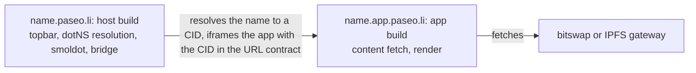
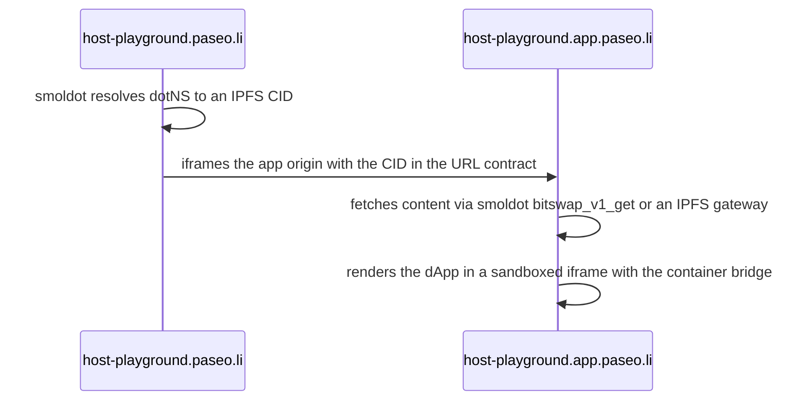

> [!WARNING] The following is a prototype, reference implementation, and proof-of-concept. This open source code is
> provided for research, experimentation, and developer education only. This code has not been audited, is actively
> experimental, and may contain bugs, vulnerabilities, or incomplete features. Use at your own risk.

<div align="center">

# dotli

[](https://paseo.li)
[](./LICENSE)
[](https://www.typescriptlang.org)
[](https://polkadot.com)

A decentralized web browser that runs in your browser. Visit any Polkadot application with fully trustless, client-side
resolution, with no servers in the loop.

[Website](https://paseo.li) | [Report an Issue](https://github.com/paritytech/dotli-community/issues)

</div>

---

## How it works

The `.dot` name is the subdomain: `host-playground.paseo.li` opens `host-playground.dot`. The root `paseo.li` is a
landing page with search, recent apps and login.



1. **Resolve:** an in-browser [smoldot](https://github.com/paritytech/smoldot) light client reads the name's CID from
   the dotNS contracts on Asset Hub Paseo.
2. **Fetch:** the app origin loads the content from the
   [Bulletin Chain](https://github.com/paritytech/polkadot-bulletin-chain) by bitswap or an IPFS gateway.
3. **Render:** the app runs in a sandboxed iframe. The TrUAPI bridge gives it accounts, signing, chain connections and
   scoped storage.



Key decisions:

- **One origin per product** (`<label>.app.paseo.li`), so products are isolated from each other.
- **Multi-file apps** are CAR archives, served by a Service Worker as a virtual file system.
- **One TrUAPI bridge per product frame.** The app context replaces its own document with the dApp, so there is no extra
  iframe level. Iframes the dApp nests are opaque to the host and share the product's core.
- **Repeat visits** render from the IndexedDB cache and re-resolve in the background. A changed CID shows **New version
  available**, never a silent swap.
- **The topbar shield** is green when the light client verified the page, orange when an RPC provider or gateway served
  it.

What it is not:

- **Not a wallet.** Per-app keys are derived on demand. Polkadot App signs.
- **No backends.** No RPC servers, no pinning, no hosting.
- **Not production-hardened.** See [Security](#security).

More: [resolution design](docs/resolution-design.md), [chain connections](docs/chain-connections.md), and the README in
each app and package.

## TrUAPI bridge

Apps talk to dotli over postMessage. Handlers: `accountGet`, `getLegacyAccounts`, `signPayload`, `signRaw`,
`chainConnection`, `localStorageRead/Write/Clear`, `navigateTo`, `featureSupported`, `connectionStatus` and `chat.*`.

**Product chat:** a product that declares `includes.chat` in its `worker.<label>.<tld>` manifest gets a chat panel in
the topbar. Chat needs a login. Messages stay on the device.

## Development

### Prerequisites

- **Node 26** (see `.nvmrc`) and **npm 12+**.
- **No funded account** is needed to browse. Polkadot App is needed only to log in and sign.
- **Network:** Paseo testnet by default. Edit `packages/config` for another chain.
- **Tooling:** npm workspaces and [Turborepo](https://turbo.build).

### Run it

```bash
nvm use                  # or any Node 26 install
npm install -g npm@latest
npm install
export VITE_NETWORKS=paseo-next-v2,previewnet
npm run dev              # Dev servers with hot reload on https://localhost:4001
npm run preview          # Production build served on localhost:5173, as the Playwright suites use it
HOST=0.0.0.0 npm run preview   # The same, reachable from a phone on the LAN
```

| Port | Server (`npm run dev`)                         |
| ---- | ---------------------------------------------- |
| 4001 | Shell                                          |
| 4002 | Sandbox (`*.app.localhost`)                    |
| 4003 | Protocol iframe, proxied by the shell at `/p/` |

- **Local apps:** `host-playground.localhost:4001` (dev) or `:5173` (preview) opens `host-playground.dot`.
- **Production behaviour:** test it with `npm run preview`.
- **HTTPS:** the first `npm run dev` installs an [mkcert](https://github.com/FiloSottile/mkcert) certificate for
  `*.localhost` and `*.local.host`. It asks for your password once. Preview stays on http.
- **Safari sign-in:** use `https://browse.local.host:4001`. Safari needs https for it. Only dev builds trust
  `local.host`.

### Scripts

| Command                                  | Purpose                                                                           |
| ---------------------------------------- | --------------------------------------------------------------------------------- |
| `npm run link:truapi`                    | Use a local truapi checkout (set `TRUAPI_REPO` if not under `truapi/hosts/dotli`) |
| `npm run unlink:truapi`                  | Back to the versions in `package-lock.json`                                       |
| `npm run preview:debug`                  | Preview with `VITE_APP_DEBUG=true`                                                |
| `npm run build:prod`                     | Production build of both apps                                                     |
| `node scripts/updatePublicSuffixList.ts` | Refresh the Public Suffix List shipped with each release                          |

### Host-playground E2E

`npm run test:e2e:local` runs the CI host-product suite against a local product checkout. It pairs a headless signer
that auto-signs.

It needs the product at `../host-playground` and the `truapi-host` CLI from
[host-rust-core](https://github.com/paritytech/host-rust-core) on `PATH`:

```bash
curl -fsSL https://raw.githubusercontent.com/paritytech/host-rust-core/main/scripts/truapi-host-installer.sh | bash
```

| Env var                | Purpose                                                   |
| ---------------------- | --------------------------------------------------------- |
| `E2E_PRODUCT_REPO`     | Product checkout path                                     |
| `E2E_PRODUCT_URL`      | Product server URL (default `http://localhost:5199`)      |
| `E2E_CHAIN_BACKEND`    | Chain backend (default `rpc-gateway`)                     |
| `SIGNING_HOST_BIN`     | A local `truapi-host` binary instead of the installed one |
| `SIGNING_HOST_NETWORK` | A non-default network                                     |

The first run registers a test account on the network and can take a few minutes. Later runs reuse it from
`apps/host/tests/e2e/.auth/signing-host`.

### Releases

- **Deploy:** pushing a `vX.Y.Z` tag deploys to `paseo.li` and `testnet.li`. The GitHub Release is published once both
  succeed.
- **Verify:** check out the tag from the [Releases page](https://github.com/paritytech/dotli-community/releases), then
  run `npm ci && npm run build:prod`.

## Debug tools

| Tool                | Turn on                                                       | Shows                                 |
| ------------------- | ------------------------------------------------------------- | ------------------------------------- |
| TrUAPI debug panel  | `VITE_APP_DEBUG=true` builds, `?debug=true`, or Settings menu | Host events and host-product messages |
| Sandbox API checker | `VITE_SANDBOX_CHECKER=true` at build time                     | Web APIs a dApp calls past the bridge |

- **Debug panel:** auto-mounts collapsed on `paseoli.dev` and `npm run preview:debug`. The choice lasts for the tab.
  `?debug=off` ends it. See [the panel's README](packages/truapi-debug-ui/README.md).
- **Sandbox checker:** logs network, worker, storage, iframe and wallet API calls, and lets them through. It is not in
  production builds.

## Network configuration

`VITE_NETWORKS` (required, set at deploy time) lists the networks a build offers. The first is the default. All
addresses and endpoints live in `packages/config/src/networkServices.ts`.

| Service               | Value                                          |
| --------------------- | ---------------------------------------------- |
| dotNS Registry        | `0xf34054fd76BbF85f216cf9908226D5f0A72E50CA`   |
| dotNS ContentResolver | `0x7F74D7CD50f5a834270E2ad395a01b01891AB37d`   |
| Bulletin Chain RPC    | `wss://paseo-bulletin-next-rpc.polkadot.io`    |
| IPFS gateway          | `https://paseo-bulletin-next-ipfs.polkadot.io` |

### Prebuilt bundles

Each release ships a container and a tarball. Both take `DOTLI_NETWORK` at run time to point at any chain:

```bash
# container
docker run -p 5173:5173 -e DOTLI_NETWORK='{…}' ghcr.io/paritytech/dotli-community:0.7.4

# tarball: needs only node >= 22 or bun
DOTLI_NETWORK='{…}' node serve.mjs
```

The override changes endpoints only. Genesis hashes and contract addresses stay fixed, as the trust root. See
[docs/docker.md](docs/docker.md).

## Security

Before you deploy it for real use, **you are responsible** for:

- **Reviewing** the code. This is a reference, not a hardened build.
- **Checking** dependencies for known vulnerabilities.
- **Securing** your fork or deployment (keys, secrets, network configuration).
- **Tracking** the latest release for security fixes. Older releases get no backports.

See Parity's [Bug Bounty](https://parity.io/bug-bounty). **Do not** open a public issue for a security report. Follow
[SECURITY](./SECURITY.md).

## License

**AGPL-3.0-only.** See [LICENSE](./LICENSE). Third-party licenses are in
[THIRD_PARTY_NOTICES.md](./THIRD_PARTY_NOTICES.md).
