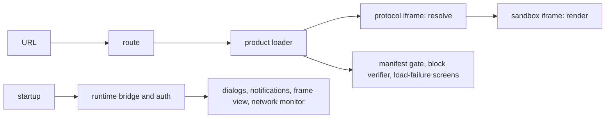

# `@dotli/host`

The top-level shell of dotli, built with Astro. It owns the topbar, the session and the bridge, and it opens a product
by `.dot` name inside a sandbox iframe. See the root [README](../../README.md) for the product as a whole.

## Responsibility

- Route a page load to a product, a local or preview target, or the landing page.
- Take a `.dot` label to a product on screen, or to the screen that says why not.
- Own the page chrome: topbar, URL pill, loading screen, chat dock, settings, account, permissions and network views.
- Own the domain building blocks the chrome composes: account, chat, permission, appearance and chain views and their
  icons. Each takes props, reads no store and reports the user's intent through a callback, so the flow that composes it
  owns the data.
- Own the page state only the host reads: the network monitor behind the network panel (block bars, phases, peers,
  transfer and the health verdict) and the landing page's recently visited names.
- Start the protocol iframe, the TrUAPI bridge and the auth controller.
- Own the host side of TrUAPI and the session: one page core with the product frame piped to it, the host callbacks
  (chain, chat, storage, prompts, notifications), login and logout through Polkadot App or a local wallet, the wallet
  mode and switch, and the auth, product, permission, theme and chat stores.
- Not content rendering, which the sandbox does.

## Design

- Two Astro pages, the shell and the landing page. Each has its own entry. Both start Sentry before any other module
  runs, then call one page start (the chunk and island failure offers and the desktop offer) and share one startup step:
  settings, the protocol iframe, the bridge and auth.
- Static markup is Astro. Interactive controls are Solid islands, one module per island, bound to sync stores that
  import no Solid.
- The building blocks group by domain beside the flows that use them, and take their types from the runtime, so a
  permission, a theme or a chat message has one type. Each has a CSS module beside it and most have a story that carries
  their tests.
- The TrUAPI side lives in its own folder. The bridge is a lazy chunk, so the boot path never loads the TrUAPI host. One
  runtime boots per page core, a signing host on the local wallet when there is one, else the pairing host. A core that
  goes stale is rebuilt without being asked. The signing worker and the local wallet core load on demand.
- The auth controller drives the sign-in modal by writing its store. It holds the blocking-modal lease while the modal
  is up, so one blocking prompt shows at a time.
- The toasts and dialogs are one idle island on each page. What boot queues before it hydrates shows once it does.
- Components are imported where they are used. The startup size budgets in CI guard what each page loads first.
- Views and rarely used modules load on demand through a lazy loader, each in its own chunk: load-failure screens, cache
  revalidation, product branding, chat, account, chains, permissions, settings, verification, the violation panel, the
  debug panel and the workbox.
- The error page and the no-content page replace the page's content at once, through the shared screen owner. A
  full-page screen ends the loading screen and the landing islands, and the product frame takes the screen down when it
  shows.
- Flows take their data sources and screens as parameters, so they run under Node without mocks. The bridge chunk is
  where the page's real dialogs, notifications, frame layout and network monitor are wired in.
- The network monitor opens no chain. The bridge reports who holds each host chain and its best blocks to it, and the
  load progress reports phases, peers and transfer.
- The recently visited names live in the store every subdomain shares, reached through the runtime's shared channel,
  with a per-origin mirror for when that store is unreachable.
- Whether a product declares chat is read from its worker manifest alongside its name and travels on the product the
  frame renders. The last answer is cached per label, so a warm load picks the connection's execution kind without
  waiting on a dotNS read.
- An island that must stand in for itself when it breaks (the landing page, the sign-in modal, the loading screen) wraps
  its tree in its own error boundary. An island whose code fails to load once page start has run is reported and offers
  a reload, the same offer as a page chunk that fails. One that fails before then, such as an island that loads with the
  page, reaches the console alone.
- The Astro config adds the PWA service worker, the signing worker, the dev SPA fallback and a Sentry release upload,
  all from the shared Vite tooling.

## Entry points

- The shell page. Dev server on port 4321.
- The landing page, served for the bare host.
- `npm run dev`, `build`, `build:prod`, `typecheck`, `lint`.
- `npm test`: unit specs. `test:functional`, `test:e2e`, `test:e2e:local` and `test:perf*` run Playwright suites. A
  local functional run needs `VITE_METRICS=true` in both the build and the run.
- `npm run storybook`, `build-storybook`, `test:stories`, `test:vrt`: component stories and their visual checks.
