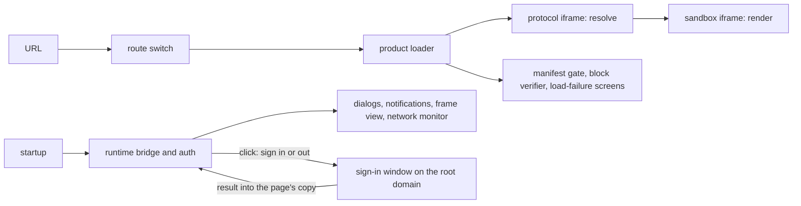
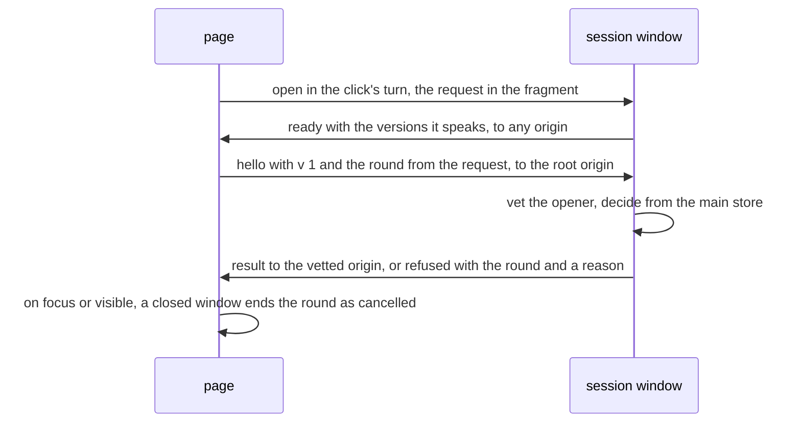

# `@dotli/host`

The top-level shell of dotli, built with Astro. It owns the topbar, the session and the bridge, and it opens a product
by `.dot` name inside a sandbox iframe. See the root [README](../../README.md) for the product as a whole.

## Responsibility

- Route a page load to a product, a local or preview target, or the landing page. A product is named by its host
  (`<label>.<domain>`) or, on the bare host, by the first path segment (`<domain>/<name>`), and gets only the path after
  it. A subname such as `pr16.my-app` opens by path only, since a wildcard certificate covers one label.
- Take a `.dot` label to a product on screen, or to the screen that says why not.
- Own the page chrome: topbar, URL pill, loading screen, settings, account, permissions and network views.
- Own the domain building blocks the chrome composes: account, chat, permission, appearance, signing and chain views and
  their icons. Each takes props, reads no store and reports the user's intent through a callback, so the flow that
  composes it owns the data.
- Own the page state only the host reads: the network monitor behind the network panel (block bars, phases, peers,
  transfer and the health verdict) and the landing page's recently visited names.
- Start the protocol iframe, the TrUAPI bridge and, on a page with a sign-in modal, the auth controller.
- Own the host side of TrUAPI and the session: one page core with the product frame piped to it, the host callbacks
  (chain, chat, storage, prompts, notifications), sign-in and sign-out through the sign-in window on the root domain
  with Polkadot App or a local wallet, the signed-in flag, the wallet mode and switch, and the auth, product,
  permission, theme and chat stores.
- Not content rendering, which the sandbox does.

## Design

- Three Astro pages, the shell, the landing page and the sign-in window. Each has its own entry. All start Sentry before
  any other module runs, then call one page start (the chunk and island failure offers and the desktop offer) and share
  one startup step: settings, the protocol iframe, the bridge and, on a page with a sign-in modal, the auth controller.
- Settings are read once at boot from the link, the store every subdomain shares and this origin's storage, and stored
  back to both stores. The boot configures the protocol frame on this origin's settings and the link's, then again once
  the shared store answers unless the page resets. The settings popover and the failure screen's backend switch save
  through the same reset. A link that changes a saved choice wipes and reloads, as Save does. A store that cannot be
  read leaves the page on this origin's settings and the link's.
- The shell page has one script. It also binds the static markup of the topbar and the URL pill, which only that page
  renders. The chat dock is off the page until the chat button returns.
- Static markup is Astro. Interactive controls are Solid islands, one module per island, bound to sync stores that
  import no Solid.
- The building blocks group by domain beside the flows that use them, and take their types from the runtime, so a
  permission, a theme or a chat message has one type. Each has a CSS module beside it and most have a story that carries
  their tests.
- The sign-in views are building blocks that each return their title, their content, their buttons and a note apart, so
  each layout orders them its own way, and read no store. The window page and the sign-in modal place the same views.
  One function picks the view for each step of a pairing, another the modal's views that wait on the sign-in window, and
  a third the screen for each of the window's own views.
- The TrUAPI side lives in its own folder. The bridge is its own chunk, which every page loads in parallel with its
  boot. It brings the TrUAPI host, the session state and the TrUAPI codecs, so none of them is in the boot chunk. One
  runtime boots per page core, a signing host on the local wallet when there is one, else the pairing host. A core that
  goes stale is rebuilt without being asked. A core outlives its last lease by a few seconds, so a lease taken soon
  after keeps the same core. The signing worker and the local wallet core load on demand.
- The session layer (the auth state type, the session state the boot starts, the core's shared-store adapter, the
  signed-in flag, the restore rule and the session lease) sits apart from the TrUAPI host callbacks. State the runtime
  reads or writes (auth, product, permissions, theme, wallet mode) lives with the runtime, and the page chrome's own
  state (topbar, URL pill, chat panel, network) lives with the page.
- Each entry chooses the page's role once, before the boot reads anything: a page (a product), the landing page, a
  preview opened on its own, a preview its preview host frames, the sign-in window or the sign-out window. The role
  alone says where a sign-in runs, whether the page shares the signed-in flag or raises it, whether a stored wallet
  picks the wallet mode, under which reader the restore rule on load counts, whether the page shows the stored session
  and whether it offers to continue a sign-in made elsewhere.
- A presence flag on the root domain says whether some sign-in exists, since Safari keeps each product's sign-in apart.
  It is a cookie on the root domain and every subdomain that holds presence only, never a secret or an identifier,
  written by the page itself. On a local root, where Chromium refuses such a cookie, it lives in the local server's
  store. A preview its preview host frames keeps its sign-in in that host's partition, so its flag reads as unknown and
  it writes none.
- The restore rule is one step over the page's copy. It reads the flag, the session and the wallet, and clears a paired
  session the flag says is gone with a compare-and-clear, so a sign-in stored meanwhile stays. It never clears the local
  wallet, which only a sign-out forgets. A flag that cannot be read keeps everything. A page runs the rule once as it
  loads, before boot picks a wallet mode or a core reads the session, and an open page runs it again each time the flag
  changes, another tab changes the local wallet or the user comes back. Each drop is counted under its reader.
- A page that shows signed out while the flag says a sign-in exists offers to continue it. Session state works that out
  from the flag and the copy, and the account button and a product's login prompt then open the sign-in window to
  resume, which sends what the main store holds without offering Continue.
- The protocol frame lives at `/p/` on the root domain, so it shares that origin with the landing page, the sign-in
  window and products opened by path. A settings wipe there clears the host's own keys and databases and keeps the
  frame's, its stores and its databases, which the frame owns.
- The page builds one route to the core's permission store and one permissions store over it. The product frame and the
  permission prompts get both, the menu reads the store and the diagnostics read the route. A product's newest
  connection answers. A stored answer returns at once, and only a question waits its turn behind other dialogs.
- The permissions panel sets an app's twelve permissions through four presets on a slider, with every permission under
  Advanced. The preset shown is the one closest to the statuses, never stored. Every change, from the panel or a prompt,
  goes through one write that retries, and a newer panel change supersedes an older one. A change announces once, and
  the frame reloads only when its `allow` attribute changes.
- The auth controller drives the sign-in modal by writing its store. It holds the blocking-modal lease while the modal
  is up, so one blocking prompt shows at a time. Its sign-in, phrase import and sign-out are the one interface every
  page offers, the debug panel's wallet tab included: they open the sign-in window, or on a preview or the landing page,
  pair in place and take a recovery phrase in the modal. That phrase check and the phrase form load only when the phrase
  view first opens.
- The sign-in window is a page on the bare host, with settings of its own that it never stores. It answers only an
  opener on an origin its rule allows, and replies to that origin alone. The first vetted hello names the round's party
  and its origin, and a request the window cannot read for that party is refused with its reason. For dot.li's own page,
  once it knows its opener, the window decides from the main store, never from the opener: it offers Continue for a
  stored wallet or paired session, pairs on its own core, or takes a recovery phrase when asked for one. A step that
  fails leaves a failure with Try again.
- For a site, the sign-in window signs in for the vetted origin, never one the request names. It asks the user's consent
  unless the site's token names a grant of that origin, in a Sign in with Polkadot view that names the site's full
  origin, and the group's registrable domain under it, then what the site gets, then runs the same flow to sign in or
  resume the main session, which tells the site's round only that a sign-in is stored and never answers the opener. For
  a sign-in the window runs its core as dot.li's own product, and only for a transaction under the product id of the
  account the site names. The round runs on whichever wallet is signed in, the local one included, with no pairing then,
  and reads the main account only from what that core reports, never from the main store's copy. The site gets the main
  account's username, or none when it has none, and nothing signed, never the main session. The window makes no account
  for a site or a group. A site that declares a group signs in once for every origin of its registrable domain, which
  the window reads from the Public Suffix List it ships. A group shares one grant, whose token answers any origin of the
  group. The window refuses a group on a public suffix or an address, on its own registrable domain, or when the list
  does not load. The window closes once the site has its result, which a window restored from the back-forward cache
  sends on the site's next hello.
- A site that cannot keep a popup signs in by redirect: its sign-in request names a return address and a temporary key,
  and the window needs no opener. Before it boots, the window checks that this browser can seal to the key, that the
  address is a site's and not dot.li's own or a product's, and that the site's well-known file lists it, read within a
  deadline and only when small. A check that fails says why and sends nothing, since the address is not yet trusted.
  Once vetted, the round runs for the address's origin, and its one answer, the message a popup would get, goes back
  sealed to the key in the address's fragment. The window forgets its kept request, then navigates there, which ends the
  page, so it never closes itself. A seal that fails says so, and forgets a grant whose token the site never got, unless
  it is a group's. Close on any view closes the window, or goes back in history when the browser keeps the tab open, but
  does nothing while the sealed answer is on its way.
- On `/s/sign`, a site asks the user to sign a transaction on Asset Hub with the product account it names. The window
  takes the site's call from the request, else from the first payload the vetted site posts for the round, and shows
  Connecting until it has one. A call that is not hex of 2 to 1 000 000 bytes, or a request of dot.li's own page, is a
  bad request. The round asks consent and resumes the main session as a sign-in does, then decodes the call for the
  review. Once the user confirms, the window fills every extension and the phone signs with the account the site names.
  The site gets the signed transaction and sends it itself, and never gets the main account.
- The sign-in window reads a site's registrable domain from a copy of the Public Suffix List it ships, a data file under
  the Mozilla Public License 2.0, read as text and kept with its license header, and refreshed with each release.
- The site list lists the sites the main store keeps a grant for, the most recently used first, each with Revoke, which
  forgets its grant at once. A group's row is headed by its registrable domain and lists the origins that used it, and
  its Revoke forgets the group's one grant, so every origin of the group asks for consent again. The list reads only the
  grants: it answers no page and boots no core.
- The sign-out window applies the restore rule to the main store and sends its vetted opener an empty result once it has
  read, or failed before it could, and its first vetting found a round of dot.li's own page, whichever comes last. Its
  sign-out never waits on the opener, and a round it refuses still signs out. Unless the page tells the phone itself, it
  ends the session it found on a core of its own, which holds it in memory only and so never touches the main store or
  the flag. Unless it kept the sign-in, it then forgets every site's grant once its first vetting found a round of
  dot.li's own page, before it closes, so a site that opens it forgets nothing.
- Each window keeps the request its URL fragment carried in the tab's session storage, so a reload answers the same
  round, and reloads when a page puts a new request in its fragment.
- Every product signs in and out through the sign-in window, opened in the click's own turn, since a product's copy may
  not be the main store. The landing page, whose copy is the main store, and a preview, whose opener policy cuts the
  link to any window, pair in place. The window's result is written into the page's copy, where its cores and session
  state pick it up. Sign out opens the sign-out window and drops the flag in the same turn. In paired mode the page
  reads its copy in that turn and ends that session on a core of its own, so the phone hears of it. In local mode the
  page waits for the window's read, then forgets the wallet it read and reloads. The landing page and a preview opened
  on its own forget every site's grant as they sign out, before any reload, and a product leaves that to the sign-out
  window. A grant that cannot be forgotten is reported and never stops a sign-out. The sign-out answers whether the
  phone heard, with one more try for a caller that lets the user retry.
- The landing page has no product to hold a core, so it holds one lease on its page core while its copy holds a paired
  session, from the first idle moment after boot, and so hears the phone end the session. It follows the stored session,
  not the auth state, so a core that reports signed out for a moment never drops and reboots it.
- The sign-in window, the landing page and a preview opened on its own keep the flag in step with the main store: every
  sign-in they store or clear goes through one flag writer, which raises the flag before the store holds a sign-in and
  drops it once the store holds none. A core's storage drops only the session that core last read or wrote, so a core
  that ends its session never clears a sign-in made elsewhere since.
- An approved review that goes to the paired phone waits there. Each core keeps a tracker that every connection to it
  taps, both ways, so it infers the phone requests from the frames that pass. A tap that fails is reported and the frame
  passes untouched. An approved review claims the request it belongs to. This is a temporary workaround, as the core
  does not report phone requests to the host. Remove it once
  [the core issue](https://github.com/paritytech/trinity-user-agents/issues/1552) lands. The core has its answer at
  once, and the dialog swaps in place for a waiting step. The prompt queue lets a prompt hold its slot past its answer,
  so the step keeps the slot until the user sends it to the background or the request ends. Each waited request ends
  with one toast, and a torn down connection ends it with none. A local wallet core's tracker is disposed, so it claims
  nothing and its dialogs close on their answer.
- The toasts and dialogs are one idle island on each page. What boot queues before it hydrates shows once it does.
- Components are imported where they are used. The startup size budgets in CI guard what each page loads first.
- The bridge, and what a visit may never open, load on demand through a lazy loader, each in its own chunk: the bridge,
  the panel bodies (chat, account, chains, permissions, settings), the violation panel, the debug panel and its wire
  describer, the recovery phrase form, the local wallet and workbox, the host runtime and its worker, the chain client
  and the QR encoder. The small pieces of a product load (branding, the cache check, the failure screen, the
  verification tooltip) are plain imports.
- The host runtime, the wire describer, the block verifier and the gateway resolver each load once and serve every
  caller after. A failed load is forgotten, so the next caller, a sign-in Retry for one, loads it again without a page
  reload. The describer and the verifier report only their first miss.
- The error page and the no-content page replace the page's content at once, through the shared screen owner. A
  full-page screen ends the loading screen and the landing islands, and the product frame takes the screen down when it
  shows.
- A flow takes as parameters what sits in another frame or origin (the name source, the product frame and what the
  sandbox reports through it, the protocol frame's version mismatch, the recent list) and what reloads or writes the
  page (the CID cache and the failure screen). A cached copy that revalidation finds cleared is evicted, and the page
  reloads onto the cold path only once the stale copy is gone. A redeploy is offered as soon as its new contenthash is
  known, and a Reload pressed before the new version is cached waits for it. A sandbox that says nothing for 30 seconds
  after the handoff fails the load, since a blocked origin or a page that never ran would otherwise leave the loading
  screen up for good. It imports the page's own state (the URL pill, the journey, the network monitor). A protocol frame
  that refuses the page's wire version, during the load or after the handoff, puts up the reload screen and ends the
  load once, so nothing after it records success. Under that screen or the silent sandbox's, the product frame halts: it
  lets go of the product's core and starts no render of its own, so nothing clears the screen until the user reloads or
  a new render is asked for. Load progress takes the loading screen as a parameter that defaults to the page's, since
  the page's draws on animation frames, so its spec runs under Node. The product loader drives the page and is tested on
  one, in the functional suite. The bridge chunk is where the page's real dialogs, notifications and frame layout are
  wired in.
- The network monitor opens no chain. The bridge reports who holds each host chain and its best blocks to it, and the
  load progress reports phases, peers and transfer.
- The recently visited names live in the store every subdomain shares, reached through the runtime's shared channel,
  with a per-origin mirror for when that store is unreachable.
- Whether a product declares chat is read from its worker manifest alongside its name and travels on the product the
  frame renders. The last answer is cached per label, so a warm load picks the connection's execution kind without
  waiting on a dotNS read.
- An island that must stand in for itself when it breaks (the landing page, the sign-in modal, the loading screen) wraps
  its tree in its own error boundary. An island whose code never ran is reported and offers a reload, and the auth modal
  and the overlays each have a stand-in that releases the sign-in lease or refuses pending prompts. One that fails
  before page start listens, such as an island that loads with the page, reaches the console alone.
- The Astro config adds the PWA service worker, the signing worker, the dev SPA fallback and a Sentry release upload,
  all from the shared Vite tooling. The shell asks for a new release as soon as its worker registers and offers one the
  moment the browser finds it. A Reload pressed while the release downloads applies it once downloaded.

A round between a page and the sign-in or sign-out window, on version 1 of the wire protocol. The page puts its request,
with a fresh round, in the window URL's fragment, and a window that speaks no version the page knows ends the round as
refused:

## Entry points

- The shell page. Dev server on port 4001.
- The landing page, served for the bare host's root.
- The session window, served for the bare host's `/s/auth`, `/s/signout`, `/s/manage` and `/s/sign`.
- `npm run dev`, `build`, `build:prod`, `typecheck`, `lint`.
- `npm test`: unit specs. `test:functional`, `test:e2e`, `test:e2e:local` and `test:perf*` run Playwright suites. A
  functional run needs the build the root `build:test` script makes, as CI does. It turns metrics on and gives Sentry a
  DSN, without which Sentry sends nothing and the light client gauge never reaches the preview server.
- Its component stories and their visual checks run in the one Storybook at the repo root.
