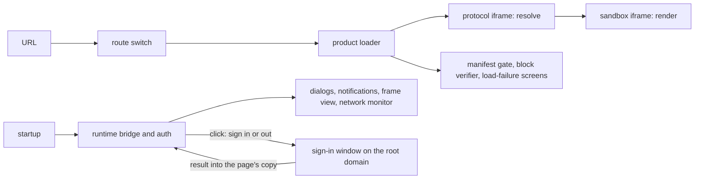
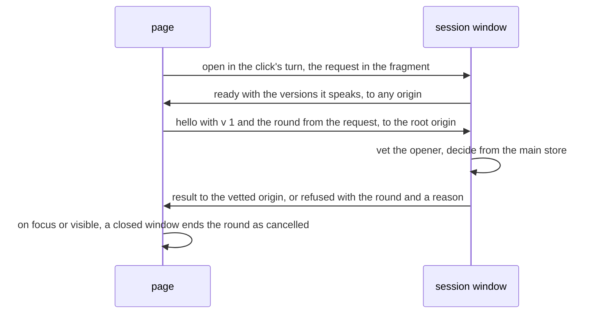

# `@dotli/host`

The top-level shell of dotli, built with Astro. It owns the topbar and the session. It also owns the bridge. It opens a
product by `.dot` name inside a sandbox iframe. See the root [README](../../README.md) for the product as a whole.

## Responsibility

- **Routing:** send a page load to a product or the landing page. A local or preview target is routed too.
  - A product is named by its host (`<label>.<domain>`), or on the bare host by the first path segment
    (`<domain>/<name>`). It gets only the path after that.
  - A subname such as `pr16.my-app` opens by path only, since a wildcard certificate covers one label.
- **Product load:** take a `.dot` label to a product on screen, or to a screen that says why not.
- **Page chrome:**
  - the topbar
  - the URL pill
  - the product card
  - the loading screen
  - the settings view
  - the account view
  - the permissions view
  - the network view
- **Building blocks:** domain views (account, chat, permission, appearance, signing, chain) and their icons. They take
  props and read no store. They report intent through callbacks.
- **Startup:** the protocol iframe and the TrUAPI bridge. On a page with a sign-in modal, also the auth controller.
- **TrUAPI host side:** the page core and the host callbacks.
- **Session:** sign-in and sign-out with Polkadot App or a local wallet. It also owns the signed-in flag and the wallet
  mode.
- **Stores:**
  - auth
  - product
  - permission
  - theme
  - chat
- **Not owned:** content rendering. The sandbox does that.

## Design

### Pages and boot

- Three Astro pages, each with its own entry:
  - the shell
  - the landing page
  - the session window
- Every entry starts Sentry first and picks the page's role before boot reads anything. It then runs the page start and
  the host start.
- The page start imports the shared stylesheet, so it goes first.
- The host start reads settings and starts the protocol iframe and the bridge. On a page with a sign-in modal, it also
  starts the auth controller.
- Static markup is Astro. Interactive controls are Solid islands.

### Settings

- Read once at boot from the link. Also read from the store every subdomain shares and from this origin's storage, and
  written back to both.
- A link that changes a saved choice wipes and reloads, as Save does.
- The protocol frame lives at `/p/` on the root domain. The landing page, the session window and products opened by path
  live there too. A settings wipe there clears only the host's own keys and databases.

### State

- **Session layer:** sits apart from the TrUAPI host callbacks. It holds:
  - the auth state
  - the signed-in flag
  - the restore rule
  - the session lease
- **Runtime state** (auth, product, permissions, theme, wallet mode) lives with the runtime.
- **Page chrome state** (topbar, URL pill, product card, chat panel, network) lives with the page.
- Each state is an entity object with a read-only store. It exposes getters and setters. Modules follow the code style
  guide.

### TrUAPI bridge and cores

- **Bridge chunk:** loads in parallel with boot. It holds the TrUAPI host, the session state and the codecs, so the boot
  chunk stays small.
- **Runtime:** one per page core. It is a signing host on the local wallet when there is one, else the pairing host.
- **Product id:** the core parses it, so the id's rules live in the core alone.
- **Lifetime:** a stale core is rebuilt on its own. A core outlives its last lease by a few seconds.
- **Chain pool:** every chain user leases from the page's pool. It owns the redial gates.
- **Local storage:** one instance per page, shared by every core, so a write reaches every runtime's subscribers.

### Page roles

Each entry picks one role:

- a product page
- the landing page
- a standalone preview
- a framed preview
- the sign-in window
- the sign-out window

The role alone decides where a sign-in runs and how the page treats the signed-in flag. It also decides whether the page
restores or offers to continue a session.

### Session

Safari keeps each product's sign-in apart, so a product's copy may not be the main store.

- **Presence flag:** a cookie on the root domain and every subdomain that says whether some sign-in exists. It holds
  presence only, never a secret. On a local root, Chromium refuses it, so it lives in the local server's store.
- **Restore rule:** clears a paired session the flag says is gone. It never clears the local wallet. An unreadable flag
  keeps everything. It runs on load. It runs again whenever the flag or the local wallet changes, and when page
  visibility changes.
- **Continue:** a page that shows signed out while the flag says a sign-in exists offers to continue it.
- **Flag writer:** pages that write the main store raise the flag before storing a sign-in and drop it after clearing
  the last one.
- **Sign-in:** a product signs in through the sign-in window, opened in the click's turn. The result goes into the
  page's copy. The landing page and a preview pair in place.
- **Sign-out:** opens the sign-out window and drops the flag in the same turn. In paired mode the page ends the session
  on its own core, so the phone hears. In local mode it waits for the window. Then it forgets the wallet and reloads.
- **Landing page lease:** the landing page holds a lease on its core while a paired session is stored, so it hears the
  phone end it.
- **Auth controller:** drives the sign-in modal and holds the blocking-modal lease, so one blocking prompt shows at a
  time. Its sign-in, phrase import and sign-out are the one interface every page and the debug panel use.

### Session windows

One page on the bare host serves `/s/auth` and `/s/signout`. It also serves `/s/manage` and `/s/sign`. It keeps its
request in session storage, so a reload answers the same round.

- **Trust:** it answers only an opener on an allowed origin, and replies to that origin alone.
- **dot.li's own page:** the window decides from the main store, never from the opener.
- **A site:** signs in for the vetted origin. It asks consent unless the site holds a grant. The site gets the main
  account's username at most, never the main session or anything signed.
- **Groups:** a site can declare a group to sign in once for its whole registrable domain, read from a bundled copy of
  the Public Suffix List (Mozilla Public License 2.0, refreshed each release).
- **Redirect:** a site that cannot keep a popup names a return address and a temporary key. The window checks the
  address against the site's well-known file, then sends one sealed answer in the address's fragment.
- **Signing (`/s/sign`):** a site asks to sign an Asset Hub transaction with the product account it names. The call is
  hex of 2 to 1 000 000 bytes. The phone signs, and the site gets the signed transaction to send itself.
- **Site list (`/s/manage`):** lists the sites with a grant, each with Revoke.
- **Sign-out window:** applies the restore rule to the main store and ends the session on a core of its own. When opened
  by dot.li's own page, and unless it kept the sign-in, it also forgets every site's grant.

### Permissions

- One permissions store over the core's permission store. The product frame, the prompts and the menu share it.
- The panel shows four presets on a slider, with every permission under Advanced. The preset is derived, never stored.
- Every change goes through one retrying write. The frame reloads only when its `allow` attribute changes.
- Each permission's facts are one table in the runtime.

### Phone requests

- Each core taps its connections to infer phone requests, since the core does not report them. An approved review then
  shows a waiting step until the request ends.
- **Temporary:** remove this once [the core issue](https://github.com/paritytech/trinity-user-agents/issues/1552) lands.

### Product load

- The CID cache read and the product's core start early, so the core boots while the name resolves.
- A cached copy that revalidation finds cleared is evicted, then the page reloads onto the cold path.
- A redeploy is offered as soon as its new contenthash is known.
- **Silent sandbox:** no word for 30 seconds after the handoff fails the load.
- **Refused wire version:** the protocol frame refusing the page's version shows the reload screen. The product frame
  then halts until the user reloads.
- The product card's author is read and cached with the manifests.
- Whether a product declares chat comes from its worker manifest and is cached per label.

### Network

- The network monitor opens no chain. The bridge and the load progress report to it.
- A hidden page pauses its network after a grace, through `createNetworkPause`, unless a load or a phone request holds
  it awake.
- Recently visited names live in the store every subdomain shares, with a per-origin mirror.

### Loading and failures

- The bridge, panel bodies, product card, debug panel, local wallet, host runtime, chain client and QR encoder load on
  demand, each in its own chunk. CI startup size budgets guard what each page loads first.
- A shared lazy module loads once. A failed load is forgotten, so the next caller retries without a page reload.
- Islands that must stand in for themselves wrap their trees in an error boundary. An island whose code never ran offers
  a reload.
- The error page and the no-content page replace the page's content through one shared screen owner.

### Build

The Astro config adds:

- the web manifest
- the signing worker
- the dev SPA fallback
- a Sentry release upload
- a service worker that retires the one earlier releases installed

### Diagrams

A round between a page and a session window, on version 1 of the wire protocol. The page puts its request in the window
URL's fragment. A window that speaks no version the page knows ends the round as refused.

## Entry points

| Entry          | Served for                                          |
| -------------- | --------------------------------------------------- |
| Shell page     | Product pages. Dev server on port 4001.             |
| Landing page   | The bare host's root.                               |
| Session window | The four session paths under the bare host's `/s/`. |
| Service worker | One file at the root. Retires the earlier one.      |

| Command                                                       | Purpose                                |
| ------------------------------------------------------------- | -------------------------------------- |
| `npm run dev`, `build`, `build:prod`, `typecheck`, `lint`     | Develop and build. Typecheck and lint. |
| `npm test`                                                    | Unit specs.                            |
| `test:functional`, `test:e2e`, `test:e2e:local`, `test:perf*` | Playwright suites.                     |

- **Trap:** a functional run needs the root `build:test` build, as CI does. It turns metrics on and sets a Sentry DSN.
  Without it, Sentry sends nothing and the light client gauge never reaches the preview server.
- Component stories run in the one Storybook at the repo root.
