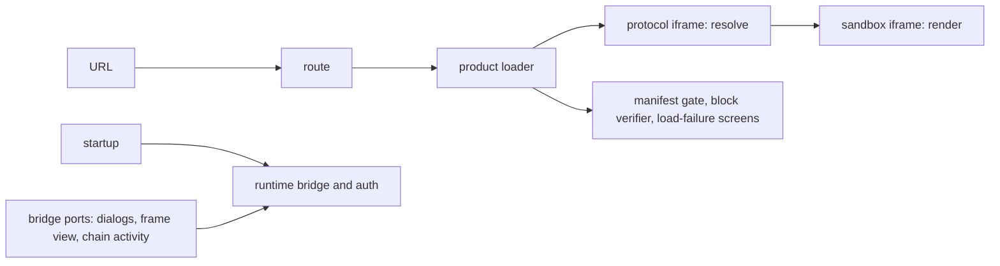

# `@dotli/host`

The top-level shell of dotli, built with Astro. It owns the topbar, the session and the bridge, and it opens a product
by `.dot` name inside a sandbox iframe. See the root [README](../../README.md) for the product as a whole.

## Responsibility

- Route a page load to a product, a local or preview target, or the landing page.
- Take a `.dot` label to a product on screen, or to the screen that says why not.
- Own the page chrome: topbar, URL pill, loading screen, chat dock, settings, account, permissions and network views.
- Own the page state only the host reads: the network monitor behind the network panel (block bars, phases, peers,
  transfer and the health verdict) and the landing page's recently visited names.
- Start the protocol iframe, the TrUAPI bridge and the auth controller, and build the ports the runtime needs.
- Not the bridge, session or auth logic itself, which the host runtime owns. Not content rendering, which the sandbox
  does.

## Design

- Two Astro pages, the shell and the landing page. Each has its own entry. Both start Sentry before any other module
  runs, then share one startup step: settings, the protocol iframe, the bridge and auth.
- Static markup is Astro. Interactive controls are Solid islands, one module per island, bound to sync stores that
  import no Solid.
- Boot modules never import views. They take UI only from the UI core, which imports no Solid, and the icons entry,
  since a toast or dialog they open carries its icon component. Lint bans the views and the island and view folders from
  every module that is not allowed to touch views.
- Views and rarely used modules load on demand through a lazy loader, each in its own chunk: bridge ports, load-failure
  screens, the no-content page, cache revalidation, product branding, chat, account, chains, permissions, settings,
  verification, the violation panel, the debug panel and the workbox.
- The error page and the no-content page take the page's content down at once and show their Solid view once its chunk
  arrives. When it cannot load, they show the shared error page as text, with the same title and line and no icon.
- Flows take their data sources and screens as parameters, so they run under Node without mocks. Two binders connect the
  runtime's `BridgePorts` to the page's dialogs, notifications, frame layout and network monitor.
- The network monitor opens no chain. The bridge reports who holds each host chain and its best blocks to it through the
  `chainActivity` port, and the load progress reports phases, peers and transfer.
- The recently visited names live in the store every subdomain shares, reached through the runtime's shared channel,
  with a per-origin mirror for when that store is unreachable.
- A few small scripts run in the page head before anything loads: theme pre-paint, an island error queue and the early
  database open. They are real modules inlined as classic scripts at build time.
- The Astro config adds a CSS split per page, the PWA service worker, the signing worker, the dev SPA fallback and a
  Sentry release upload, all from the shared Vite tooling.

## Entry points

- The shell page. Dev server on port 4321.
- The landing page, served for the bare host.
- `npm run dev`, `build`, `build:prod`, `typecheck`, `lint`.
- `npm test`: unit specs. `test:functional`, `test:e2e`, `test:e2e:local` and `test:perf*` run Playwright suites.
- `npm run storybook`, `build-storybook`, `test:stories`, `test:vrt`: component stories and their visual checks.
