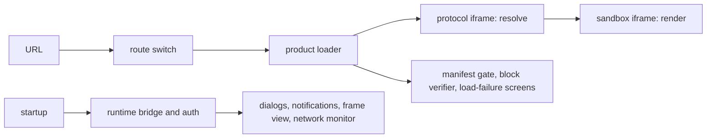

# `@dotli/host`

The top-level shell of dotli, built with Astro. It owns the topbar, the session and the bridge, and it opens a product
by `.dot` name inside a sandbox iframe. See the root [README](../../README.md) for the product as a whole.

## Responsibility

- Route a page load to a product, a local or preview target, or the landing page. A product is named by its host
  (`<label>.<domain>`) or, on the bare host, by the first path segment (`<domain>/<name>`), and gets only the path after
  it. A subname such as `pr16.my-app` opens by path only, since a wildcard certificate covers one label.
- Take a `.dot` label to a product on screen, or to the screen that says why not.
- Own the page chrome: topbar, URL pill, loading screen, settings, account, permissions and network views.
- Own the domain building blocks the chrome composes: account, chat, permission, appearance and chain views and their
  icons. Each takes props, reads no store and reports the user's intent through a callback, so the flow that composes it
  owns the data.
- Own the page state only the host reads: the network monitor behind the network panel (block bars, phases, peers,
  transfer and the health verdict) and the landing page's recently visited names.
- Start the protocol iframe, the TrUAPI bridge and the auth controller.
- Own the host side of TrUAPI and the session: one page core with the product frame piped to it, the host callbacks
  (chain, chat, storage, prompts, notifications), login and logout through Polkadot App or a local wallet, the wallet
  mode and switch, and the auth, product, permission, theme and chat stores.
- Not content rendering, which the sandbox does.

## Design

- Two Astro pages, the shell and the landing page. Each has its own entry. Both start Sentry before any other module
  runs, then call one page start (the chunk and island failure offers and the desktop offer) and share one startup step:
  settings, the protocol iframe, the bridge and auth.
- Settings are read once at boot from the link, the store every subdomain shares and this origin's storage, and stored
  back to both stores. The boot configures the protocol frame on this origin's settings and the link's, then again once
  the shared store answers unless the page resets. The settings popover and the failure screen's backend switch save
  through the same reset. A link that changes a saved choice wipes and reloads, as Save does. A store that cannot be
  read leaves the page on this origin's settings and the link's.
- The shell page has one script. It also binds the static markup of the topbar and the URL pill, which only that page
  renders. The chat dock is off the page until the chat button returns.
- Static markup is Astro. Interactive controls are Solid islands, one module per island, bound to sync stores that
  import no Solid.
- The building blocks group by domain beside the flows that use them, and take their types from the runtime, so a
  permission, a theme or a chat message has one type. Each has a CSS module beside it and most have a story that carries
  their tests.
- The TrUAPI side lives in its own folder. The bridge is its own chunk, which every page loads in parallel with its
  boot. It brings the TrUAPI host, the session state and the TrUAPI codecs, so none of them is in the boot chunk. One
  runtime boots per page core, a signing host on the local wallet when there is one, else the pairing host. A core that
  goes stale is rebuilt without being asked. The signing worker and the local wallet core load on demand.
- The session layer (the auth state type, the session state the boot starts and the core's shared-store adapter) sits
  apart from the TrUAPI host callbacks. State the runtime reads or writes (auth, product, permissions, theme, wallet
  mode) lives with the runtime, and the page chrome's own state (topbar, URL pill, chat panel, network) lives with the
  page.
- The page builds one route to the core's permission store and one permissions store over it. The product frame and the
  permission prompts get both, the menu reads the store and the diagnostics read the route. A product's newest
  connection answers.
- The permissions panel sets an app's twelve permissions through four presets on a slider, with every permission under
  Advanced. The preset shown is the one closest to the statuses, never stored. Every change, from the panel or a prompt,
  goes through one write that retries, and a newer panel change supersedes an older one. A change announces once, and
  the frame reloads only when its `allow` attribute changes.
- The auth controller drives the sign-in modal by writing its store. It holds the blocking-modal lease while the modal
  is up, so one blocking prompt shows at a time.
- The toasts and dialogs are one idle island on each page. What boot queues before it hydrates shows once it does.
- Components are imported where they are used. The startup size budgets in CI guard what each page loads first.
- The bridge, and what a visit may never open, load on demand through a lazy loader, each in its own chunk: the bridge,
  the panel bodies (chat, account, chains, permissions, settings), the violation panel, the debug panel and its wire
  describer, the local wallet and workbox, the host runtime and its worker, the chain client and the QR encoder. The
  small pieces of a product load (branding, the cache check, the failure screen, the verification tooltip) are plain
  imports.
- The host runtime, the wire describer, the block verifier and the gateway resolver each load once and serve every
  caller after. A failed load is forgotten, so the next caller, a sign-in Retry for one, loads it again without a page
  reload. The describer and the verifier report only their first miss.
- The error page and the no-content page replace the page's content at once, through the shared screen owner. A
  full-page screen ends the loading screen and the landing islands, and the product frame takes the screen down when it
  shows.
- A flow takes as parameters what sits in another frame or origin (the name source, the product frame and what the
  sandbox reports through it, the recent list) and what reloads or writes the page (the CID cache and the failure
  screen). A cached copy that revalidation finds cleared is evicted, and the page reloads onto the cold path only once
  the stale copy is gone. A sandbox that says nothing for 30 seconds after the handoff fails the load, since a blocked
  origin or a page that never ran would otherwise leave the loading screen up for good. It imports the page's own state
  (the URL pill, the journey, the network monitor). A protocol frame rebuilt after the handoff that refuses the page's
  wire version replaces the open app with the reload screen. Load progress takes the loading screen as a parameter that
  defaults to the page's, since the page's draws on animation frames, so its spec runs under Node. The product loader
  drives the page and is tested on one, in the functional suite. The bridge chunk is where the page's real dialogs,
  notifications and frame layout are wired in.
- The network monitor opens no chain. The bridge reports who holds each host chain and its best blocks to it, and the
  load progress reports phases, peers and transfer.
- The recently visited names live in the store every subdomain shares, reached through the runtime's shared channel,
  with a per-origin mirror for when that store is unreachable.
- Whether a product declares chat is read from its worker manifest alongside its name and travels on the product the
  frame renders. The last answer is cached per label, so a warm load picks the connection's execution kind without
  waiting on a dotNS read.
- An island that must stand in for itself when it breaks (the landing page, the sign-in modal, the loading screen) wraps
  its tree in its own error boundary. An island whose code never ran is reported and offers a reload, and the auth modal
  and the overlays each have a stand-in that releases the sign-in lease or refuses pending prompts. One that fails
  before page start listens, such as an island that loads with the page, reaches the console alone.
- The Astro config adds the PWA service worker, the signing worker, the dev SPA fallback and a Sentry release upload,
  all from the shared Vite tooling.

## Entry points

- The shell page. Dev server on port 4321.
- The landing page, served for the bare host's root.
- `npm run dev`, `build`, `build:prod`, `typecheck`, `lint`.
- `npm test`: unit specs. `test:functional`, `test:e2e`, `test:e2e:local` and `test:perf*` run Playwright suites. A
  local functional run needs `VITE_METRICS=true` in both the build and the run.
- Its component stories and their visual checks run in the one Storybook at the repo root.
