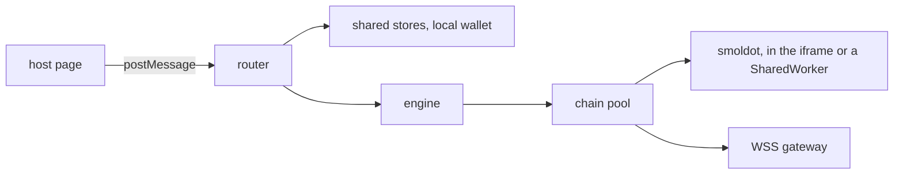

# `@dotli/protocol-app`

The hidden protocol iframe that holds the light client and answers the host's requests. It is the one place that talks
to the network on the host's behalf. See the root [README](../../README.md) for the product as a whole.

## Responsibility

- Run smoldot (or a trusted RPC gateway) and resolve names, chain requests and block fetches for host pages.
- Serve the shared auth, mode and local wallet stores to host and landing origins of the root domain.
- Share one light client across tabs through a SharedWorker in shared-worker mode.
- Not the protocol types, the chain pool, the light client, the gateway providers or the resolution logic. The frame
  wires them, it does not own them.

## Design

- The `?mode=` query picks smoldot in a cross-tab SharedWorker, smoldot in the iframe, or trusted WSS RPC for gateway
  mode. Each chain mode loads its chains on demand, so the shared-worker mode, which only relays, loads none. The byte
  meter is installed where the light client runs, in the iframe or the SharedWorker, before it starts, and either one
  posts the light client's byte total for the host's speed readout. Startup reports failures to the parent without a
  reload.
- One window listener is the iframe's router. It admits requests from allowed host pages and sends each to the store or
  engine that serves its method. A handler's failure is answered as an error response.
- One engine dispatches for every mode. A scope holds one tab's chain connections and budget, while the chains are
  shared by every scope of the engine.
- Two handlers serve the shared stores and the local wallet under the shared-auth trust boundary: host and landing
  origins only, never product origins.
- The SharedWorker runs smoldot and serves each tab port with its own engine scope. The iframe reaches it through a link
  with typed messages.
- One setup starts the light client's chains, the idle leases that let the relay and Bulletin sync be watched, and the
  name resolver, for the iframe and the SharedWorker alike. Each keeps its own transport. Both build the telemetry they
  send the host with one typed builder, so a change to the wire contract fails the build in both. Tester knobs come from
  session storage and never block startup.
- The worker core may read only the fixed services config, because the runtime network config never reaches a worker
  that serves every tab. Lint enforces it.

## Entry points

- The iframe page. Dev server on port 4323.
- The SharedWorker.
- `npm run dev`, `build`, `build:prod`, `typecheck`, `lint`, `test`.
