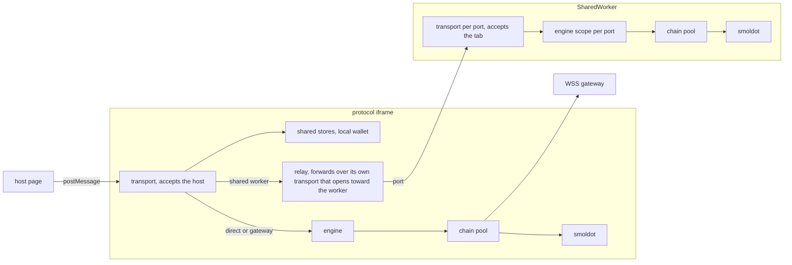

# `@dotli/protocol-app`

The hidden protocol iframe. It holds the light client and answers the host's requests. It is the one place that talks to
the network for the host. Every page loads it from `/p/` on the root domain. See the root [README](../../README.md) for
the product as a whole.

## Responsibility

**Owns:**

- Running smoldot, or a trusted RPC gateway, for name, chain and block requests.
- Serving the shared auth, mode and local wallet stores to host and landing origins.
- Sharing one light client across tabs through a SharedWorker.

**Does not own:** the protocol types, the chain pool, the light client, the gateway providers or the resolution logic.
The frame only wires them.

## Modes

The `?mode=` query picks the backend:

| `?mode=`        | What runs                           |
| --------------- | ----------------------------------- |
| `shared-worker` | smoldot in a cross-tab SharedWorker |
| `direct`        | smoldot in the iframe               |
| `rpc`           | trusted WSS RPC (gateway mode)      |
| none            | auth-only, no chains                |

## Design

- **Shared origin:** it sits under `/p/` beside the host's pages. It removes only its own keys and databases.
- **Safari:** a frame under a product keeps that product's own copy of the stores. Safari keys a frame's storage by the
  page that embeds it.
- **One link to the host:** a transport on a window provider that admits only its parent at an allowed origin.
- **Trust boundary:** the stores and the wallet are served to host and landing origins only, never product origins.
- **Nothing unsolicited:** readiness and failures reach the host on the frame status subscription. It ends typed, so the
  host's error screen tells failures apart.
- **Heartbeat:** answered at once, so the host can spot a silent frame.
- **No deadline crosses the wire.** A name read's sync budget is its method's budget, less a grace for the failure to
  cross back.
- **One engine** dispatches for every mode. A scope holds one tab's connections. Chains are shared.
- **One setup** starts the chains, idle leases and name resolver for the iframe and the SharedWorker alike.
- **Telemetry:** a byte meter where the light client runs feeds the host's speed readout. Auth-only and gateway mode
  serve an idle feed.
- **Pause:** the host pauses the network with `frame.pause`. In shared-worker mode the worker pauses only while every
  tab asks.
- **Tester knobs** come from session storage and never block startup.

### Shared-worker mode

- The iframe serves the stores and wallet itself. It forwards chain and name calls to the worker as raw bytes.
- The worker runs smoldot and serves each tab port with its own transport and engine scope.
- The worker beats each port. A port silent for too many beats is released, and its tab rebuilds the frame on thaw.
- A fatal light client ends every port's status, then the worker closes.

**Trap:** the worker core may read only the fixed services config. The runtime network config never reaches a worker
that serves every tab. Lint enforces it.

## Entry points

- **Iframe page** at `/p/`. Dev server on port 4003, proxied at `/p/` by the host's dev server on the bare host.
- **SharedWorker**, for shared-worker mode.
- **Scripts:** `npm run dev`, `build`, `build:prod` (build, then compress), `typecheck`, `lint`, `test`.
