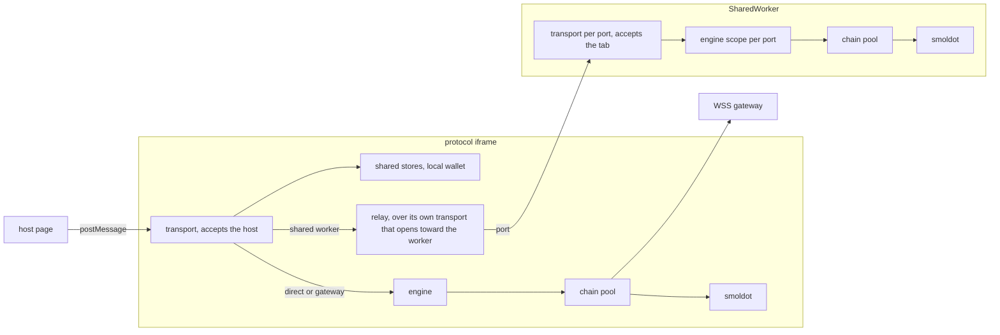

# `@dotli/protocol-app`

The hidden protocol iframe that holds the light client and answers the host's requests. It is the one place that talks
to the network on the host's behalf. See the root [README](../../README.md) for the product as a whole.

## Responsibility

- Run smoldot (or a trusted RPC gateway) and resolve names, chain requests and block fetches for host pages.
- Serve the shared auth, mode and local wallet stores to host and landing origins of the root domain.
- Share one light client across tabs through a SharedWorker in shared-worker mode.
- Not the protocol types, the chain pool, the light client, the gateway providers or the resolution logic. The frame
  wires them, it does not own them.

## Design

- The `?mode=` query picks smoldot in a cross-tab SharedWorker, smoldot in the iframe, or trusted WSS RPC for gateway
  mode. Each chain mode loads its chains on demand, so the shared-worker mode, which only relays, loads none. The byte
  meter is installed where the light client runs, in the iframe or the SharedWorker, before it starts, and either one
  posts the light client's byte total for the host's speed readout. Startup reports failures to the parent without a
  reload.
- One ticker reads the byte meter for every telemetry subscription where the light client runs, started by the first and
  stopped with the last. Each subscriber hears the total at once as its baseline. A subscribe whose first read or ticker
  start fails leaves nothing behind. A read that fails on a tick is skipped and reported once per run of failures, under
  its own metric, and a subscriber that throws is reported without stopping the others.
- The iframe speaks to the host through the transport library over the protocol schema: one transport on a window
  provider that admits only its parent at an allowed origin. It accepts the host's handshake, whose hello names no page
  load, since the iframe reads that from its URL. Bytes from a page at any other origin are refused, and the first from
  each such origin is counted as a refused wire message and logged, so a hostile page that keeps posting floods neither.
  Objects from the parent come only from a host page of an earlier release, and are counted as not bytes.
- What a provider or a transport drops is counted once, under the side that dropped it, the frame or the worker: a
  message that does not decode or does not fit the call it names, data that is not bytes, which the provider drops
  before the transport sees it, and a message the provider could not post, which is also captured and logged, under its
  call's name when it belonged to one. A listener that throws on the transport is reported as a listener.
- It sends nothing unsolicited: its readiness and failures reach the host on the frame status subscription, which a late
  subscriber hears on subscribe. The status tells each subscriber on its own, so one that throws is reported and the
  others still hear. It ends typed, as a fatal light client, a failed init, a released port or a version mismatch, so
  the host tells them apart, and any other error ends it as that error's failure.
- A handler answers with a result. A resolver's sync timeout and a stopped light client are typed failures the host's
  error screen tells apart, and any other failure is thrown, so it crosses as the handler's failure under its error's
  name and message. A subscription a handler cannot start ends the same way.
- No deadline crosses the wire. A name read sizes its sync budget from its method's budget, the one the host gives up
  on, less a grace for the typed failure to cross back, counted from when the call arrives. A tester can cap it from
  session storage.
- The frame's boot holds the status and the telemetry together, since the host subscribes to both as soon as its
  handshake is answered, before the mode has loaded anything. A chain mode feeds the telemetry from its light client.
  Auth-only and gateway mode run none, so once ready they serve an idle feed that stays open and says nothing. A boot
  that fails, or a fatal asset load, ends the status and any telemetry still waiting with that error. A ready frame that
  dies later keeps its telemetry.
- One engine dispatches for every mode. A scope holds one tab's chain connections and budget, while the chains are
  shared by every scope of the engine. A chain send needs a connection id. A name read whose result or end cannot be
  sent to the host is reported, and a result that cannot be sent ends the read with that error, so the host does not
  wait.
- Two handlers serve the shared stores and the local wallet under the shared-auth trust boundary: host and landing
  origins only, never product origins. The iframe's provider holds it, since it admits no other origin, and it guards
  every method the iframe serves. No other transport serves the stores or the wallet. What the stores refuse is counted
  as bad input, and what the wallet refuses is logged.
- In shared-worker mode the iframe serves the store and wallet methods itself and relays the others to the SharedWorker
  through its own transport, including the frame status and telemetry subscriptions. That transport opens the handshake
  toward the worker, with this page load's resolution id as its hello. The relay adds nothing to a call and passes each
  answer, value and end on as the worker gave it. When this tab's status from the worker ends, the relay first ends the
  frame status: with the worker's own end as it is, or, when its transport closed under it, with the closing error. The
  host drops the frame on that end, as the worker orders its own release. The relay then closes its transport, so each
  call the worker still held fails. A transport's own closing error, such as a version mismatch, reaches the host under
  the protocol's class, as it would from the iframe's own link, and a version mismatch ends the status typed.
- The SharedWorker runs smoldot and serves each tab port with its own transport and engine scope, so no buffer is shared
  between ports. It accepts each tab's handshake and labels that tab's request spans with the page load its hello names.
  It drives the heartbeat: it sends a beat to each port on its own clock, the iframe answers each with a heartbeat
  request, and a port that sends nothing for too many beats is released. A release ends that port's frame status as a
  released port, then closes its transport, which posts nothing more. The tab's link ends the rest of what it holds with
  that end, so a thawed tab rebuilds its frame and opens a new port. A released port stays open, so a frozen tab still
  hears its release when it thaws. It closes on the beat after its tab speaks again, so the end posted at the release
  arrives first, or when the worker closes.
- A tab that leaves disposes its link, which closes its port and posts nothing. A port whose tab left or crashed fires
  its close event, and the worker forgets it, or closes it if it was released, at once. Where an engine never fires the
  event, the heartbeat release frees the tab's connections once it misses its beats, and holds its port as it holds a
  frozen tab's.
- The iframe's link to the worker waits for the worker to be ready, and answers its beats until the worker's status
  ends. The ready wait is the link's one deadline, and its handshake has none of its own, so a worker that never answers
  counts as a ready timeout. A heartbeat it cannot send is captured, logged and counted, and the link stops answering,
  so the worker releases the port. A ready wait that fails, by timeout, a worker that fails to load or one that reports
  a failure, disposes the link's transport with that error, so the status subscription, the beats and the relay let go
  of the worker. The timeout and the load failure are init failures.
- A fatal light client ends every port's frame status with the error, and a port that connects later hears it on
  subscribe. The worker closes once every connected port has heard it.
- One setup starts the light client's chains, the idle leases that let the relay and Bulletin sync be watched, a watcher
  that takes a halted chain again after a short wait, and the name resolver, for the iframe and the SharedWorker alike.
  Each keeps its own transport. Both build the telemetry they send the host with one typed builder, so a change to the
  wire contract fails the build in both. Tester knobs come from session storage and never block startup.
- The worker core may read only the fixed services config, because the runtime network config never reaches a worker
  that serves every tab. Lint enforces it.

## Entry points

- The iframe page. Dev server on port 4323.
- The SharedWorker.
- `npm run dev`, `build`, `build:prod`, `typecheck`, `lint`, `test`.
