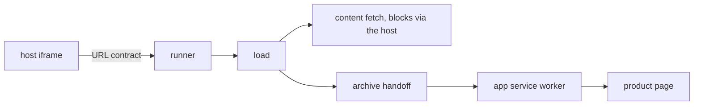

# `@dotli/sandbox`

The per-product origin that loads and renders a product's files. It runs inside the host's iframe and does no name
resolution. See the root [README](../../README.md) for the product as a whole.

## Responsibility

- Read the host's URL contract, fetch and verify the product's content by CID, and write its page into the window.
- Serve the product's files to its page through a service worker.
- Ask for a password when content is encrypted, and show a retry screen when a load fails.
- In a checker build, inject a script first in the product's page that reports each browser API the product reaches
  around the host.
- Not name resolution or the chain connection: the host and the protocol app do that. Block requests go to the host,
  which proxies them to the protocol iframe.

## Design

- Boot starts Sentry before any other module evaluates. The page start then listens for chunk preload errors and mounts
  the toasts and dialogs, in a container that a full-page screen keeps.
- A runner performs the load once, and again on each retry the visitor asks for, up to a limit. Every failure is
  reported and shown. It refuses to run as a top-level page.
- One load fetches and verifies the content, hands an archive to the service worker and writes the page. It never
  throws, so the caller learns which step failed.
- Blocks come from the host parent through a bridge. Progress and completion go back to the host the same way.
- The service worker serves the archive, injects the sandbox checker and keeps the archive in IndexedDB for restarts.
  The page side registers it and checks its version. The packed archive reaches the controlling worker by a handoff.
- After a load the origin's stores are purged of anything the product left behind.
- The password dialog loads on demand through a lazy loader. Its dialogs are `ModalView` data, with an icon component,
  that the shared dialog renders.
- The error page and the retry screen take the page over at once. The retry screen draws the brand's petal mark.
- A small helper for product sub-pages is a real module that the service worker inlines as a classic script. The service
  worker is built by the page's own config, after the page, into one file at the root.
- The checker is a real module inlined as a classic script, so it runs before any product script. Its reports use the
  violation message of the wire protocol. A normal build drops it, and the page loads the injector lazily.

## Entry points

- The sandbox page. Dev server on port 4322.
- The service worker, one file at the root.
- `npm run dev`, `build`, `build:prod`, `typecheck`, `lint`, `test`.
- `npm run storybook`, `build-storybook`, `test:stories`, `test:vrt`.
