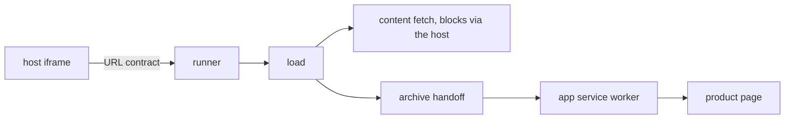

# `@dotli/sandbox`

The per-product origin that loads and renders a product's files inside the host's iframe. See the root
[README](../../README.md) for the product as a whole.

## Responsibility

- **Load:** read the host's URL contract, fetch and verify the content by CID, and write the product's page.
- **Serve:** serve the product's files through a service worker.
- **Screens:** a password prompt for encrypted content and a retry screen for failed loads.
- **Checker build:** inject a script that reports each browser API the product reaches around the host.
- **Not owned:** name resolution and chain connections. Block requests go to the host, which proxies them to the
  protocol iframe.

## Design

- **Runner:** runs the load, and again on each retry up to a limit. It refuses to run as a top-level page.
- **Load:** fetches and verifies content while the service worker registers. It then hands the archive to the worker and
  writes the page. It never throws, so the caller learns which step failed.
- **Host channel:** blocks, progress and completion pass through a bridge to the host. The sandbox reports its start at
  once, since the host fails a silent sandbox.
- **Full reset:** the first load purges what an earlier product left, so a fresh worker starts clean.
- **Lazy UI:** the sandbox's own UI is one chunk, loaded only when needed. A failed chunk load falls back to a static
  Reload message.
- **Checker:** a module inlined as a classic script, so it runs before any product script. A normal build drops it.

### Service worker

- Serves archive files byte for byte, kept in IndexedDB across restarts.
- Keeps one archive per page and answers each client from its own page's archive.
- Navigations go to the network, since the page writes the product's `index.html` itself.
- A miss retries under the page's directory, so deep links and client routers resolve relative URLs.
- Built into one file at the root.

## Entry points

| Entry                                                             | What it is                        |
| ----------------------------------------------------------------- | --------------------------------- |
| Sandbox page                                                      | Dev server on port 4002.          |
| Service worker                                                    | One file at the root.             |
| `npm run dev`, `build`, `build:prod`, `typecheck`, `lint`, `test` | Develop, build, check, unit test. |

Component stories run in the one Storybook at the repo root.
