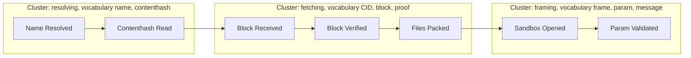

# Event storming

A lightweight modeling technique for finding the seams in a system. dotli uses it for one decision: **where does the
seam fall between packages or apps, and between the host and the sandbox or protocol frame?**

External reference: [eventstorming.com](https://www.eventstorming.com/).

## Technique

List **events**, which are facts in past tense ("Name Resolved", "Block Verified"), on a timeline, then group them by
the vocabulary they share. Where the language shifts, the boundary is.

1. **List events** for the scenario you are modeling, in past tense, one per line.
2. **Mark the actor or command** that produced each event ("the host asked for a name" produces `Name Resolved`).
3. **Cluster by vocabulary.** Events that talk about the same nouns and verbs belong together. A cluster that suddenly
   introduces new terms is its own context.
4. **Name each cluster.** The name is a candidate package, app or module.
5. **Draw the dependency arrows.** A cluster that is referenced by others but does not reference back is a lower-level
   concept. Extract it first.

## The application: finding a seam

Run the technique whenever:

- A package or app starts mixing terms from two vocabularies, for example a package about blocks that also talks about
  frame URL params.
- You cannot describe the change in one sentence in the vocabulary of one package or app (step 1 of the `architecture`
  skill).
- You cannot tell whether a new behavior belongs to the host, the sandbox or the protocol frame, because the actor, the
  trigger or the resulting state is unclear.

A new vocabulary cluster means a new owner is forming. Let the existing layer depend on it, never the reverse. To decide
whether two flows belong in the same package or app, draw the causal arrows: which event triggers which command, which
command updates which state, which state is read by which view. Flows belong together only if those arrows **cross
between them**, so that an outcome of one is the trigger of the other or both act on the same state. If you can erase
one flow's events and the other flow is still complete and coherent, the coupling was illusory. Split them.

Where the seam lands is then a placement question. Take the clusters to `docs/code/placement.md`.

## Worked example

This scenario is illustrative. It models how a host opens a product and is simplified.

Events on the timeline, grouped by vocabulary:

Each cluster speaks its own language: names and contenthashes, CIDs and proofs, frames and params. That is the signal to
keep them as separate owners (`@dotli/resolver`, `@dotli/content`, `@dotli/sandbox-wire`) rather than let one grow terms
from the others. The arrows run one way. Fetching needs a contenthash from resolving and framing needs files from
fetching, but resolving knows nothing about frames. If a proposed change makes `Block Verified` depend on
`Sandbox Opened`, the arrow points back up and the seam is in the wrong place.

## For Claude

Trigger: if the change cannot be stated in one sentence in the vocabulary of one package or app, meaning two
vocabularies show up, or the actor, trigger or resulting state is unclear, run a lightweight event storming with the
owner before going on. Ask narrow, one-fact-at-a-time questions:

- "What event does the user expect after this action, for example `Name Resolved`, `Block Verified`?"
- "Who triggers it: the user directly, the host, the sandbox, a background subscription?"
- "What state has changed once the event has happened? Whose state, this package's or another's?"
- "Is `<term X>` the same concept as `<term Y>` you mentioned earlier, or two different things?"

Stop asking once you have an event name in past tense, the actor or command, the affected state, and confidence that one
vocabulary covers it. Then continue with the lifecycle. Do not guess the model. Guessed models leak across seams and are
expensive to undo.
