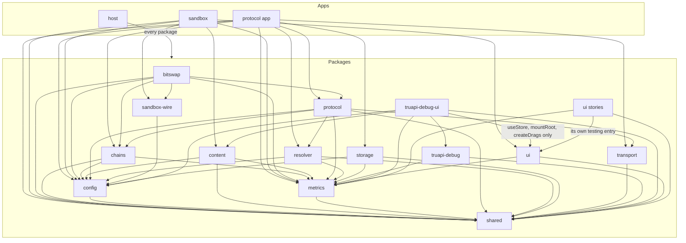
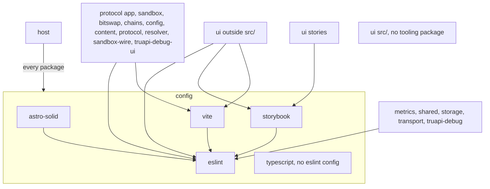

# Placement

This doc owns where code and files go.

## Layer map

dotli has three apps in `apps/`, the packages in `packages/` and the tooling packages in `config/`. What a package owns
and exposes is in its `README.md`. What it may import is in its `eslint.config.js`, which lists the `@dotli/*`,
`@config/*` and `@parity/*` packages it may import and bans the rest. The host is the top layer and may import every
package, so its config lists none.

This section and the next summarise the `eslint.config.js` files and the READMEs. Those files win on any conflict, and a
change to one updates this doc in the same commit.

Imports between the apps and the packages. An arrow means "may import". The ui package restricts its stories differently
from the rest of it.

The protocol app's worker and light client service, and the provider and chain sync in chains, import
`@dotli/config/fixed`, never the bare `@dotli/config`.

Imports of the tooling packages. The ui package restricts its stories, the rest of its `src/` and the files outside
`src/` differently. `config/typescript` holds `tsconfig` bases and has no `eslint.config.js`.

## Which package or app

| If it is                                                                                                                       | It goes in                                            |
| ------------------------------------------------------------------------------------------------------------------------------ | ----------------------------------------------------- |
| The top-level shell: topbar, session and bridge, opening a product by `.dot` name in a sandbox iframe                          | `apps/host` (`@dotli/host`)                           |
| The hidden protocol iframe that holds the light client and talks to the network on the host's behalf                           | `apps/protocol` (`@dotli/protocol-app`)               |
| The per-product origin that loads and renders a product's files, with no name resolution                                       | `apps/sandbox` (`@dotli/sandbox`)                     |
| Fetching single blocks from the Bulletin Chain through the light client, and relaying a sandbox's block requests               | `packages/bitswap` (`@dotli/bitswap`)                 |
| Connecting to chains: the light client, the gateway providers over trusted RPC nodes, and the shared connection pool           | `packages/chains` (`@dotli/chains`)                   |
| Build-time and runtime configuration: environment, networks, chain services, user settings and timeouts                        | `packages/config` (`@dotli/config`)                   |
| Fetching a product's files by CID and proving they are the content the CID names                                               | `packages/content` (`@dotli/content`)                 |
| Metrics, spans and error capture over Sentry                                                                                   | `packages/metrics` (`@dotli/metrics`)                 |
| The host page's client for the hidden protocol frame, turning postMessage traffic into promises and streams                    | `packages/protocol` (`@dotli/protocol`)               |
| Resolving a `.dot` name to its manifests and content hash through dotNS, and the dotNS naming rules                            | `packages/resolver` (`@dotli/resolver`)               |
| The protocol between the host and a sandbox frame: URL params, messages and the host's listener                                | `packages/sandbox-wire` (`@dotli/sandbox-wire`)       |
| A small, framework-free helper every other package may use: logging, errors, task pool, listener set, sync store               | `packages/shared` (`@dotli/shared`)                   |
| Persistent browser data in IndexedDB databases: caches, local chat, the local wallet, site grants, scheduled notifications     | `packages/storage` (`@dotli/storage`)                 |
| A generic transport between documents, with requests and subscriptions declared from codecs                                    | `packages/transport` (`@dotli/transport`)             |
| The debug event bus and debug mode, with no UI                                                                                 | `packages/truapi-debug` (`@dotli/truapi-debug`)       |
| The TrUAPI debug panel, which loads only in debug mode                                                                         | `packages/truapi-debug-ui` (`@dotli/truapi-debug-ui`) |
| UI more than one app shows, with no domain and no data source: primitives, floating layers, stores, icons, tokens, brand marks | `packages/ui` (`@dotli/ui`)                           |
| The Astro integration for Solid 2                                                                                              | `config/astro-solid` (`@config/astro-solid`)          |
| Shared ESLint flat configs and the import-layer helpers                                                                        | `config/eslint` (`@config/eslint`)                    |
| Tooling for the one Storybook at the repo root                                                                                 | `config/storybook` (`@config/storybook`)              |
| Shared `tsconfig` bases                                                                                                        | `config/typescript` (`@config/typescript`)            |
| A build plugin or option shared by the host, sandbox and protocol builds, or the tests' CSS-modules naming                     | `config/vite` (`@config/vite`)                        |

## Inside the host

- The host's domain building blocks (account, chat, permission, settings and chain views, and their icons) sit in
  `apps/host/src/components/<domain>/` beside the flows that compose them.
- The host's side of TrUAPI and the session lives in `apps/host/src/runtime/`.

## Inside a package

These hold in every app and package. The `src/index.ts` entry and the `./testing` entry are for packages alone.

- Each package exposes only `src/index.ts`. Never import another package's internal modules.
- On-demand modules go through a loader in `src/lazy.ts` to stay a separate chunk.
- Styles go in a CSS module beside the component.
- A unit test sits beside its module: `src/foo.ts` gets `src/foo.spec.ts`.
- Functional tests live in `<pkg>/tests/` as `*.test.ts`.
- Test-only modules live in `src`: `<name>.fake.ts` beside the module it fakes, shared fixtures in `src/testing/`. Never
  export them from `src/index.ts`. Another package reaches them through a `./testing` package entry.
- A constant two modules share lives in a leaf module, and a protocol constant is defined once.
- A shared fixture that reads the page is named `<name>.dom.ts`. Only functional tests and stories use it.
- There is one Storybook, at the repo root. It runs every story in every app and package. Story fixtures and frames live
  in the package's `src/testing/stories/` and are never exported. Stories may also import `./testing` entries.
- Helpers every package's tests use live once: in `@dotli/shared/testing`, the page wait `untilDom` included, and page
  queries in `@dotli/ui/testing`.

## Cut rules

- A view, screen or flow used by one app lives in that app.
- A component that owns an interaction with the product (a subscription, an action and its error copy) is a flow. A
  building block takes props, reads no store and reports the user's intent through a callback.
- A building block stays simple: it shows one entity or one control, such as an account, a chain or a message. A whole
  flow, such as a multi-step modal or a panel with its own actions, lives in the app that uses it and is composed there
  from building blocks. It never goes in `@dotli/ui`, which has no domain and no data source.
- Primitives, icons, the brand marks, the tokens, and the screens and overlays both apps show live in `@dotli/ui`. Its
  entries are the index, `./icons`, `./brand`, `./styles.css` and `./testing`.
- Chrome that only lays out one app's page (which items a bar shows and in what order, a loading screen) stays in that
  app as Astro markup and the app's own islands. A domain-free mechanism under it goes to `@dotli/ui` even when one app
  uses it today, taking the app's ids and types as parameters.
- The debug panel is its own lazily loaded package with its own UI kit. It reads the host through its port and the debug
  bus.
- Shared Vite plugins live in `config/vite/src/` as `@config/vite`.
- Import a component where it is used and let the bundler split chunks. What a visit may never open (a panel's content,
  the debug panel) loads through `lazy()` or a loader in `src/lazy.ts`. The startup size budgets in CI guard what a page
  loads first, not import rules.

## No home found

If this doc gives the code no home, stop and ask the owner. Never invent a package or a file to resolve it.
