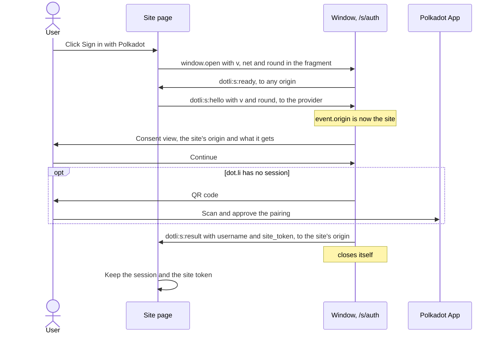
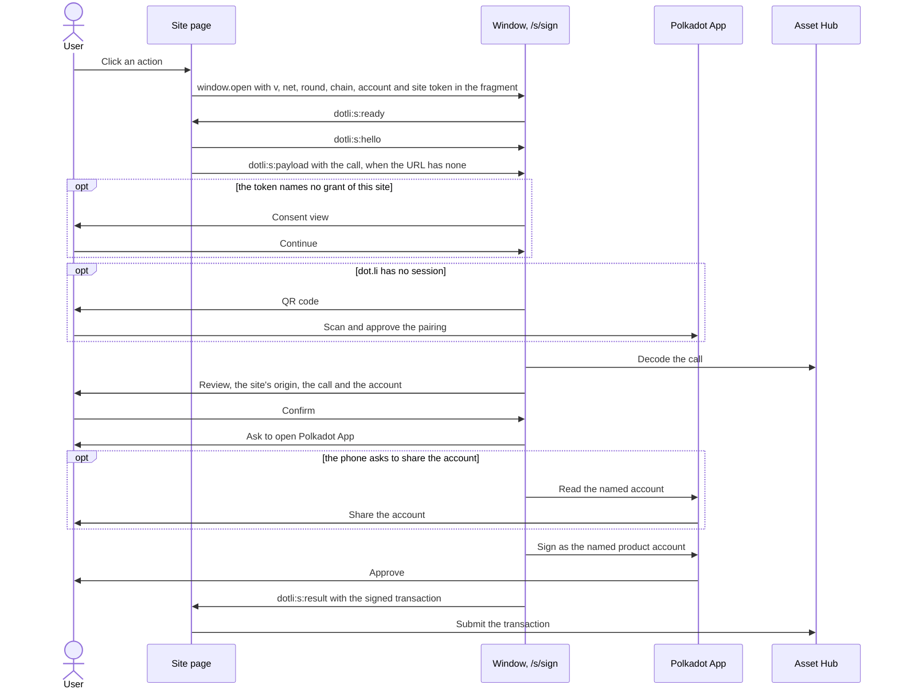
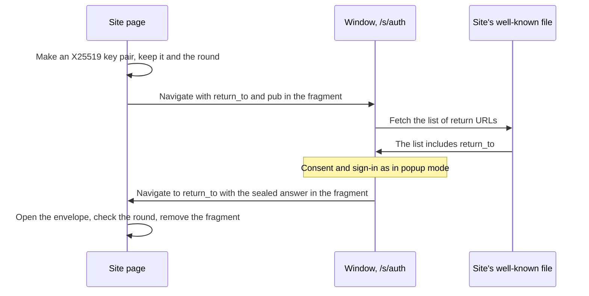

# Sign in with Polkadot for third-party sites

The protocol between a website and dot.li's session pages: how a site signs a user in, asks for a transaction to be
signed, and reads the answers. It is written for anyone who builds a site or a client library against the session
pages, and describes only what crosses the wire.

## Summary

Any website can offer "Sign in with Polkadot" that works in every browser, Safari included. A click opens a dot.li
session page as a popup, the way Google sign-in works in popup mode. The user's pairing with the Polkadot App stays on
the dot.li root domain. A site gets the user's username, or `null` when the user has none, and a site token of its
own, which it keeps in its own storage, so later visits restore with no popup.

Sign-in signs nothing and proves nothing. It tells a site who the user says they are, for display. The real check comes
when the user approves an action. A site that wants a transaction opens `/s/sign` with the call and the product account
that is to sign it. dot.li shows the call, has the Polkadot App sign it, and hands the signed transaction back. dot.li
never submits it. The site does.

dot.li never derives an account for a site and never sends a site the user's main account. Only a transaction request
names an account, and it is the site that names it.

The client library a site uses is a separate package, outside the dot.li repo. This document specifies the protocol it
speaks, and recommends its API.

A hidden iframe can't do this job. Chrome, Firefox and Safari all give a cross-site iframe storage keyed by the
top-level site, so a dot.li iframe on `my-site.com` starts empty everywhere. A top-level window opened by a click is
the one path every browser allows.

## Conventions

The key words "MUST", "MUST NOT", "REQUIRED", "SHALL", "SHALL NOT", "SHOULD", "SHOULD NOT", "RECOMMENDED", "MAY" and
"OPTIONAL" in this document are to be interpreted as described in [RFC 2119](https://www.rfc-editor.org/rfc/rfc2119).

The wire protocol (routes, request fields, messages, results, refusals, the redirect seal and the headers) is
normative. The library API is a recommendation, which its owners MAY shape differently.

- **Provider**: the origin of a dot.li deployment, such as `https://dot.li`. Session pages live under
  `<provider>/s/`.
- **Window**: a session page, open as a top-level window.
- **Site**: a web origin that is not the provider's, and the page on it that opens a window.
- **Round**: one request from a site and the window's one answer to it.

## Goals

- A site adds sign-in with one package and one button. It needs no registration with dot.li and no server.
- A user already signed in on dot.li signs in to a new site with a click and Continue. No QR code and no phone step.
- Later visits restore silently from the site's own storage.
- Safari, Chrome and Firefox behave the same.
- A site gets the user's username, or `null`, and a site token that stays the same until revoked.
- A site can ask dot.li to sign a transaction as a product account the site names, and gets the signed transaction to
  submit itself.
- The user can see and revoke each site's access.

## Non-goals

- Sign-in without a click, like Google One Tap. It needs third-party cookies or FedCM, and Safari has neither.
- A proof of sign-in that a site's backend can verify, and with it any server-side OAuth or OIDC flow. Sign-in gives a
  site nothing it could not make up, so there is nothing to verify.
- Telling sites right away about a sign-out. A site finds out the next time it contacts dot.li.
- Submitting transactions, or reporting whether one was included. The site submits what it gets.
- Raw message signing.
- A direct channel between a site and the phone. Every request to the phone goes through dot.li.
- Changes to TrUAPI or the Polkadot App.
- Wallet features beyond signing, such as balances or transfers.

## Anti-goals

- The main pairing session leaving the root domain.
- The main account's address, or an account derived for the site, given to a site at sign-in.
- Secret material in a cookie, or in a URL a server can read.
- A result sent to an origin the browser did not vouch for, or in redirect mode to a return URL the site did not list.
- An iframe, a hidden window or a redirect chain used to get around storage partitioning.

## Constraints

| Constraint                                                                                      | Consequence                                                                                                         |
| ----------------------------------------------------------------------------------------------- | ------------------------------------------------------------------------------------------------------------------- |
| Safari blocks `window.open` called after the click's task has ended                             | The site opens the window synchronously in the click handler, before any `await`                                    |
| `Cross-Origin-Opener-Policy: same-origin` on either page cuts the opener link                   | The site sends no `same-origin` COOP. Session pages send no COOP                                                    |
| Every browser partitions cross-site iframe storage and `BroadcastChannel`                       | No embedded dot.li frame on a third-party site. Session pages are the only channel                                  |
| A product opened by path takes `<domain>/<label>`, and dotNS registers no name as short as `s` | Session pages live under `/s/`                                                                                      |
| Browsers cap URL length                                                                         | A long call comes by message after the handshake, in popup mode only                                                |
| WebCrypto has X25519 in all three engines                                                       | The redirect mode's temporary private key stays non-extractable                                                     |
| In-app browsers and some mobile setups block or lose popups                                     | Sign-in has a redirect mode as a fallback                                                                           |
| Safari clears script-writable storage after 7 days of browser use with no interaction on a site | Applies to each site and to dot.li's own store on the root domain (see Open problems)                               |
| Session pages must not be framed                                                                | They send `frame-ancestors 'none'`, and a framed session page does nothing                                          |

## Model

The dot.li root domain is the identity provider and each site is a relying party, keyed by its exact origin or by its
group when it declares one. Only scoped grants pass between them.

| Role          | Runs on                             | Holds                                                    |
| ------------- | ----------------------------------- | -------------------------------------------------------- |
| Session pages | `<provider>/s/*`, top-level         | The main pairing session and the sites the user granted |
| Library       | Inside the site's page              | The site's session and site token, the message protocol  |
| Polkadot App  | The user's phone                    | Account keys, paired sessions                            |

### A site is its origin

- The window reads a site's origin from the browser: the `event.origin` of the site's hello, or in redirect mode the
  origin of a listed return URL. Never from a request field or `document.referrer`.
- A site is an `https:` origin whose host is not the provider's host or under it, on any port, or, for
  development, an origin whose host is exactly `localhost`, over `http:` or `https:` on any port, other than the
  window's own origin. A subdomain of `localhost` is a site only over `https:`. Pages of the provider's own domain are
  dot.li's own and are not sites. Any other origin, such as one on plain `http:` or a product's origin under the
  provider's domain, is refused with `origin_not_allowed`.
- By default a grant belongs to the exact origin, such as `https://app.my-site.com`. With the registrable domain as
  key, `uploads.my-site.com` would get the grant of `app.my-site.com`. A site opts into sharing by declaring a group.

### What a site receives

| What         | Content                                                                                                    | Phone step                                                     |
| ------------ | ---------------------------------------------------------------------------------------------------------- | -------------------------------------------------------------- |
| Sign-in      | The user's username, lite or full, or `null` when the user has none. A site token for a new grant          | None, except pairing by QR when dot.li has no session yet      |
| Transactions | The transaction the site asked for, signed by the product account the site named, as bytes it submits itself | The phone confirms each transaction, and MAY first ask the user to share the named account                                   |

### Identity

A site gets no user id beyond the username and the site token.

- The username is what the user's main account carries, its full username when it has one and else its lite one. It
  MAY be `null`. It is the user's own claim, and a site MUST treat it as a display name only.
- The site token names the site's grant. It stays the same until the grant is revoked. A site MAY key its own user
  data on it. A new token means dot.li no longer knew the old one, revoked, lost with dot.li's storage, or dropped when
  another account signed in on dot.li, so a site that keys data on the token treats a new one as a new identity.

### Trust

- The site trusts the code served under `<provider>/s/`. That server is in the trust path, as it is for dot.li itself.
  Open problems covers how to cap it.
- The window trusts only what the browser vouches for: the `event.origin` of the opener's hello, or in redirect mode
  the origin of a return URL the site listed.
- The site trusts its own session. Nothing proves it, and nothing needs to, since every action of consequence is
  approved by the user on the window and on the phone.

## Site token and groups

### Site token

dot.li and each site share a site token that names the site's grant. It adds to origin keying and never replaces it.

- **Issue.** The window issues a token when a round ends in a new grant that it could keep, on `/s/auth` or
  `/s/sign`: 32 random bytes in unpadded base64url. The token travels as `site_token` on the round's `dotli:s:result`,
  and only there. A result with no `site_token` leaves the site's token as it was.
- **Reuse.** Every later request carries the token in `site_token`. The window skips the consent view when the token
  names a grant of the requesting origin, or of the request's group (below), made while the same dot.li account was
  signed in. A token that is unknown, revoked, of another origin or of another dot.li account gets the same answer as
  no token: the consent view shows again, and agreeing issues a new token.
- **Revoke.** The user revokes a site on `/s/manage`, which deletes its token. Signing out of dot.li on dot.li's own
  pages deletes every site's token. A site is not told. It finds out at its next request, which shows the consent view
  again.
- The token never goes in a query string. It is a stable handle for one user on one site, and the provider's server
  would see it there.

### Site groups

A site with several origins under one registrable domain can share one grant across them by declaring a group. It
passes the same `group_token` on each of its origins.

- The registrable domain is the origin's public suffix plus one label, by the Public Suffix List, private section
  included. So `alice.github.io` and `bob.github.io` never share a group. dot.li judges with its own copy of the list.
- A group's grant is keyed by the registrable domain plus the group token. With a group token, a site token answers
  when its grant has the same registrable domain and group token, whichever origin of the group sent it. Each origin
  that uses the grant joins it.
- With a group token and no known site token, the consent view names the exact origin and the group's registrable
  domain. Agreeing returns the group's existing site token when the group already has one, so every origin of the group
  holds the same token.
- A site token issued without a group does not answer a request with a group token, nor the other way round.
- Passing the site token between its own origins is the site's job, through its backend or a cookie on its
  registrable domain.
- The group token is public once a page carries it, so the registrable domain is the real boundary. Any origin under it
  that can run script can join the group, with at most one consent click. A site that serves other people's content
  from a subdomain MUST NOT declare a group.
- A group never spans registrable domains. `my-site.com` and `my-site.io` stay two sites.

The window refuses a request with a group token with `bad_request` when the origin has no registrable domain, as for a
public suffix such as `github.io`, an IP address or `localhost`, when the registrable domain is the provider's own, and
when its copy of the Public Suffix List fails to load.

## Routes

Each route is an exact path with no trailing slash.

| Route        | Shows                                                                                                              | Takes                                 | Returns                                                     | Third party                    |
| ------------ | ------------------------------------------------------------------------------------------------------------------ | ------------------------------------- | ----------------------------------------------------------- | ------------------------------ |
| `/s/auth`    | The site's origin and what it gets, then Continue and Cancel. With no session on dot.li, pairs by QR after Continue         | A sign-in request, popup or redirect  | The username, and a site token for a new grant              | Yes                            |
| `/s/sign`    | The decoded call, the site's origin and the named account, then Confirm. The consent view first for an unknown token | A transaction request, popup only     | The signed transaction, and a site token for a new grant    | Yes                            |
| `/s/manage`  | The sites the user granted, each with Revoke                                                                       | Nothing                               | Nothing                                                     | A site MAY link to it          |
| `/s/signout` | dot.li's own sign-out                                                                                              | dot.li's own request                  | Nothing to a site                                           | No. A site MUST NOT open it    |

`/s/manage` reads no request, answers no page and posts no message. `/s/signout` belongs to dot.li's own pages. It ends
nothing for a site, and answers a site's hello, if at all, with `bad_request`.

## Request

### URL

A site opens a route with its request in the URL fragment:

```text
<provider>/s/<route>#params=<base64url without padding of the UTF-8 bytes of the request's JSON>
```

- The request is one JSON object. Anything else, or a `params` value that is not unpadded base64url of UTF-8 JSON, is
  no request.
- The window reads the fragment as `application/x-www-form-urlencoded` and takes the `params` key. A site SHOULD put
  nothing else in the fragment.
- The fragment never reaches the provider's server, so the server can't log which sites a user visits. A query string
  would reach it, so a site MUST NOT put a request field in the query string.
- The window removes the fragment from its URL as soon as it reads it, so tokens don't stay in the browser's history.
  It keeps the request for the tab's session, so a reload of the window answers the same round.
- A site that puts a new request in an open window's fragment makes the window load again for that request.
- An OPTIONAL field is omitted when unused. A field sent with `null` or a value of the wrong type is present and
  invalid.
- A window with no request, or a request with no round, answers nothing and shows a refusal.

### Fields on every route

| Field         | Type   | Rule                                                                                                                                     | When it fails                    |
| ------------- | ------ | ---------------------------------------------------------------------------------------------------------------------------------------- | -------------------------------- |
| `v`           | number | REQUIRED. `1`                                                                                                                            | `unsupported_version`            |
| `net`         | string | REQUIRED. A network the deployment enables (see Networks)                                                                                | `unknown_network`                |
| `round`       | string | REQUIRED. Not empty. A site MUST make it from at least 128 bits of a cryptographically secure random source, RECOMMENDED as unpadded base64url of 16 or more random bytes | No request. The window answers nothing |
| `site_token`  | string | OPTIONAL. Canonical unpadded base64url of exactly 32 bytes, 43 characters, as the window issued it                                      | `bad_request`                    |
| `group_token` | string | OPTIONAL. 1 to 256 UTF-16 code units, with no CR, LF, U+2028 or U+2029 and no lone surrogate. The same on every origin of the group      | `bad_request`                    |

On `/s/auth` the redirect fields, and in redirect mode the vetting, come first (see Redirect mode). Then the window
checks `v`, then `net`, then the route's own fields.

### `/s/auth`

| Field       | Rule                                                                                                          |
| ----------- | ------------------------------------------------------------------------------------------------------------- |
| `return_to` | Redirect mode only. An absolute URL with no `#`, on `https:`, or on `http:` with the host `localhost`          |
| `pub`       | Redirect mode only. The site's temporary X25519 public key, 32 bytes in canonical unpadded base64url          |

- `return_to` and `pub` come together or not at all. Neither means popup mode. Both valid means redirect mode. One
  alone, or either one invalid, makes the window show a refusal and answer nothing, with no message and no navigation.
- `account`, `nonce`, `statement` and any field this document does not name are ignored. Sign-in names no account.
- `intent` is refused with `bad_request`.

### `/s/sign`

| Field     | Rule                                                                                                                                         |
| --------- | -------------------------------------------------------------------------------------------------------------------------------------------- |
| `chain`   | REQUIRED. The genesis hash of the Asset Hub of `net`, as `0x` hex, in either case                                                             |
| `account` | REQUIRED. The product account that signs, as `<product>/<index>` (below)                                                                      |
| `call`    | OPTIONAL. The call's SCALE bytes as `0x` followed by an even number of hex digits in either case, 2 to 1 000 000 bytes. Absent means it comes by `dotli:s:payload` |

- A call that does not decode on that Asset Hub is refused with `bad_request`.
- `return_to`, `pub`, `nonce`, `statement` and any field this document does not name are ignored. `/s/sign` has no
  redirect mode, so a request with no opener is answered by nothing.
- `intent` is refused with `bad_request`.
- Browsers cap URL length at different sizes. A library SHOULD send a call by `dotli:s:payload` unless it is small, and
  MAY always do so.

### Account form

`account` is `<product>/<index>`, with exactly one `/`.

- `<product>` is a dotNS name ending in `.<TLD>` of `net`'s TLD (see Networks). The name before the TLD is one or more
  labels joined by `.`, at most 253 characters in all. Each label is 1 to 63 characters of lowercase ASCII letters,
  digits and `-`, neither starting nor ending with `-`, and not starting with `xn--` or `sn--`. The last label is at
  least 2 characters. For example `my-app.paseo` or `pr16.my-app.paseo`.
- `<index>` is a decimal number from `0` to `4294967295` with no leading zeros, or `0x` followed by 64 hex digits for a
  raw 32-byte derivation index.

The window shows the product and index on its review, as the site wrote them.

### Networks

A deployment enables one or more of these networks.

| `net`           | TLD       | Asset Hub genesis (`chain`)                                          |
| --------------- | --------- | -------------------------------------------------------------------- |
| `paseo-next-v2` | `paseo`   | `0x4349b00e54897e21196fd331015fc5be0f14e118beb0375ed2bb1793737bb57a` |
| `previewnet`    | `testnet` | `0xbac97e23fc8f4bccae72a98f8aeb2bcab20bf755862304e4b46ad6473456e896` |

## Messages

In popup mode the window and the site talk by `postMessage`. Every message is a JSON-compatible object with a `type`.

| Message             | Direction                    | Fields                                         | Target origin                                                                  |
| ------------------- | ---------------------------- | ---------------------------------------------- | ------------------------------------------------------------------------------ |
| `dotli:s:ready`     | window to `window.opener`    | `type`, `versions: number[]`, now `[1]`        | `*`                                                                            |
| `dotli:s:hello`     | site to window               | `type`, `v: 1`, `round: string`                | The provider                                                                   |
| `dotli:s:payload`   | site to window               | `type`, `round: string`, `call: string`        | The provider                                                                   |
| `dotli:s:result`    | window to site               | `type`, `round`, `result`, `site_token?`       | The site's exact origin                                                        |
| `dotli:s:refused`   | window to site               | `type`, `round`, `reason: string`              | The site's exact origin, or for `origin_not_allowed` the origin of the hello |
| `dotli:s:cancelled` | window to site               | `type`, `round`                                | The site's exact origin                                                        |

`ready` carries no account data, which is why it may go to any origin. `site_token` appears on `result` only for a new
grant.

### What the window does

- It posts `ready` once it starts with an opener, and again when the page is restored from the back-forward cache. In
  redirect mode it posts nothing.
- It ignores every message whose `event.source` is not its `window.opener`.
- It takes a hello only while it waits for one, and only with `v` equal to `1` and `round` equal to its request's
  round. Any other hello is ignored with no answer. `unsupported_version` comes only from the request's `v`, never from
  a hello.
- The first hello it takes names the site. Its `event.origin` becomes the origin the window answers, alone, for the
  rest of the round. After a restore from the back-forward cache, only a hello from that same origin counts.
- A hello from an origin that can't be a site gets `refused` with `origin_not_allowed`, posted to that origin, and ends
  the round.
- It takes a payload only from the site's origin, for its round, after the hello, and only on `/s/sign` with no `call`
  in the request. The first one counts. A payload whose `call` breaks the `call` rule is refused with `bad_request`.
- It posts nothing but `ready` before the hello names the site, and nothing at all when it has no opener.
- It answers a round once, with one `result`, `refused` or `cancelled`, then usually closes itself. After a refusal of
  the request itself it MAY stay open and show the refusal.
- It sets no deadline on the handshake. A user may take as long as pairing needs.

### What a site MUST do

- Open the window synchronously in the click handler, and keep the handle `window.open` returns.
- Accept a message only when `event.source` is that handle and `event.origin` is the provider.
- Answer every `ready` whose `versions` include `1` with a hello for its round, targeted at the provider, while the
  round is open. A reloaded or restored window says `ready` again and needs the same round.
- Generate `round` with at least 128 random bits, and ignore every `result`, `refused` or `cancelled` for a round it
  did not start or already closed.
- Send its payload after its hello, when its `/s/sign` request carries no `call`.
- Treat a window that closes with no answer as cancelled. Closing a window with the browser's own controls sends
  nothing.
- Treat a `reason` it does not know as a refusal, since a newer window may send one.
- Ignore fields it does not know, in every message and result.

A library SHOULD close the window once its round ends.

## Results

### `/s/auth`

```json
{
  "type": "dotli:s:result",
  "round": "<the site's round>",
  "result": { "username": { "name": "alice", "kind": "full" } },
  "site_token": "<43 characters, only for a new grant>"
}
```

`result.username` is `{ "name": string, "kind": "lite" | "full" }`, or `null` when the user's account has no username.
A missing username is never an error. Sign-in carries no address, no public key, no signature and no expiry.

### `/s/sign`

```json
{
  "type": "dotli:s:result",
  "round": "<the site's round>",
  "result": { "transaction": "0x..." },
  "site_token": "<43 characters, only for a new grant>"
}
```

- `result.transaction` is the whole signed extrinsic as lowercase `0x` hex, for the Asset Hub of `net`, signed by the
  account the request named, with the extensions filled from that chain.
- It is mortal. Its era starts at a recent finalized block and typically lasts 32 blocks. A site SHOULD submit it at
  once and MUST NOT rely on a longer life.
- dot.li never submits it. The site submits it through its own connection, and learns the outcome from the chain.
- The nonce is read from the chain when the window signs, so a transaction signed before an earlier one is included MAY
  get the same nonce. A site SHOULD wait for one to be included before it asks for the next.

## Refusals

`dotli:s:refused` carries one of a closed set of reasons. A window of a later release MAY add one.

| Reason                | When                                                                                                                                                                                        |
| --------------------- | ------------------------------------------------------------------------------------------------------------------------------------------------------------------------------------------- |
| `origin_not_allowed`  | The hello came from an origin that can't be a site                                                                                                                                         |
| `unsupported_version` | The request's `v` is not the number `1`                                                                                                                                                     |
| `unknown_network`     | The request's `net` is absent or not a network the deployment enables                                                                                                                       |
| `bad_request`         | A field breaks its rule or a refused field is present, a site opened `/s/signout`, the group can't be judged, the payload's call breaks the `call` rule, or the call does not decode on Asset Hub |
| `declined`            | The user pressed Cancel on the consent view                                                                                                                                                 |
| `transaction_invalid` | The wallet does not support or allow the transaction                                                                                                                                        |

`dotli:s:cancelled` means the user left the round without an answer: Cancel anywhere but the consent view, a sign-in
step the user closed, or a request the user rejected on the phone.

A round may also end with no message at all: when the request can't be read, the redirect fields are invalid, a
redirect can't be vetted, the window has no opener in popup mode, or the user closes the window. A failure the user can
try again, such as an unreachable chain, sends nothing until the user tries again or cancels.

## Redirect mode

For contexts that lose popups. `/s/auth` only.

The site creates a temporary X25519 key pair, keeps the private key non-extractable and the round for the tab, and
navigates to `/s/auth` with `return_to` and `pub` in the request. The window answers by navigating back to `return_to`
with the sealed answer in the fragment, which no server receives. Only the page holding the private key can read it.
A redirect round needs no opener, and the window posts no message in it.

### Vetting

Until vetting passes, the window trusts nothing in the request, so a failure only shows a view and sends the site
nothing. In order:

1. The browser can do X25519 with `pub`. A browser without X25519, or a key it can't use, fails.
2. The origin of `return_to` is one that can be a site.
3. The site's well-known file lists `return_to`.

Once vetting passes, the origin of `return_to` takes the place of a hello's `event.origin` for the rest of the round,
and every answer, `refused` and `cancelled` included, goes back sealed.

### The well-known file

The site lists its return URLs at `<origin of return_to>/.well-known/polkadot-signin.json`:

```json
{ "return_to": ["https://my-site.com/signed-in", "https://my-site.com/app/?from=dotli"] }
```

- The window fetches it cross-origin, with no credentials, no cache and no redirects. The site MUST serve it with a
  CORS header that lets the provider read it, such as `Access-Control-Allow-Origin: *`, and MUST NOT redirect it.
- A non-2xx answer, a redirect, a network or CORS failure, or no complete answer within 10 seconds makes the file
  unreachable.
- A body over 64 KiB, a body that is not JSON, or one that is not an object whose `return_to` is an array of strings
  lists nothing.
- `return_to` and each entry are compared after URL normalisation, as `new URL(value).href` does. An entry that is not
  a URL is skipped.

### The seal

The window seals the exact message popup mode would post, `dotli:s:result` with its `site_token` when there is one,
`dotli:s:refused` or `dotli:s:cancelled`:

1. Generate a fresh X25519 key pair, the ephemeral key.
2. Derive 256 bits of shared secret by X25519 between the ephemeral private key and `pub`.
3. Derive an AES-256-GCM key by HKDF-SHA-256 from the shared secret, with salt the UTF-8 bytes of `round` and info the
   UTF-8 bytes of `dotli:s:v1:redirect`.
4. Encrypt the UTF-8 bytes of the message's JSON with AES-256-GCM, a fresh random 12-byte IV, a 128-bit tag appended to
   the ciphertext, and associated data the UTF-8 bytes of `round`.
5. Build the envelope `{ "v": 1, "round": <round>, "epk": <ephemeral public key, 32 raw bytes>, "iv": <12 bytes>,
   "ct": <ciphertext and tag> }`, each byte field in unpadded base64url.
6. Replace the fragment of `return_to` with `dotli-s=<unpadded base64url of the UTF-8 bytes of the envelope's JSON>`,
   and navigate there, replacing the window's own history entry.

The salt and the associated data both bind the answer to its round. A window that can't seal shows a failure and
answers nothing.

### On the return page

The site MUST:

- Read `dotli-s` from the fragment, then remove the fragment from its URL.
- Accept the envelope only with `v` equal to `1` and `round` equal to the round it stored, then derive the key as above
  with its own private key and `epk`, and decrypt.
- Check the decrypted message's `round` again, and read it as it would read the popup message.
- Discard the private key and the round once the round ends, answered or not.

## Headers

Every route under `/s/` sends `Content-Security-Policy: frame-ancestors 'none'` and no `Cross-Origin-Opener-Policy`.
A session page that finds itself framed does nothing.

A site MUST NOT send `Cross-Origin-Opener-Policy: same-origin` on the page that opens the window, and MUST NOT open it
with `noopener`. Either cuts the link the messages need. `same-origin-allow-popups` and `unsafe-none` keep it.

## Versioning

The protocol version is `1`. It is the request's `v`, the hello's `v`, the envelope's `v`, and the one entry of
`ready`'s `versions`. A later version will add itself to `versions`. A site SHOULD answer a `ready` whose `versions`
lack every version it speaks by ending its round with `unsupported_version` of its own.

## What a site must do

- Call sign-in and transaction signing from a click, and open the window before any `await`.
- Send no `Cross-Origin-Opener-Policy: same-origin`, and open the window without `noopener`.
- Serve over HTTPS, or from `localhost` in development.
- Follow the checks in Messages, the round rule above all.
- Keep its session and site token in its own storage, and replace the token when a result carries a new one.
- Treat the username as a display name, and the session as its own record, not a proof. A site's backend MUST NOT treat
  a sign-in as authority over anything of value. The user approves each transaction on the window and the phone.
- Submit a signed transaction itself, at once.
- With a group, pass the same group token on every origin, and share the site token between them. Declare no group when
  a subdomain serves other people's content.
- For redirect mode, publish its return URLs in the well-known file, with CORS.

## The library

The library is a small package a site bundles. It speaks the session pages' protocol, checks what comes back, and keeps
the session and site token in the site's own storage. It contains no dot.li code and embeds no frame.

### Responsibilities

- **Open.** Open the route with the request in its fragment, synchronously in the caller's click handler. Report
  `popup_blocked` when `window.open` returns nothing or a window that is already closed.
- **Handshake.** Answer each `ready` from the window it opened, checked by `event.source` and the provider's origin,
  with a hello for its round, and on `/s/sign` the call as a payload when it is not in the URL. Report `opener_cut`
  when no `ready` arrives within a few seconds while the window is still open, which points at a COOP header. Report
  `unsupported_version` when `ready` lists no version it speaks.
- **Check.** Ignore every answer for a round it did not start or already closed. Treat a window that closed with no
  answer as cancelled.
- **Store.** Keep the session and the site token in the site's IndexedDB. Set the session's expiry from its own
  lifetime, since dot.li gives none. Replace the token when a result carries one. With a group, read the site token from
  the site's shared copy before each request and write a new one back to it. On `declined`, end the session.
- **Restore.** Read the session on load, with no window and no network call.
- **Sign.** Each transaction opens `/s/sign` and starts from a click. The result is the signed bytes, which the site
  submits.
- **Redirect.** Create the temporary key pair with a non-extractable private key, keep it in IndexedDB and the round in
  `sessionStorage`, navigate, and on return open the envelope and remove the fragment from the URL.

### API

A recommendation, which the library's owners MAY shape differently.

```ts
function createPolkadotSignIn(options: {
  network: string // a network the deployment enables, such as "paseo-next-v2"
  provider?: string // a deployment's origin, by default one that enables `network`
  sessionLifetime?: number // ms a session lasts on the site, default 30 days
  group?: {
    token: string // the same on every origin of the site
    loadSiteToken: () => Promise<string | null> // the site's shared copy, from its backend or a domain cookie
    saveSiteToken: (token: string) => Promise<void>
  }
}): PolkadotSignIn

interface PolkadotSignIn {
  // signIn and signTransaction run synchronously from a click handler.
  signIn(options?: {
    mode?: 'popup' | 'redirect'
    returnTo?: string // redirect mode, a URL listed in the site's well-known file
  }): Promise<Session>
  signTransaction(
    call: Uint8Array,
    options: { account: string }, // `<product>/<index>`, the product account that signs
  ): Promise<Uint8Array> // the signed transaction, for the site to submit
  completeRedirect(): Promise<Session | null>
  restore(): Promise<Session | null>
  signOut(): Promise<void>
  subscribe(listener: (session: Session | null) => void): () => void
}

interface Session {
  username: { name: string; kind: 'lite' | 'full' } | null
  expiresAt: number // when this site's session ends
}
```

Errors carry a `reason`: one of the refusal reasons, `cancelled`, `popup_blocked` or `opener_cut`. The site token
stays inside the library and is not part of the API. There is no assertion to verify.

## Flows

### First sign-in on a site



The main session stays on the root domain. Only the username and the site's own token reach the site.

### Returning visit

The library reads the session from the site's own storage and checks the expiry it set. No window and no network call.
An expired or missing session shows the sign-in button again. A sign-in with a known token opens the window, skips the
consent view and answers with no input when dot.li has a session, and with no new `site_token`.

### Signing



After the user confirms the review, the window reads the named account from the Polkadot App, which MAY ask the user to
share it. A rejection on the phone, there or at signing, ends the round with `cancelled`. A wallet that can't sign the transaction
ends it with `transaction_invalid`.

### Sign-out

- On a site: the library deletes its session and token. dot.li is not involved.
- On dot.li: signing out on dot.li's own pages forgets every site token.
- Revoking a site on `/s/manage` deletes its token.
- The site finds out at its next request, which shows the consent view again. A session the site already started is
  the site's to end, as with Google.

### Redirect



## Security

| Threat                                                                    | Answer                                                                                                                                                                                       |
| ------------------------------------------------------------------------- | -------------------------------------------------------------------------------------------------------------------------------------------------------------------------------------------- |
| A malicious site opens a session page                                     | It gets the username and its own token, after a consent view that shows its real origin. Each transaction needs the user's confirmation on the window and the phone                          |
| A site claims another origin                                              | The window takes the origin from the hello's `event.origin`, never from the request. In redirect mode the answer goes only to a listed `return_to`                                           |
| A forged, stolen or wrong session on a site                               | A session proves nothing and opens nothing in dot.li. At most it leads to a transaction request, which the user sees and rejects on the window and the phone                               |
| A site's backend trusts a sign-in                                         | Nothing in a sign-in can be verified. A site MUST NOT grant anything of value on a session alone                                                                                             |
| A leaked site token                                                       | Useless on another origin. It answers only the origin, or for a group the registrable domain and group token, it was issued to, and only while the same dot.li account is signed in. At most it skips the consent view and gives the username |
| A subdomain that runs other people's script joins a group                 | The registrable domain is the group's boundary. Such a site MUST NOT declare a group                                                                                                        |
| A group across unrelated sites on a shared host, such as `github.io`      | The Public Suffix List puts them in different registrable domains                                                                                                                            |
| The provider's server learns which sites a user signs in to               | The request and tokens ride in the URL fragment, which the window then removes. The server only sees that a session page loaded                                                              |
| A crafted session page URL with no opener                                 | In popup mode the window answers nobody. A redirect answer goes only to the site's listed URL, and the site ignores rounds it did not start                                                    |
| An open redirect on the site carries a redirect answer away               | The window returns only to a URL the site listed in its well-known file                                                                                                                      |
| An answer replayed to a site                                              | The site ignores every round it did not start. A redirect answer is sealed to a one-time key and bound to its round                                                                         |
| Clickjacking a session page                                               | `frame-ancestors 'none'`, and the pages are always top-level                                                                                                                                 |
| Another page catches the result                                           | `postMessage` targets the site's exact origin. The site also checks `event.source`                                                                                                          |
| A site names another product's account                                    | The review shows the site's origin, the call and the account. The user approves on the window and the phone                                                                                  |
| XSS on a site                                                             | Uses only that site's session and token. A transaction it asks for still needs the user's confirmation on the window and the phone                                                          |
| Tracking across sites                                                     | Each site gets its own token. The username is the same on every site, and sites that name the same product account see the same signer, so such sites can link the user                     |
| A site learns the main account                                            | A site never receives it. A signed transaction names only the product account the site asked for                                                                                            |
| A fake session page on a look-alike domain                                | It can't read dot.li's store, so it has to pair from scratch with a new QR code, which a signed-in user doesn't expect                                                                       |
| The main session leaks to a site                                          | A site's result carries the username alone, or the transaction it asked for                                                                                                                  |
| A compromised dot.li server                                               | Can't be prevented in a plain browser. Capped by the phone approval on every signature (see Open problems)                                                                                   |

## Open problems

| Problem                                                              | Answer                                                                                                                                                                                                               | Status                          |
| -------------------------------------------------------------------- | -------------------------------------------------------------------------------------------------------------------------------------------------------------------------------------------------------------------- | ------------------------------- |
| A sign-in proves nothing                                             | By design. A site can't verify a session, and dot.li sends nothing a site could not make up. The check that matters is the user's approval of each transaction                                                       | Accepted                        |
| The username is the user's own claim                                 | Sites show it as a display name only                                                                                                                                                                                 | Accepted                        |
| Sites that name the same product account can link the user           | Its transactions name the same signer on every such site                                                                                                                                                            | Accepted                        |
| A site with several origins                                          | A group token, checked with the registrable domain and the site token (see Site groups). Limited to one registrable domain                                                                                           | Decided                         |
| A compromised dot.li server                                          | Every signature still needs a phone approval. Reproducible builds and a monitor comparing release hashes with what the server serves would make tampering visible                                                    | Left out for now                |
| iOS may drop the popup's opener while the user is in the Polkadot App | The window keeps its request across reloads, but does not finish by redirect when the opener is gone. Not tested on iOS                                                                                             | Left out for now                |
| Safari clears dot.li's store after 7 days without a visit            | Every session page visit counts, since each needs a click. A user who only visits third-party sites pairs by QR again at the next sign-in, and each site shows the consent view again                               | Accepted                        |
| Which origin serves which network                                    | Each deployment has its own origin and enables its own networks. The library maps a network to a deployment that enables it, and `provider` overrides it                                                                                                                          | Decided                         |
