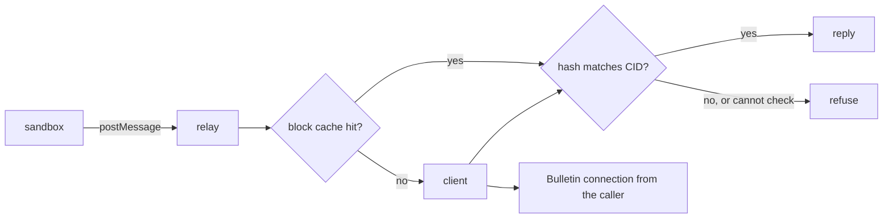

# `@dotli/bitswap`

## Overview

Fetches single blocks from the Bulletin Chain, and relays a sandbox frame's block requests to the host.

## Responsibilities

- **Owns:** the `bitswap_v1_get` client, the host-side relay with content progress, and the per-block check on the
  Bitswap path.
- **Does not own:** the hash functions, the block cache or the light client.

## Public API

### `@dotli/bitswap`

| Export                                         | What it does                                  |
| ---------------------------------------------- | --------------------------------------------- |
| `createBitswapClient(params)`, `BitswapClient` | A client over the caller's Bulletin provider. |
| `createSandboxBlockRelay`, `SandboxBlockRelay` | The host-side relay.                          |
| `BlockCache`                                   | The block cache the relay takes.              |
| `BlockOrigin`                                  | `cache` or `network`.                         |
| `ContentProgress`                              | Bytes fetched, total and speed.               |

## Design

- **Every block is checked:** from cache or network, against its CID. A block that cannot be checked is refused.
- **Connection:** the caller gives it. The client holds it while fetches run and closes it after the last one.
- **Retries:** within a total time budget. "Block not found" is retried a few times. Other errors are terminal.
- **Sharing:** a second request for the same CID waits on the first.
- **Host holds blocks:** the sandbox's credentialless origin loses its storage on reload.
- **Progress:** totals come from a hand-decoded dag-pb root, to keep the decoder out of the eager bundle.
- **Errors:** carry stable names, since the sandbox rebuilds them across `postMessage`.
