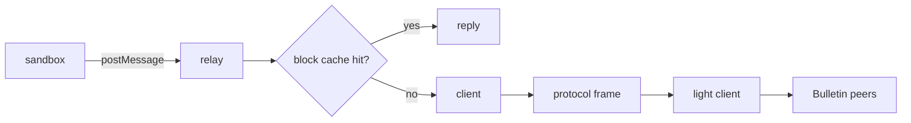

# `@dotli/bitswap`

Fetches single blocks from the Bulletin Chain through the light client, and relays a sandbox frame's block requests to
the host.

## Responsibility

- Owns the `bitswap_v1_get` client: one connection, retries and same-CID request sharing.
- Owns the host side relay that serves sandbox block requests and reports content progress.
- Does not own hash verification, the block cache or the light client.

## Design

- The client keeps one Bulletin connection to the protocol frame, redialled after a halt. Retryable errors go through
  `createAsyncTaskPool` within a total time budget. A "block not found" answer is retried a few times because it only
  means the connected peers lacked the block. Other errors are terminal. A second request for the same CID waits on the
  first.
- The page has one client, built on first use over the protocol frame's remote chain provider.
- The relay listens on the host's sandbox channel. It takes the cache and the client through `SandboxBlockRelayDeps` and
  tags each block with its `BlockOrigin`. The host holds the blocks because the sandbox's credentialless origin loses
  its storage on reload.
- Progress totals come from a hand-decoded dag-pb root that sums link sizes, which keeps the `@ipld/dag-pb` decoder out
  of the eager host bundle.
- Errors carry stable names. The sandbox rebuilds errors by name across `postMessage`, so callers branch on
  `error.name`.

## Public API

### `@dotli/bitswap`

- Client: `bitswapGet`.
- Relay: `createSandboxBlockRelay`, `SandboxBlockRelay`, `SandboxBlockRelayDeps`, `BlockCache`, `BlockOrigin`,
  `ContentProgress`.
