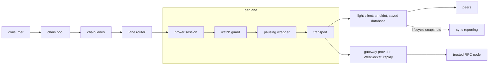

# `@dotli/chains`

## Overview

Connects to the chains dotli reads. Holds the in-browser light client and the gateway providers. Also holds the chain
pool.

## Responsibilities

- **Owns** the smoldot light client and its saved database. It also owns the client's sync reporting.
- **Owns** the gateway mode providers over trusted RPC nodes.
- **Owns** the chain pool and what it runs on:
  - its lanes
  - its JSON-RPC broker
  - the watch guard
- **Owns** the byte meter for the chains' inbound traffic, and the error a halted chain answers with.
- **Does not own** what is read over a chain, or the connections the host reaches through the protocol frame.

## Public API

### `@dotli/chains`

| Export                                                                                      | What it does                       |
| ------------------------------------------------------------------------------------------- | ---------------------------------- |
| `createLightClient`, `createLightClientDeps`, `LightClient`, `LightClientDeps`              | The context's light client.        |
| `LightClientStatus`, `LightClientChange`, `SmoldotDbChain`, `SmoldotDbOutcome`              | Its state and database outcomes.   |
| `SMOLDOT_DB_NAME`                                                                           | Its saved database's name.         |
| `chainSync`, `ChainDetail`, `ChainPeer`, `ChainSyncEvent`, `ChainSyncKind`                  | Sync reporting.                    |
| `byteMeter`                                                                                 | Inbound byte count.                |
| `createCoreRpcChainTransport`, `isCoreRpcChainSupported`, `getConnectedAssetHubRpcEndpoint` | Gateway chains.                    |
| `ChainTransport`, `ChainTransportHooks`, `ConnectionStatus`, `RPC_FOLLOW_LIMIT`             | Transport types and follow limit.  |
| `createChainPool`, `ChainPool`, `ChainPoolControl`, `ChainPoolWatcher`, `ChainActivity`     | The chain pool.                    |
| `requireBrokerLocalProvider`, `ChainBrokerManager`, `StringJsonRpcConnection`               | A provider leased from the broker. |
| `ChainHaltError`, `getHaltReason`, `RemoteChainHalt`, `createChainHaltedError`              | Chain halts.                       |
| `createJsonRpcError`                                                                        | Every transport's error answer.    |
| `loadProvider`                                                                              | Lazy loader of the light client.   |

### `@dotli/chains/testing`

`FakeWebSocket`: a WebSocket fake for tests.

## Design

- **Light client:** one per context. Its database is saved per genesis hash, so a repeat visit skips the checkpoint
  sync.
- **Gateway providers:** reconnect and replay subscriptions. They never import smoldot.
- **Pool:** each lease is a consumer. A chain closes after its last lease, or at once when it halts.
- **Healing:** a local lease takes the rebuilt chain after a halt. A remote session ends and hears why.
- **Lanes:** each lane is one connection. Follows spread across lanes to stay under the transport's follow limit. A halt
  of any lane halts the chain.
- **Pause:** closes every connection and keeps every lease. Sessions above stay connected.
- **Broker:** shares one connection between JSON-RPC sessions. Each session owns its own upstream follow. A halt is
  final.
- **Watch guard:** ends transaction watches a disconnect drops, so a replay never resubmits them.
- **Byte meter:** wraps the socket constructors, since resource timing misses WebSocket and WebRTC. Install it before
  any socket opens.
- **Lazy loading:** the light client is heavy and loads through `loadProvider`. The entry is pure re-exports.
- **Fixed config only:** the light client and sync reporting also run in a worker, so they read only the fixed services
  config. Lint enforces it.
- **Halt modules** import nothing that loads the pool, so an eager client can take them.
