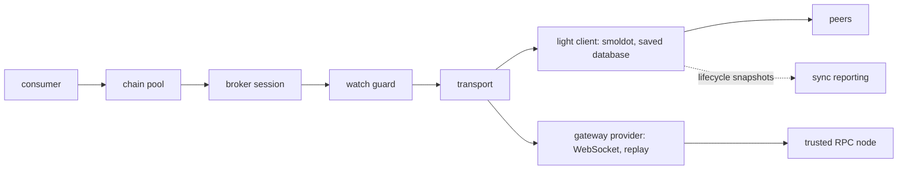

# `@dotli/chains`

Connects to the chains dotli reads: the in-browser light client, the gateway providers over trusted RPC nodes, and the
pool that shares one connection per chain among its consumers.

## Responsibility

- Owns the light client built on smoldot, its saved database and its sync reporting.
- Owns the gateway mode chain providers over trusted RPC nodes.
- Owns the byte meter that counts the chains' inbound traffic.
- Owns the chain pool, its JSON-RPC broker and the watch guard, and the marker a halted chain answers with.
- Does not own what is read over a chain, names or blocks. Does not own the connections the host reaches through the
  protocol frame.

## Design

- One light client runs per context. It takes its storage and hooks through `LightClientDeps` and publishes its state as
  `LightClientStatus`. Finalized database blobs are kept per genesis hash so a repeat visit skips the checkpoint sync.
- Sync reporting turns the provider's lifecycle snapshots into the milestones and peer details the loading screen and
  the network panel show.
- Gateway providers reconnect their WebSocket and replay subscriptions. They never import smoldot. They report status
  and halt through shared `ChainTransportHooks`.
- The chain pool holds one connection per chain in a JS context, over whichever transport it is given. Each lease is a
  broker session. An entry closes after its last lease is released, and at once when its transport halts. A watcher sees
  each held chain's activity and best block.
- The broker multiplexes JSON-RPC sessions over one connection. Every request it sends upstream with an id has one owner
  its answer goes to: a session, a shared follow, a release the broker sent itself, or a session that left, whose
  answered subscription is released at once. A follow the node refuses is answered to every session waiting on it, and
  the next follow asks afresh. The watch guard ends transaction watches that a disconnect drops, so a replay never
  resubmits them.
- Identical follows share one upstream follow. Its snapshot keeps the newest finalized block, every unfinalized block
  above it, forks included, and the best block, so a session that joins late is replayed from it. A block is unpinned
  upstream only once no session and no snapshot holds it.
- A request a halted chain leaves unanswered gets a marked error, and a typed error says whether the chain or the whole
  frame stopped. The halt module imports nothing, so an eager client takes it without the broker.
- The byte meter wraps the socket constructors, since resource timing misses WebSocket and WebRTC. It is installed
  before any socket opens.
- The light client is heavy, so it loads through a lazy loader. The entry is pure re-exports. The light client and its
  sync reporting read only the fixed services config, because they also run in a worker that the runtime network config
  never reaches. Lint enforces it for both.

## Public API

### `@dotli/chains`

- Light client: `createLightClient`, `lightClientDeps`, `LightClient`, `LightClientDeps`, `LightClientStatus`,
  `LightClientChange`, `SmoldotDbChain`, `SmoldotDbOutcome`.
- Sync and metering: `enableSyncReporting`, `onChainSync`, `onChainDetail`, `chainBytesReceived`, `installByteMeter`,
  `ChainDetail`, `ChainPeer`, `ChainSyncEvent`, `ChainSyncKind`.
- Gateway chains: `createCoreRpcChainProvider`, `getConnectedAssetHubRpcEndpoint`, `isCoreRpcChainSupported`,
  `ChainTransportHooks`, `ConnectionStatus`.
- Chain pool: `createChainPool`, `ChainPool`, `ChainPoolWatcher`, `LeaseProvider`, `ChainActivity`,
  `requireBrokerLocalProvider`, `ChainBrokerManager`, `StringJsonRpcConnection`.
- Chain halt: `ChainHaltError`, `chainHaltedError`, `haltReasonOf`, `CHAIN_HALTED_ERROR_DATA`, `RemoteChainHalt`.
- Lazy loader: `loadProvider`.

### `@dotli/chains/testing`

- `FakeWebSocket`.
