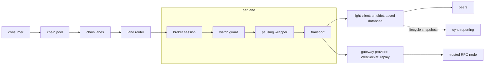

# `@dotli/chains`

Connects to the chains dotli reads: the in-browser light client, the gateway providers over trusted RPC nodes, and the
pool that shares each chain's connections among its consumers.

## Responsibility

- Owns the light client built on smoldot, its saved database and its sync reporting.
- Owns the gateway mode chain providers over trusted RPC nodes.
- Owns the byte meter that counts the chains' inbound traffic.
- Owns the chain pool, its lanes, its JSON-RPC broker and the watch guard, and the error a halted chain answers with.
  The marker that error carries is a shared wire constant.
- Does not own what is read over a chain, names or blocks. Does not own the connections the host reaches through the
  protocol frame.

## Design

- One light client runs per context. It takes its storage and hooks through `LightClientDeps` and publishes its state as
  `LightClientStatus`. Finalized database blobs are kept per genesis hash so a repeat visit skips the checkpoint sync. A
  chain opened while the light client starts reads its blob while the engine loads.
- Sync reporting turns the provider's lifecycle snapshots into the milestones and peer details the loading screen and
  the network panel show. A chain's sync is kept per chain across the connections that report it, and a late subscriber
  replays the chain's current run only.
- Gateway providers reconnect their WebSocket and replay subscriptions. They never import smoldot. They report status
  and halt through shared `ChainTransportHooks`.
- The chain pool holds each chain's connections in a JS context, over whichever transport it is given. Each lease is a
  consumer of the chain. An entry closes after its last lease is released, and at once when it halts. A local lease then
  heals: it takes the rebuilt chain behind the pool's redial gates, one per chain and one for the protocol frame. A
  remote session ends at its chain's halt and hears why. A remote session whose chain halts while it opens is refused
  with the halt as the cause. A chain whose teardown fails is reported, and the pool still closes the others. A watcher
  sees each held chain's activity and best block. A follow the node refuses is tried again behind the redial backoff
  while the chain is held.
- Each chain's leases spread over lanes, each its own connection from the chain's transport. A consumer has a home lane
  for every request that names no follow. A follow goes to a lane with room under the transport's follow limit, and the
  follow's later calls go after it. Lane 0 lasts as long as the chain, and every other lane closes once empty. A halt of
  any lane halts the chain.
- The pool pauses and resumes its chains at once, keeping every lease. A pausing wrapper under each lane's watch guard
  closes its connection on a pause and opens it again on a resume, while the sessions above stay connected. A chain
  built while paused starts closed. A resume retries a connection whose reopening failed. A resume leaves a chain that
  only waits out its destroy delay closed until a lease takes it. A chain that fails to pause or resume is reported and
  halted, and the pool goes on with the others. A lease that finds its chain failing to reopen gets a chain built in its
  place.
- The broker multiplexes JSON-RPC sessions over one connection. Each request it sends upstream with an id has one owner,
  which gets the answer: a session, a release the broker sent itself, or a session that left, whose answered
  subscription is released at once. Events the node still sends for a subscription that is being released, by the broker
  itself or by the last session that held it, are dropped quietly. A follow the node refuses is answered to its session.
  A halt is final: a session that opens after it, or while the upstream opens, is never served, and the upstream it
  opened is closed. The broker counts the follows its node may hold and knows the tokens it issued, so the chain's lanes
  can keep each connection under its follow limit. The watch guard ends transaction watches that a disconnect drops, so
  a replay never resubmits them.
- Each session's follow is its own upstream follow, owned by its session like any subscription, so its events, unpins
  and unfollow go to and from the node for that session alone.
- A request a halted chain leaves unanswered gets a marked error, and a typed error says whether the chain or the whole
  frame stopped. The halt modules import nothing that loads the pool, so an eager client takes them without the broker.
- The byte meter wraps the socket constructors of its own global scope, a page or a worker, since resource timing misses
  WebSocket and WebRTC. It patches on its first `install`, never at import, and is installed before any socket opens.
- The light client is heavy, so it loads through a lazy loader, whose namespace also carries `chainSync`, so a context
  that loads the light client lazily keeps sync reporting off its boot path. The entry is pure re-exports. The light
  client and its sync reporting read only the fixed services config, because they also run in a worker that the runtime
  network config never reaches. Lint enforces it for both.

## Public API

### `@dotli/chains`

- Light client: `createLightClient`, `createLightClientDeps`, `LightClient`, `LightClientDeps`, `LightClientStatus`,
  `LightClientChange`, `SmoldotDbChain`, `SmoldotDbOutcome`, and `SMOLDOT_DB_NAME`, the name of the database that
  warm-starts them.
- Sync and metering: `chainSync`, the context's sync reporting (`enableSyncReporting`, `onChainSync`, `onChainDetail`),
  `byteMeter` (`install`, `readBytesReceived`), `ChainDetail`, `ChainPeer`, `ChainSyncEvent`, `ChainSyncKind`.
- Gateway chains: `createCoreRpcChainTransport`, `getConnectedAssetHubRpcEndpoint`, `isCoreRpcChainSupported`,
  `ChainTransportHooks`, `ConnectionStatus`.
- Chain pool: `createChainPool`, `ChainPool`, `ChainPoolControl`, `ChainPoolWatcher`, `ChainActivity`,
  `requireBrokerLocalProvider`, `ChainBrokerManager`, `StringJsonRpcConnection`, `ChainTransport`, `RPC_FOLLOW_LIMIT`.
- Chain halt: `ChainHaltError`, `createChainHaltedError`, `getHaltReason`, `RemoteChainHalt`, and `createJsonRpcError`,
  the error answer every chain transport sends.
- Lazy loader: `loadProvider`.

### `@dotli/chains/testing`

- `FakeWebSocket`.
