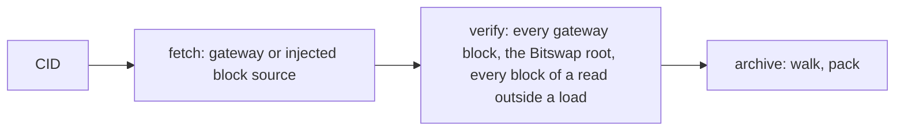

# `@dotli/content`

Fetches a product's files by CID and proves they match the CID. No gateway or peer is trusted.

## Responsibility

- **Owns:** fetching from a gateway or a block source, walking the UnixFS DAG, packing files, hash checks, decryption.
- **Does not own:** block transport over the light client, or the block cache.

## Design

- **One source per fetch:** gateway or Bitswap, never a fallback. Bitswap is passed in as a block-fetching function.
- **Gateway:** the network is passed in, the page's own by default. A stalled, oversized or unreachable gateway fails
  with a named error, so the visitor can retry.
- **Who hashes:** this package checks every gateway block. On a product load over Bitswap, the host's block relay checks
  every block and this package re-hashes only the root. Any other Bitswap read is checked here block by block.
- **Archive:** CAR files and UnixFS directories, plain or HAMT-sharded. A file must match its declared size.
- **Decryption:** ChaCha20-Poly1305, in the layout external tooling writes.
- **Errors:** rebuilt across `postMessage`, so callers branch on `error.name`.
- **Bundling:** the entry is pure re-exports. The hash code loads lazily through `loadVerify`.

## Public API

### `@dotli/content`

| Export                          | What it does                                                         |
| ------------------------------- | -------------------------------------------------------------------- |
| `fetchArchive`                  | Fetches a CID's files over Bitswap or the gateway.                   |
| `fetchFromIpfs`                 | Fetches one raw block from a gateway, unverified.                    |
| `parseIpfsResponse`             | Turns a gateway response into `ArchiveFiles`.                        |
| `readArchiveFiles`              | Reads a CID's files outside a product load.                          |
| `packArchive`                   | Packs `ArchiveFiles` into one buffer plus an offset index.           |
| `ArchiveFiles`, `FetchResult`   | A path to bytes map, and a fetch's result.                           |
| `CONTENT_ERRORS`                | Names of the verification, gateway and wrong-password errors.        |
| `isEncrypted`, `decryptContent` | Detect and decrypt encrypted content.                                |
| `createCidFromHash`             | The raw-codec CIDv1 of a hex blake2b-256 hash.                       |
| `loadVerify`                    | Loads `assertBlockMatchesCid` and `isBlockMatchingCid` on first use. |
