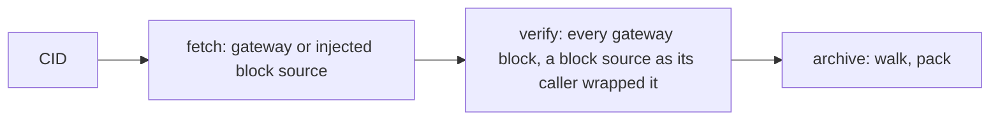

# `@dotli/content`

## Overview

Fetches a product's files by CID and proves they match the CID. No gateway or peer is trusted.

## Responsibilities

- **Owns:**
  - fetching from a gateway or a block source
  - walking the UnixFS DAG
  - packing files
  - hash checks
  - decryption
- **Does not own:** block transport over the light client, or the block cache.

## Public API

### `@dotli/content`

| Export                           | What it does                                                                 |
| -------------------------------- | ---------------------------------------------------------------------------- |
| `readArchive`                    | Reads a CID's files over a block source or the gateway, measured on request. |
| `ArchiveTransport`               | Where a read's blocks come from: a block source or the gateway.              |
| `fetchFromIpfs`                  | Fetches one raw block from a gateway, unverified.                            |
| `parseIpfsResponse`              | Turns a gateway response into `ArchiveFiles`.                                |
| `packArchive`                    | Packs `ArchiveFiles` into one buffer plus an offset index.                   |
| `ArchiveFiles`, `FetchResult`    | A path to bytes map, and a fetch's result.                                   |
| `CONTENT_ERRORS`                 | Names of the verification and gateway errors. A wrong password has its own.  |
| `isEncrypted`, `decryptContent`  | Detect and decrypt encrypted content.                                        |
| `createCidFromHash`              | The raw-codec CIDv1 of a hex blake2b-256 hash.                               |
| `loadVerify`                     | Loads `assertBlockMatchesCid` and `isBlockMatchingCid` on first use.         |
| `createVerifyingBlockSource`     | Wraps a block source so every block it returns is hashed against its CID.    |
| `createRootVerifyingBlockSource` | Wraps a block source so only the root block is hashed.                       |

## Design

- **One source per fetch:** gateway or Bitswap, never a fallback. Bitswap is passed in as a block-fetching function.
- **Measuring:** a read records no metrics unless its caller asks. A product load asks, and its read then records the
  timers, marks and distributions that measure the load. Its failure log tells a frame's teardown from a real failure.
- **Gateway:** the network is passed in, the page's own by default. A stalled, oversized or unreachable gateway fails
  with a named error, so the visitor can retry.
- **Who hashes:** the read checks every gateway block, since the gateway is untrusted. It does not check a block
  source's blocks. The caller knows how far it trusts its source, so it wraps the source with the exported check that
  fits: every block, or the root alone when a relay upstream already checked every block.
- **Archive:** CAR files and UnixFS directories, plain or HAMT-sharded. A file must match its declared size.
- **Decryption:** ChaCha20-Poly1305, in the layout external tooling writes.
- **Errors:** rebuilt across `postMessage`, so callers branch on `error.name`.
- **Bundling:** the entry is pure re-exports. The hash code loads lazily through `loadVerify`.
