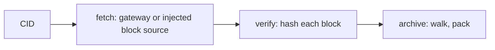

# `@dotli/content`

Fetches a product's files by CID and proves they are the content the CID names, so an untrusted gateway or peer is never
in the trust path.

## Responsibility

- Owns fetching from an IPFS gateway or from a block source, walking the UnixFS DAG and packing the files.
- Owns hash verification of every block against its CID, and decryption of encrypted content.
- Does not own block transport over the light client or the block cache.

## Design

- Fetching picks one source and never falls back from one to the other. The Bitswap source is passed in as a
  block-fetching function, so this package does not import the transport.
- The gateway path calls the active network's gateway and fetches a CAR or raw bytes.
- Verification recomputes each block hash (sha2-256 or blake2b-256) and throws `ContentVerificationError`. Gateway
  content is verified block by block. Content from the Bitswap source is verified at the root only, since that transport
  already checks every block.
- The archive step reads CAR files and UnixFS directories into `ArchiveFiles`, a path to bytes map.
- Decryption handles content in the layout external tooling writes, with ChaCha20-Poly1305.
- Error names are kept apart from the code that throws them. Callers branch on `error.name`, since errors are rebuilt
  across `postMessage`.
- The entry is pure re-exports so the bundler drops unused ones. Fetch and verify pull the DAG and hash code, so the
  host's eager path loads them through lazy loaders.

## Public API

### `@dotli/content`

- Fetch and archive: `fetchFromIpfs`, `packArchive`, `parseIpfsResponse`, `ArchiveFiles`, `FetchResult`.
- Verification: `assertBlockMatchesCid`, `CONTENT_ERRORS`.
- Encryption and CIDs: `isEncrypted`, `decryptContent`, `hashToCid`.
- Lazy loaders: `loadFetch` and `loadVerify` load the fetch and verify modules on first use.
