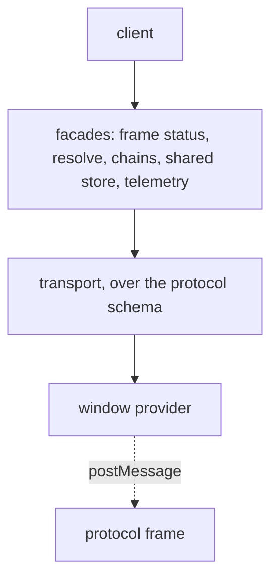

# `@dotli/protocol`

The host page's client for the hidden protocol frame, the origin that runs the light client and the shared store. It
turns postMessage traffic into promises, streams and remote chain connections.

## Responsibility

- The protocol iframe lifecycle: boot on demand, status, rebuild when lost.
- Typed requests to the frame: resolving a `.dot` name and its manifests, remote chain connections, the shared store of
  auth, mode and local wallet.
- Telemetry the frame reports: chain sync, peers, traffic and the light client's saved database.
- Not the frame's own code, name resolution logic, the chain pool, the light client or the halt marker.

## Design

- The page speaks to the frame through the transport library, over the protocol schema. The library owns the framing,
  the handshake, the queue, the request and subscription ids and the strict decoding. This package owns the schema, the
  frame's lifecycle, the facades and how every outcome reaches host code.
- The protocol schema is where the wire types come from. It groups the methods into traits: the frame, name resolution,
  the shared store, the local wallet and chains. Each method declares its kind (request or subscription) and its
  payloads, and each handshake's hello has a resolution id field, null from the host and the page load's id from the
  iframe toward the SharedWorker. Each payload is typed by its method, so a payload, answer or value that does not fit
  its method fails to compile. Its value codecs are built from the protocol's own checked codecs and cross the package
  only as opaque values.
- A remote failure the host branches on is a typed error in the schema: the frame status ends as fatal, as a failed
  init, as a released port or as a version mismatch, and name resolution and chain connections fail with a sync timeout
  or a stopped light client. A telemetry event past the limits, such as the peer count limit, fails to decode, so it is
  refused as malformed.
- Every integer goes through a codec that throws on a value it cannot carry exactly, and a payload that is truncated,
  has trailing bytes, names an unknown variant or holds an option or bool byte other than 0 or 1 fails to decode.
- Every method keeps one name for the metrics, the trail, the budgets and the errors, the flat name it had before the
  methods were grouped into traits, such as `resolveOwner` or `authStorageRead`, so dashboards read on unchanged.
- The frame module creates the iframe, publishes a `ProtocolStatus` (`idle`, `booting`, `listening`, `ready`, `failed`)
  and owns one provider and one transport per iframe. The window provider admits only bytes from that iframe's window at
  the frame's origin. It rebuilds itself when lost, after a backoff that grows while rebuilds keep failing, and a
  request while it is down boots one at once. Boot is deduped with a task pool. It is configured with the backend, and
  names it in its URL in the frame's own words, which a host page of an earlier release still sends.
- The facades are the host's parts written against the transport: name resolution, remote chains, the shared store and
  telemetry. The client factory builds them and returns them as one object. The page's instance is `protocolClient()`,
  built on first use, and callers reach every request through it.
- A request has a budget per method. No deadline crosses the wire, so the frame sizes its own work from the same
  budgets. A shared store request's budget runs from the call. A chain or resolve request's runs once the frame is
  ready, since it also waits for the light client. A request that outlives its budget is given up on the host and its
  late answer is ignored, with no cancel on the wire, while a subscription given up is stopped in the frame.
- A request is timed and counted from when it goes out after the handshake, on a monotonic clock. One whose budget runs
  out before it goes out is counted as a timeout. A boot that fails is otherwise counted once, as the frame's.

### How outcomes reach host code

Each outcome becomes the error host code has always seen, so the error screen, the metrics and the trail stay as they
were.

- A typed failure becomes its class or its name: a fatal, a failed init, a released port and a version mismatch become
  `ProtocolFatalError`, `ProtocolInitFailedError`, `ProtocolPortReleasedError` and `ProtocolVersionMismatchError`, and a
  sync timeout and a stopped light client become a `ProtocolRequestError` named `NetworkSyncTimeoutError` and
  `ApiStoppedError`.
- A handler's own failure crosses as its name and message only, and becomes a `ProtocolRequestError` under that name. A
  request's bare `Error` is named `ProtocolResponseError`, so it still reads as one that crossed the boundary.
- A refusal, a method the frame does not serve and a call it cannot read become a `ProtocolRequestError` named `Denied`,
  `Unsupported` and `MalformedFrame`. A request given up on its budget fails with its timeout.
- A transport that closes rejects every request and ends every subscription with why: the frame's loss itself, or a
  handshake that timed out or met another version, which become `ProtocolHandshakeTimeoutError` and
  `ProtocolVersionMismatchError`.
- A subscription the host holds hears one end, the frame's or the closed transport's, and a listener that throws is
  reported while the others still hear it.

### Handshake and queue

- The host opens the handshake when the iframe has loaded, and repeats it on a short interval until the frame answers.
  `listening` is a completed handshake. Its hello carries no resolution id, since the frame reads that from its URL.
- A call made before the handshake succeeds waits and goes out once it does, in call order. A call given up, or a
  subscription stopped, while it waits is never sent.
- A handshake that does not succeed in time fails with a timeout, measured on a clock that does not run while the page
  is frozen. When it fails, every queued call fails with the reason.

### Frame loss and version mismatch

- A lost frame disposes its transport with the loss as the reason. Every call in flight rejects with it and every open
  subscription ends with it, so a remote chain connection hears that the frame stopped. The transport goes before the
  iframe, so the frame still hears each subscription stop. The frame is then rebuilt.
- A call made while the frame is down waits for the next transport.
- A version mismatch is final. A rebuild cannot fix it and a reload can, so the frame moves to `failed`, stops
  rebuilding, and rejects every waiting and later call with `ProtocolVersionMismatchError`.
- A frame rebuilt while an app is open can come from a newer release and refuse the page's wire. The client's
  `onProtocolVersionMismatch` hears that once, and at once for a listener that subscribes after it, so the host can
  replace the open app with its reload screen.
- A boot that fails is counted under the frame's ready metric with the step that failed, and logged. A fatal light
  client or a failed init ends the frame status subscription with that error.
- A frame lost after it was ready is counted once under its own frame lost metric with the error's name, and logged.
  Only the first such loss since the last frame that stayed ready for 30 seconds is captured, so a frame that keeps
  dying soon after ready does not flood the error tracker. A tab the SharedWorker let go of while it was frozen finds
  its port released when it thaws, which is expected, so that loss is counted and left in the trail but not captured.

### Held feeds

- The host holds the shared auth changes and the telemetry for as long as anyone listens. The frame ends either only
  when it fails, so an end on a frame that stays up is counted and logged, captured once per held feed, and reopened on
  the same transport.
- The reopen waits 1 second, doubling after each end on the same frame up to 30 seconds. A feed that stayed open for 30
  seconds before it ended starts the waits over.
- An end is judged after the first wait, so a frame that counts its loss meanwhile is not reported. The frame's loss
  ends the feed for good, since whoever follows the frame opens it on the next one.

### Refused messages

A message from the frame that cannot be decoded, or does not fit the call it names, is dropped, counted once with its
reason (malformed or invalid) and side, and logged once with what failed. Data from the frame that is not bytes is
counted as not bytes, since only a frame of an earlier release sends it, once, whether the provider or the transport
drops it. A message the provider could not post is captured, logged and counted, with its call's name when it belonged
to one. A late answer to a call that is no longer waiting is ignored without a count.

### Shared store and chains

- Shared store keys are named in one place, and only allowed origins may use them.
- A remote chain connection answers a request its chain halted under with the chain pool's halt marker, and tells its
  consumer whether the chain or the whole frame stopped. A connection its consumer leaves before it connects settles as
  a disconnect, and a chain message that cannot be parsed is reported, counted and dropped.
- A name resolution is unsubscribed as soon as its result arrives, so the frame stops it whether or not it ends it.

## Public API

### `@dotli/protocol`

- Client: `protocolClient` (the page's client, built on first use: frame, resolution, remote chains, shared store and
  telemetry as one object), `ProtocolClient`, `ProtocolFrameConfig`, `ProtocolStatus`, `getProtocolOrigin`.
- Remote chains: `isRemoteChainSupported`, `isRemoteChainConnectable`, `RemoteChainProvider`.
- Shared store: `SharedStoreStatus`, `SHARED_CORE_SESSION_KEY`, the key helpers `buildSharedAuthStorageKey`,
  `buildSharedModeStorageKey`, `isValidSharedAuthKey`, `isValidSharedModeKey`, and the request guards
  `isSharedAuthOriginAllowed`, `isSharedAuthSiteId` and `isSharedModeRequestMethod`, which tells the mode store's
  methods from the rest of the storage trait.
- Local wallet: `LocalWalletIdentity`, `LocalWalletReadResult` (a read's `status`: `none`, `unreadable`, or `ok` with
  the entropy and the cached identity).
- The protocol as a transport schema: `protocolSchema`, its traits `frame`, `resolve`, `storage`, `wallet` and `chain`,
  with the resolution hello and the typed failures of the frame status, the resolve methods and chain connections.
  `ProtocolSchema`, `ProtocolTransport` and `ProtocolContext` type a transport over it and its handlers' context.
  `FrameFailure` and `RemoteFailure` are its typed failures, and `SubscriptionStart` and `SubscriptionValue` what a
  subscription starts with and sends. `TelemetryEvent` is what the frame reports on its telemetry feed.
- Budgets, for the frame to size its own work: `budgetOf` (a method's budget by its trait and method, or null for one
  waited on without a timer), `CONNECT_BUDGET_MS` and `RESOLVE_BUDGET_MS`.
- For the frame, which serves the schema and waits on or relays another frame's calls: `callName` and `CallName` (a
  method's one name for metrics, the trail and spans), the two sides of a failure's crossing, `frameStatusEnd` (how a
  frame ends its status on an error), `fromTransportError` (a transport's closing error under the protocol's class) and
  `remoteFailureOf` (the typed failure of a resolver or chain error, or null) beside `failureOf` (a call's failure as
  the error host code sees, by its trait and method), and `createIssueReporter` (what a transport cannot handle itself,
  counted and logged under the side that reports it, as the host's own transport is).
- Frame and errors: `backendOfFrameMode`, `ProtocolFatalError`, `ProtocolInitFailedError`, `ProtocolPortReleasedError`,
  `ProtocolVersionMismatchError`.

### `@dotli/protocol/testing`

Test-only, for functional tests that read the protocol frame's traffic in a real page. Never imported by shipped code.

- `describeWireMessage`: a wire message as its trait, method, leg, id and decoded body, with bytes as hex, or null for
  data that does not decode as one. The trait and method are the schema's names, such as `frame` and `status`, and the
  leg is the transport's: `request`, `response`, `start`, `receive`, `interrupt` or `stop`. An answer or an interrupt
  reads as its outcome, so the frame status ending as fatal is `{ ok: false, error: { tag: 'Domain', value } }` with the
  `fatal` failure as its value.
- `DescribedWireMessage`: the type of what `describeWireMessage` returns.
