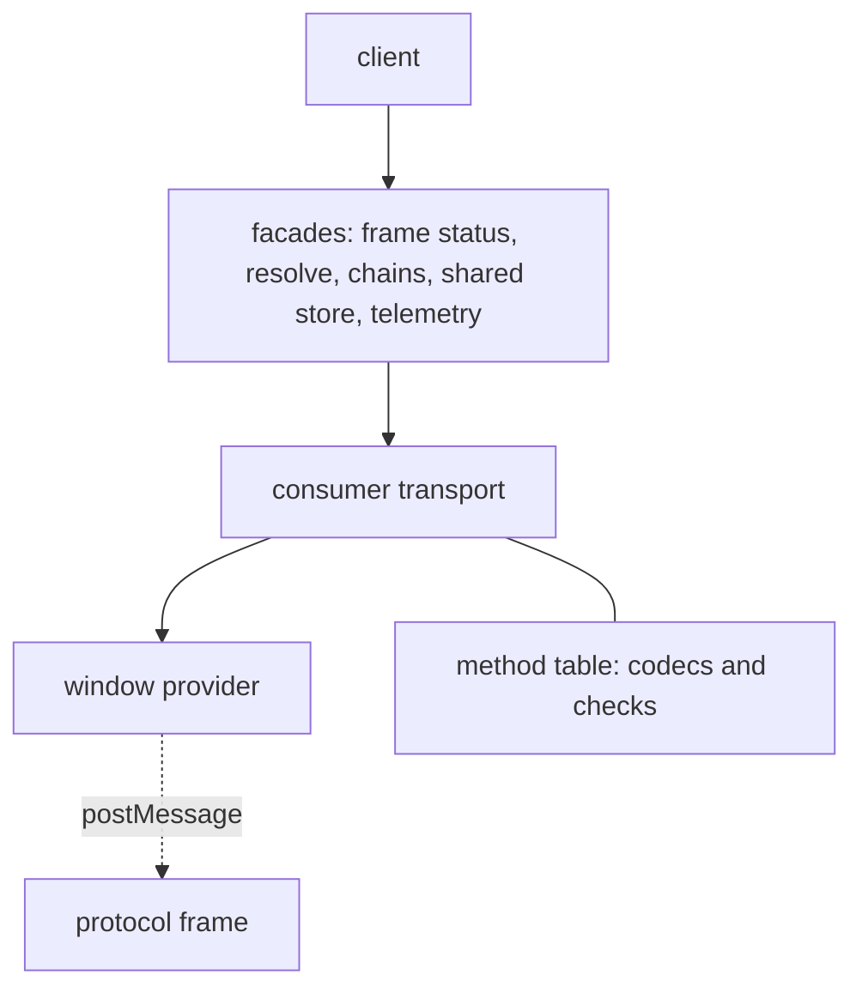

# `@dotli/protocol`

The host page's client for the hidden protocol frame, the origin that runs the light client and the shared store. It
turns postMessage traffic into promises, streams and remote chain connections.

## Responsibility

- The protocol iframe lifecycle: boot on demand, status, rebuild when lost.
- Typed requests to the frame: resolving a `.dot` name and its manifests, remote chain connections, the shared store of
  auth, mode and local wallet.
- Telemetry the frame reports: chain sync, peers, traffic and the light client's saved database.
- Not the frame's own code, name resolution logic, the chain pool, the light client or the halt marker.

## Design

- The provider moves bytes and nothing else. The window provider admits only `ArrayBuffer` data from one window and one
  origin, and posts to that window at that origin. Given a predicate, it locks to the first admitted origin that sends
  bytes, so other data from an admitted origin never locks it. It tells its owner of data from its peer that is not
  bytes, and of bytes from any window at an origin it does not admit, so a page outside the trust boundary that tries
  the wire is seen. The port provider wraps a `MessagePort`, and closes it on dispose unless its owner keeps that for
  itself.
- A provider holds nothing for a listener yet to come, so its owner subscribes in the turn that creates it. Once
  disposed it delivers nothing, not even the rest of a message it was delivering, and a listener added then hears
  nothing.
- The transport owns the framing, the request and subscription ids, the handshake, the queue and the matching of answers
  and events. One transport is bound to one provider for its whole life, and disposing it ends everything on it. The two
  ends share the framing and the receiving: a consumer side that calls and a serving side that handles.
- The method table is the one source of every wire type. Each method declares its kind (request or subscription) and its
  codecs, and holds the checks a codec cannot express, such as the peer count limit. Every message is encoded with SCALE
  codecs and sent as a transferred `ArrayBuffer`. Each leg is typed by its method, so a payload, answer or event that
  does not fit its method fails to compile. Codecs, the table and the framing never leave the package, so callers see
  only typed requests and subscriptions.
- Every integer goes through a codec that throws on a value it cannot carry exactly, and a message that is truncated,
  has trailing bytes, names an unknown variant or holds an option or bool byte other than 0 or 1 fails to decode.
- The frame module creates the iframe, publishes a `ProtocolStatus` (`idle`, `booting`, `listening`, `ready`, `failed`)
  and owns one provider and one transport per iframe. It rebuilds itself when lost, after a backoff that grows while
  rebuilds keep failing, and a request while it is down boots one at once. Boot is deduped with a task pool. It is
  configured with the backend, and names it in its URL in the frame's own words, which a host page of an earlier release
  still sends.
- The facades are the host's parts written against the transport: name resolution, remote chains, the shared store and
  telemetry. The client factory builds them and returns them as one object. The page's instance is `protocolClient()`,
  built on first use, and callers reach every request through it.
- A call can carry an abort signal. A request given up this way is dropped locally and no cancel goes over the wire,
  while a subscription is unsubscribed. It rejects, or its subscription ends, with the signal's reason itself when that
  is an error, and wraps any other reason.
- A request has a budget per method. A shared store request's budget runs from the call. A chain or resolve request's
  runs once the frame is ready, since it also waits for the light client.
- A request is timed and counted from when it goes out after the handshake, on a monotonic clock. One whose budget runs
  out before it goes out is counted as a timeout. A boot that fails is otherwise counted once, as the frame's.
- A listener's error, for an event or an end the consumer hears or a stop function the serving side runs, goes to the
  transport's `report` option, so the others still run.

### Handshake and queue

- The consumer sends a handshake with its wire version and repeats it on a short interval until the serving side
  answers. The first answer wins and a repeat is harmless. The handshake starts when the iframe has loaded, and
  `listening` is a completed handshake.
- A call made before the handshake succeeds waits in a task pool and is sent once it does, in call order and ahead of
  any call made after. The pool is unbounded, so calls run side by side once the handshake is done. Every post encodes a
  fresh buffer, since a transferred buffer is detached. A call given up, or a subscription unsubscribed, while it waits
  is never sent.
- A handshake that does not succeed in time fails with a timeout, measured on a clock that does not run while the page
  is frozen. When it fails, every queued call rejects and every queued subscription ends with the reason.
- The serving side answers a call for a method it does not handle with an error at once.
- The serving side never throws into a handler. An answer, event or end its provider cannot post is captured, logged and
  counted. An answer that settles after the serving side was disposed is logged and never posted. The ends it posts as
  it disposes go unreported, since the peer may already be gone.
- The serving side's `onPeerIdle` hears a peer that left. A live peer keeps at least one subscription open, so when the
  peer's own unsubscribe leaves nothing running and no call of its is in flight, the peer has disposed its transport. A
  call the peer makes after that cancels it, and an end the serving side posted never counts, since the peer may not
  have heard it.

### Frame loss and version mismatch

- A lost frame disposes its transport with the loss as the reason. Every call in flight rejects with it and every open
  subscription ends with it, so a remote chain connection hears that the frame stopped. The frame is then rebuilt.
- A call made while the frame is down waits for the next transport.
- A version mismatch is final. A rebuild cannot fix it and a reload can, so the frame moves to `failed`, stops
  rebuilding, and rejects every waiting and later call with `ProtocolVersionMismatchError`.
- A frame rebuilt while an app is open can come from a newer release and refuse the page's wire. The client's
  `onProtocolVersionMismatch` hears that once, and at once for a listener that subscribes after it, so the host can
  replace the open app with its reload screen.
- A boot that fails is counted under the frame's ready metric with the step that failed, and logged. A fatal light
  client or a failed init ends the frame status subscription with that error.
- A frame lost after it was ready is counted once under its own frame lost metric with the error's name, captured and
  logged. A tab the SharedWorker let go of while it was frozen finds its port released when it thaws, which is expected,
  so that loss is counted and left in the trail but not captured.

### Held feeds

- The host holds the shared auth changes and the telemetry for as long as anyone listens. The frame ends either only
  when it fails, so an end on a frame that stays up is counted and logged, captured once per held feed, and reopened on
  the same transport.
- The reopen waits 1 second, doubling after each end on the same frame up to 30 seconds. A feed that stayed open for 30
  seconds before it ended starts the waits over.
- An end is judged after the first wait, so a frame that counts its loss meanwhile is not reported. The frame's loss
  ends the feed for good, since whoever follows the frame opens it on the next one.

### Refused messages

A message that cannot be decoded, or fails a check of its method, is dropped, counted once with its reason (malformed or
invalid) and logged once with what failed. Data that is not an `ArrayBuffer` is dropped too. The frame's provider facing
its parent counts it as not bytes, since only a host page of an earlier release sends it there, while the other
providers drop it without a count. These are ignored without a count: an answer for a call that is no longer waiting, an
unsubscribe for a subscription that already ended, and a repeat handshake answer.

### Shared store and chains

- Shared store keys are named in one place, and only allowed origins may use them.
- A remote chain connection answers a request its chain halted under with the chain pool's halt marker, and tells its
  consumer whether the chain or the whole frame stopped. A connection its consumer leaves before it connects settles as
  a disconnect, and a chain message that cannot be parsed is reported, counted and dropped.
- A name resolution is unsubscribed as soon as its result arrives, so the frame stops it whether or not it ends it.

## Public API

### `@dotli/protocol`

- Client: `protocolClient` (the page's client, built on first use: frame, resolution, remote chains, shared store and
  telemetry as one object), `ProtocolClient`, `ProtocolFrameConfig`, `ProtocolStatus`, `getProtocolOrigin`.
- Remote chains: `isRemoteChainSupported`, `isRemoteChainConnectable`, `RemoteChainProvider`.
- Shared store: `SharedStoreStatus`, `SharedWalletRequestMethod`, `SHARED_CORE_SESSION_KEY`, the key helpers
  `buildSharedAuthStorageKey`, `buildSharedModeStorageKey`, `isValidSharedAuthKey`, `isValidSharedModeKey`, and the
  request guards `isSharedAuthOriginAllowed`, `isSharedAuthSiteId`, `isSharedAuthRequestMethod`,
  `isSharedModeRequestMethod`, `isSharedWalletRequestMethod`.
- Local wallet: `LocalWalletIdentity`, `LocalWalletReadResult` (a read's `status`: `none`, `unreadable`, or `ok` with
  the entropy and the cached identity).
- Transport, for the frame app: `createConsumerTransport`, `createServingTransport` (with `onPeerIdle`),
  `ConsumerTransport`, `ServingTransport`, `CallContext`, `RequestHandler`, `SubscriptionHandler`, `SubscriptionSink`.
- Providers: `createWindowProvider` (with `onNotBytes` and `onRefusedOrigin` for what it drops), `createPortProvider`.
- Method names and their types: `RequestMethod`, `SubscriptionMethod`, `RequestPayload`, `SubscribePayload`, `Answer`,
  `SubscriptionEvent`, `TelemetryEvent`.
- Frame and errors: `backendOfFrameMode`, `ProtocolFatalError`, `ProtocolInitFailedError`, `ProtocolPortReleasedError`,
  `ProtocolVersionMismatchError`.

### `@dotli/protocol/testing`

Test-only, for functional tests that read the protocol frame's traffic in a real page. Never imported by shipped code.

- `describeWireMessage`: a wire message as its method, leg, id and body, with bytes as hex, or null for data that does
  not decode as one.
- `DescribedWireMessage`: the type of what `describeWireMessage` returns.
