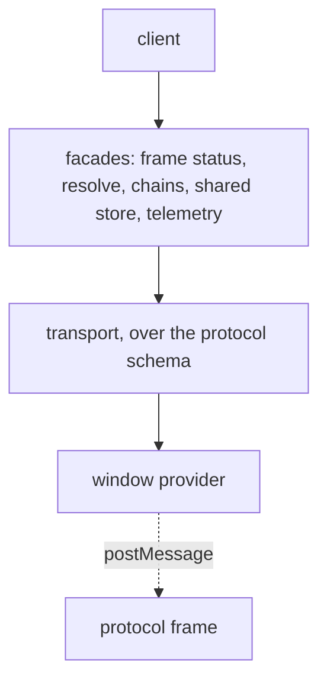

# `@dotli/protocol`

## Overview

The host page's client for the hidden protocol frame. The frame is the page at `/p/` on the root domain. It runs the
light client and the shared store. This package turns its postMessage traffic into promises and streams. It also opens
remote chain connections over it.

## Responsibilities

**Owns:**

- The protocol iframe lifecycle:
  - boot on demand
  - status
  - rebuild when lost
- Typed requests to the frame:
  - name and manifest resolution
  - remote chains
  - auth and mode in the shared store
  - the local wallet in the shared store
- Telemetry from the frame:
  - chain sync
  - peers
  - traffic
  - the light client's saved database

**Does not own:**

- the frame's own code
- name resolution logic
- the chain pool
- the light client
- the halt marker

## Public API

One entry, `@dotli/protocol`.

| Export                                                                         | What it does                                        |
| ------------------------------------------------------------------------------ | --------------------------------------------------- |
| `getProtocolClient`, `ProtocolClient`                                          | The page's client.                                  |
| `ProtocolFrameConfig`, `ProtocolStatus`, `isFrameDown`                         | Frame config and status. Whether the frame is down. |
| `ProtocolFatalError`, `ProtocolInitFailedError`                                | Frame errors.                                       |
| `ProtocolPortReleasedError`, `ProtocolVersionMismatchError`                    | Frame errors.                                       |
| `getProtocolOrigin`                                                            | The frame's origin.                                 |
| `getBackendOfFrameMode`                                                        | The backend a frame URL's mode names.               |
| `isRemoteChainSupported`, `isRemoteChainConnectable`, `RemoteChainProvider`    | Remote chain checks and connection.                 |
| `SharedStoreStatus`                                                            | The shared store's status.                          |
| `SHARED_CORE_SESSION_KEY`, `SHARED_AUTH_KEY_PREFIX`, `SHARED_MODE_KEY_PREFIX`  | Store key names.                                    |
| `buildSharedAuthStorageKey`, `buildSharedModeStorageKey`                       | Build a store key.                                  |
| `isValidSharedAuthKey`, `isValidSharedModeKey`                                 | Check a store key.                                  |
| `isSharedAuthOriginAllowed`, `isSharedAuthSiteId`, `isSharedModeRequestMethod` | Request guards.                                     |
| `LocalWalletIdentity`, `LocalWalletRead`, `LocalWalletReadResult`              | Local wallet types.                                 |
| `isLocalWalletEntropy`, `isLocalWalletIdentity`                                | Check a wallet that did not pass the codec.         |
| `protocolSchema`, `ProtocolSchema`, `ProtocolHello`                            | The transport schema.                               |
| `ProtocolTransport`, `ProtocolContext`, `ProtocolServing`, `ProtocolHandler`   | A transport over the schema, and handlers.          |
| `FrameFailure`, `RemoteFailure`, `DomainFailure`, `SubscriptionEnd`            | Typed failures and subscription ends.               |
| `SharedAuthChange`, `TelemetryEvent`                                           | What the auth and telemetry feeds send.             |
| `createEndListeners`                                                           | Joins a subscription's `interrupt` and `fail`.      |

For the frame, which serves the schema and relays calls:

| Export                                                                  | What it does                                                 |
| ----------------------------------------------------------------------- | ------------------------------------------------------------ |
| `getPolicy`, `MethodPolicy`, `getBudget`                                | A method's policy and budget.                                |
| `getCallName`, `CallName`                                               | A method's name for metrics and the trail. Spans use it too. |
| `createFrameStatus`, `FrameStatus`, `FrameStatusSink`, `FrameStatusEnd` | The `frame.status` subscription a frame serves.              |
| `toFrameStatusEnd`, `toRemoteEnd`                                       | End a status or a call on an error.                          |
| `fromTransportError`, `getFailure`                                      | Map errors to the protocol's classes.                        |
| `createWireReport`                                                      | Hooks that count and log refused wire messages.              |

## Design

- **The transport library owns:**
  - framing and the handshake
  - the queue and ids
  - decoding
- **This package owns:**
  - the schema and the frame's lifecycle
  - the facades
  - how each outcome reaches host code
- **Schema:** the one source of wire types. The `frame`, `resolve`, `storage`, `wallet` and `chain` sections divide it.
  A payload that does not fit its method fails to compile. Codecs are scale-ts.
- **Typed failures:** a remote failure the host branches on is typed in the schema. A subscription ends as truapi's
  `Result<(), CallError>`, so a relaying frame can pass a failure on as its own.
- **Method policy:** one record per method holds its metric name and budget. It also says whether the method is traced,
  and whether the frame answers it before the light client is ready. Metric names keep the old flat names, so dashboards
  keep working.
- **One client:** `getProtocolClient()` builds on first use. `frame`, `sharedStore`, `sharedAuth`, `sharedMode`,
  `sharedWallet`, `resolve`, `telemetry` and `chains` are the entities it returns. Every request goes through it.
- **Status:** the frame's `ProtocolStatus` (`idle`, `booting`, `listening`, `ready`, `failed`) is one nanostores atom.
  The shared store's status is a `computed` over it, correct with no listener.

### Frame

- **Origin:** the root domain's. On a local root (`localhost`, or `local.host` in a development build) it is the page's
  scheme there, with the dev port in development and the page's port otherwise.
- **Window check:** host pages share the frame's origin, so the provider admits only bytes from the iframe's window.
- **Boot:** on demand, deduped with a task pool. The transport is built only after the iframe loads.
- **Handshake:** retried for 5 s, on a clock that stops while the page is frozen. Calls queue until it succeeds, then go
  out in order. `listening` means it completed.
- **Rebuild:** a lost frame is rebuilt with a growing backoff. Its calls reject and its subscriptions end with the loss.
- **Held for the store:** a frame whose light client failed to start still serves shared store calls. Chain and resolve
  calls reject at once.
- **Heartbeat:** a shared store call that times out makes the host ping the frame once. No answer means a lost frame.
- **Network pause:** `chains` sends it to the ready frame and each later one, and never boots a frame for it. A frame in
  SharedWorker mode forwards it to the worker.

### Budgets

- Each method has a budget. No deadline crosses the wire, so the frame sizes its own work from the same budgets.
- A shared store budget runs from the call. A chain or resolve budget runs from frame ready.
- A request past its budget is dropped on the host, with no cancel sent. A dropped subscription is stopped in the frame.

### Version mismatch

- The wire has a version. A cached older shell meets the reload screen instead of writing data in an old shape.
- A mismatch is final. The frame goes `failed`, stops rebuilding and rejects every call with
  `ProtocolVersionMismatchError`.
- A frame rebuilt from a newer release while an app is open fires `frame.subscribeVersionMismatch`, so the host can show
  its reload screen.

### Errors host code sees

Each outcome becomes the error host code always saw, so the error screen, metrics and trail stay the same.

| Outcome                              | Error                                                                        |
| ------------------------------------ | ---------------------------------------------------------------------------- |
| Fatal, failed init, released port    | `ProtocolFatalError`, `ProtocolInitFailedError`, `ProtocolPortReleasedError` |
| Version mismatch                     | `ProtocolVersionMismatchError`                                               |
| Handshake timeout                    | `ProtocolHandshakeTimeoutError`                                              |
| Sync timeout, stopped light client   | `ProtocolRequestError` named `NetworkSyncTimeoutError`, `ApiStoppedError`    |
| Handler's own failure                | `ProtocolRequestError` under its name                                        |
| Refused, unserved or unreadable call | `ProtocolRequestError` named `Denied`, `Unsupported`, `MalformedFrame`       |

### Reporting

- A frame lost after ready is captured once per 30 seconds of stable ready, so a crash loop does not flood the error
  tracker.
- A port the SharedWorker released while the tab was frozen is expected. It is counted, not captured.
- A message that fails to decode is dropped and counted with its reason. It is logged once.

### Held feeds

- Shared auth changes are held while anyone listens. Telemetry is held for the page's life.
- An end on a live frame is reported, and the feed reopens after 1 s, doubling up to 30 s.

### Shared store

- **Allowed origins:** host or landing pages on the root domain or a subdomain, never a product's sandbox. A production
  build trusts only `localhost` as a local root, never the public `local.host`.
- **Safari trap:** under a product, Safari gives the frame that product's own copy of the store. Other browsers share
  one. The host keeps the copies in step, outside this package.
- **Compare-and-clear:** `sharedAuth.clearIf` and `sharedWallet.forgetIf` clear only if the value or version still
  matches, so another tab's newer write survives.
- **Change feed:** a `session` change carries a key and value. A `wallet` change says a site's local wallet changed.
