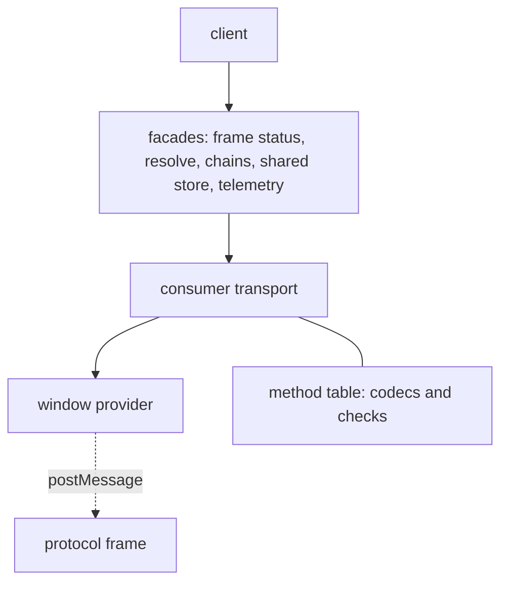

# `@dotli/protocol`

The host page's client for the hidden protocol frame, the origin that runs the light client and the shared store. It
turns postMessage traffic into promises, streams and remote chain connections.

## Responsibility

- The protocol iframe lifecycle: boot on demand, status, rebuild when lost.
- Typed requests to the frame: resolving a `.dot` name and its manifests, remote chain connections, the shared store of
  auth, mode and local wallet.
- Telemetry the frame reports: chain sync, peers, traffic and the light client's saved database.
- Not the frame's own code, name resolution logic, the chain pool, the light client or the halt marker.

## Design

- The provider moves bytes and nothing else. The window provider admits only `ArrayBuffer` data from one window and one
  origin, and posts to that window at that origin. The port provider wraps a `MessagePort`, and closes it on dispose
  unless its owner keeps that for itself.
- The transport owns the framing, the request and subscription ids, the handshake, the queue and the matching of answers
  and events. One transport is bound to one provider for its whole life, and disposing it ends everything on it. Both
  ends use the same module: a consumer side that calls and a serving side that handles.
- The method table is the one source of every wire type. Each method declares its kind (request or subscription) and its
  codecs, and holds the checks a codec cannot express, such as the peer count limit. Every message is a scale-ts codec
  sent as a transferred `ArrayBuffer`. Codecs, the table and the framing never leave the package, so callers see only
  typed requests and subscriptions.
- Every integer goes through a codec that throws on a value it cannot carry exactly, and a message that is truncated,
  has trailing bytes or names an unknown variant fails to decode.
- The frame module creates the iframe, publishes a `ProtocolStatus` (`idle`, `booting`, `listening`, `ready`, `failed`)
  and owns one provider and one transport per iframe. It rebuilds itself when lost, after a backoff that grows while
  rebuilds keep failing, and a request while it is down boots one at once. Boot is deduped with a task pool. It is
  configured with the backend, and names it in its URL in the frame's own words, which a host page of an earlier release
  still sends.
- The facades are the host's parts written against the transport: name resolution, remote chains, the shared store and
  telemetry. The client factory builds them and returns them as one object. The page's instance is `protocolClient()`,
  built on first use, and callers reach every request through it.
- A call can carry an abort signal. A call given up this way is dropped locally and no cancel goes over the wire.
- A request has a budget per method. A shared store request's budget runs from the call. A chain or resolve request's
  runs once the frame is ready, since it also waits for the light client.

### Handshake and queue

- The consumer sends a handshake with its wire version and repeats it on a short interval until the serving side
  answers. The first answer wins and a repeat is harmless. The handshake starts when the iframe has loaded, and
  `listening` is a completed handshake.
- A call made before the handshake succeeds is queued as a value and sent in call order once it does. Every post encodes
  a fresh buffer, since a transferred buffer is detached. A subscription unsubscribed while queued is never sent.
- A handshake that does not succeed in time fails with a timeout, measured on a clock that does not run while the page
  is frozen. When it fails, every queued call rejects and every queued subscription ends with the reason.
- The serving side answers a call for a method it does not handle with an error at once.

### Frame loss and version mismatch

- A lost frame disposes its transport with the loss as the reason. Every call in flight rejects with it and every open
  subscription ends with it, so a remote chain connection hears that the frame stopped. The frame is then rebuilt.
- A call made while the frame is down waits for the next transport.
- A version mismatch is final. A rebuild cannot fix it and a reload can, so the frame moves to `failed`, stops
  rebuilding, and rejects every waiting and later call with `ProtocolVersionMismatchError`.
- The frame's failures are reported with `captureException` and outcome metrics. A fatal light client or a failed init
  ends the frame status subscription with that error.

### Refused messages

A message that cannot be decoded, or fails a check of its method, is dropped and counted once with its reason
(malformed, invalid or not bytes). Data that is not an `ArrayBuffer` is counted only by the frame's provider facing its
parent. These are ignored without a count: an answer for a call that is no longer waiting, an unsubscribe for a
subscription that already ended, and a repeat handshake answer.

### Shared store and chains

- Shared store keys are named in one place, and only allowed origins may use them.
- A remote chain connection answers a request its chain halted under with the chain pool's halt marker, and tells its
  consumer whether the chain or the whole frame stopped.

## Public API

### `@dotli/protocol`

- Client: `protocolClient` (the page's client, built on first use: frame, resolution, remote chains, shared store and
  telemetry as one object), `ProtocolClient`, `ProtocolFrameConfig`, `ProtocolStatus`, `getProtocolOrigin`.
- Remote chains: `isRemoteChainSupported`, `isRemoteChainConnectable`, `RemoteChainProvider`.
- Shared store: `SharedStoreStatus`, `SharedWalletRequestMethod`, `SHARED_CORE_SESSION_KEY`, the key helpers
  `buildSharedAuthStorageKey`, `buildSharedModeStorageKey`, `isValidSharedAuthKey`, `isValidSharedModeKey`, and the
  request guards `isSharedAuthOriginAllowed`, `isSharedAuthSiteId`, `isSharedAuthRequestMethod`,
  `isSharedModeRequestMethod`, `isSharedWalletRequestMethod`.
- Local wallet: `LocalWalletIdentity`, `LocalWalletReadResult`.
- Transport, for the frame app: `createConsumerTransport`, `createServingTransport`, `ConsumerTransport`,
  `ServingTransport`, `CallContext`, `RequestHandler`, `SubscriptionHandler`, `SubscriptionSink`.
- Providers: `createWindowProvider`, `createPortProvider`.
- Method names and their types: `RequestMethod`, `SubscriptionMethod`, `RequestPayload`, `SubscribePayload`, `Answer`,
  `SubscriptionEvent`, `TelemetryEvent`.
- Frame and errors: `backendOfFrameMode`, `ProtocolFatalError`, `ProtocolInitFailedError`, `ProtocolPortReleasedError`,
  `ProtocolVersionMismatchError`.

### `@dotli/protocol/testing`

Test-only, for functional tests that fake the protocol frame and read its traffic in a real page. Never imported by
shipped code.

- `describeWireMessage`: a wire message as its method, leg, id and body, with bytes as hex, or null for data that does
  not decode as one.
- `createServingTransport` and `createWindowProvider`, so a page-side test bundle serves the host from this one entry.
