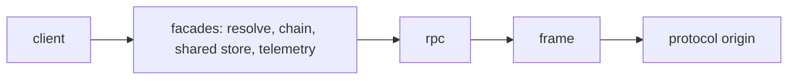

# `@dotli/protocol`

The host page's client for the hidden protocol frame, the origin that runs the light client and the shared store. It
turns postMessage traffic into promises, streams and remote chain connections.

## Responsibility

- The protocol iframe lifecycle: boot on demand, status, rebuild when lost.
- Typed requests to the frame: resolving a `.dot` name and its manifests, remote chain connections, the shared store of
  auth, mode and local wallet.
- Telemetry the frame reports: chain sync, peers, traffic and the light client's saved database.
- Not the frame's own code, name resolution logic, the chain pool, the light client or the halt marker.

## Design

- The frame module creates the iframe, publishes a `ProtocolStatus` (`idle`, `booting`, `listening`, `ready`, `failed`)
  and is the only listener for its messages. It rebuilds itself when lost, after a backoff that grows while rebuilds
  keep failing, and a request while it is down boots one at once. Boot is deduped with a task pool. It is configured
  with the backend, and names it in its URL in the frame's own words, which a host page of an earlier release still
  sends.
- The wire contract holds the envelope guards. Events pass an origin and source check, then a payload check.
- The rpc layer sends requests and matches answers, with a timeout per method.
- The client factory builds the frame, the rpc layer and the parts over them (resolution, remote chains, the shared
  store and telemetry) and returns them as one object. Its type is what the factory returns, so each request is declared
  once. The page's instance is `protocolClient()`, built on first use, and callers reach every request through it.
- Each request method has an answer type, so the rpc layer hands callers typed results. The only cast is where an answer
  arrives over `postMessage`.
- A remote chain connection answers a request its chain halted under with the chain pool's halt marker, and tells its
  consumer whether the chain or the whole frame stopped.
- Shared store keys are named in one place, and only allowed origins may use them.
- The frame's failures are reported with `captureException` and outcome metrics. Calls from several callers share one
  frame.

## Public API

### `@dotli/protocol`

- Client: `protocolClient` (the page's client, built on first use: frame, resolution, remote chains, shared store and
  telemetry as one object), `ProtocolClient`, `ProtocolFrameConfig`, `ProtocolStatus`, `getProtocolOrigin`.
- Remote chains: `isRemoteChainSupported`, `isRemoteChainConnectable`, `RemoteChainProvider`.
- Shared store: `SharedStoreStatus` and the key helpers `buildSharedAuthStorageKey`, `isSharedAuthOriginAllowed`,
  `isValidSharedAuthKey`, `SHARED_CORE_SESSION_KEY`.
- Wire and errors: `isProtocolEnvelope`, `ProtocolEnvelope`, `getRequestSyncTimeoutMs`, `backendOfFrameMode`,
  `ProtocolFatalError`, `ProtocolInitFailedError`.

There is no `testing` export.
