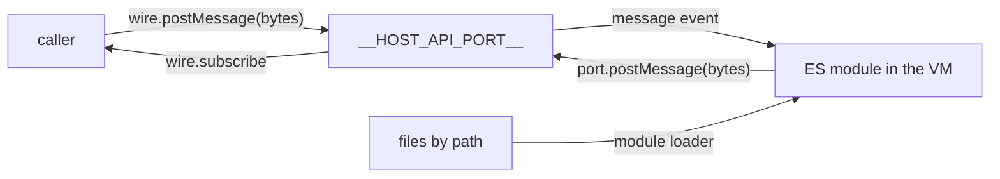

# `@dotli/quickjs-runtime`

## Overview

Runs an ES module in a QuickJS VM, on the release asyncify build of QuickJS. The module reaches its host through
`__HOST_API_PORT__`, a MessagePort-like object that carries bytes. The host holds the other end, the wire. The runtime
knows nothing of the host, products or TrUAPI. What the bytes mean is the caller's.

## Responsibilities

- **Owns:**
  - one VM and its own WebAssembly module, and freeing them
  - the host API port in the VM and the wire to it
  - the globals the VM's code reads: `__HOST_WEBVIEW_MARK__`, and `top` and `window` as the global object
  - the browser globals a worker script uses:
    - `console`
    - `TextEncoder` and `TextDecoder`
    - the timers and `queueMicrotask`
    - `crypto` and `CryptoKey`
  - loading the entrypoint and its imports from a map of files
- **Does not own:**
  - where the files come from
  - the protocol on the wire
  - where console output goes
  - which WebCrypto backs `crypto`

## Public API

| Export            | What it is                                      |
| ----------------- | ----------------------------------------------- |
| `createQuickJsVm` | Builds one VM, ready to run its entrypoint      |
| `QuickJsVm`       | What it builds                                  |
| `QuickJsVmParams` | Its options                                     |
| `ModuleFiles`     | The files: bytes by path                        |
| `ByteWire`        | The host's end of the port, which carries bytes |
| `ConsoleSink`     | What hears the VM's console calls               |
| `ConsoleLevel`    | The console method called                       |

`createQuickJsVm` options:

| Option       | Meaning                                                                           |
| ------------ | --------------------------------------------------------------------------------- |
| `files`      | The module files, by path                                                         |
| `entrypoint` | The path of the ES module that `run` evaluates                                    |
| `onError`    | Hears what goes wrong in the VM outside a run                                     |
| `onConsole`  | Hears each console call as its level and formatted message. The runtime logs none |
| `crypto`     | The WebCrypto behind the VM's `crypto`, such as the worker's own                  |
| `timers`     | The host timers behind the VM's timers. The page's own by default                 |

A `QuickJsVm` has:

- `wire`: `postMessage(bytes)` delivers a frame to the module's listeners, and `subscribe(listener)` hears each frame
  the module posts.
- `run()`: evaluates the entrypoint. It resolves once the module and its top-level await finish, and rejects with the
  VM's message when the module throws or an import is missing. A repeated call returns the first run.
- `dispose()`: clears the VM's timers, drops its crypto calls in flight, closes the port and frees the VM. Safe to call
  again.

## Design

- **One WebAssembly module per VM:** freeing a VM can abort its module when the VM's code still holds objects. The abort
  then ends that VM alone, and `dispose` reports it to `onError` rather than throwing.
- **Bytes are copied:** a frame is copied into the VM and out of it, so neither side can change what the other holds.
- **Jobs run after each frame:** the promise jobs the listeners queue run before `postMessage` returns.
- **Listeners:** the port takes `onmessage` and up to 32 `message` listeners. Adding one listener twice adds it once,
  told apart by the VM's own `===`. A listener past the cap is dropped and reported.
- **Imports:** a relative specifier resolves against the importing module's directory. Any other specifier is a path in
  the files as written. The loader answers at once, so the VM never suspends while it loads a module.
- **Browser marks:** `top` and `window` are the global object and cannot be replaced or deleted.
- **Jobs run after each callback:** a timer callback, a microtask and a settled crypto call each run the promise jobs
  they queued, as a frame does. A callback that throws, or a job after it that fails, reaches `onError`.
- **Timers:** a delay below 4 ms waits 4 ms, so zero-delay timers cannot flood the host. Timeouts and intervals share
  one set of ids, as in a browser. At most 1024 microtasks wait at once, and one past the cap is dropped and reported
  once a burst.
- **Console:** the first string argument takes the browser's format directives, and the rest join with spaces. Control
  characters other than tab and line feed become a replacement character, and a message past 64 KiB is cut.
- **Crypto:** `getRandomValues` and each `subtle` call run on the passed WebCrypto. A real key never enters the VM. The
  VM holds a frozen `CryptoKey` that names it, and the host drops the key once the VM collects that wrapper. A call that
  WebCrypto refuses rejects in the VM with WebCrypto's error name, such as `NotSupportedError`.
- **Host functions stay hidden:** a global built in the VM reaches its host functions through a closure, never through a
  global the VM's code could call.
