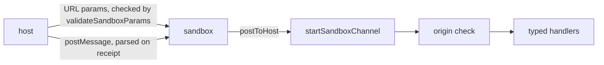

# `@dotli/sandbox-wire`

The protocol between the host and a sandbox frame: the URL params the host opens the sandbox with, every message the two
post to each other, and the host's one listener for that traffic.

## Responsibility

- Owns the param contract: the param names, the schema version and the sandbox's validation of what the host passes.
- Owns the message shapes in both directions, the checker build's violation report among them, and the parsers each side
  runs on what it receives.
- Owns the host's channel, which listens for sandbox messages once and hands typed messages to its consumers.
- Does not own what the messages carry out: the block relay, the product frame, the loading screen or the sandbox run.

## Design

- The host and the sandbox are separate origins that can run different releases for a while after a deploy, so the
  formats are additive. A change may add an optional field or a new message type, never rename or retype one.
- The sandbox cannot read the host's settings, so the host passes every decision as a URL param. The validator rejects
  any value it does not recognize instead of defaulting, and an absent required param is marked recoverable so the host
  can render the frame again.
- A new required param bumps `SANDBOX_SCHEMA_VERSION`, so a stale host cannot feed a fresh sandbox. An explicit version
  must match.
- Any frame or extension can post to a window, so each side parses what it receives and drops what does not parse.
- The host listens on one channel. It parses each message once, drops messages from untrusted origins and reports a
  handler that throws, so one consumer cannot break the others.
- The param names and the schema version import nothing, so tooling under Node can read them without the config barrel.

## Public API

### `@dotli/sandbox-wire`

- Param contract: `SANDBOX_SCHEMA_VERSION`, `SANDBOX_CONTRACT_PARAMS`, `validateSandboxParams`.
- Messages: `parseHostToSandboxMessage`, `postToHost`, `parseApiViolationMessage`, `ApiViolationMessage`,
  `SandboxToHostMessage` (each member named through `SandboxMessageOf`), `HostToSandboxMessage`, `BitswapResultMessage`.
- Channel: `startSandboxChannel`, `SandboxChannel`, `StartedSandboxChannel`, `SandboxChannelOptions`, `SandboxSender`,
  `SandboxMessageType`, `SandboxMessageOf`.
