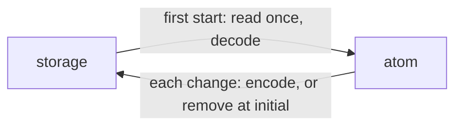

# `@dotli/stores-persistent`

Keeps a nanostores atom in web storage.

## Responsibility

- Owns `createPersistentAtom`, an atom that reads its stored value on first start and writes each change back.
- Does not own which values are kept, their formats or the storage itself. The caller passes the key, the storage and
  the codec.

## Design

- The atom is built from the initial value and reads nothing then, so a module may build it at import.
- The stored text is read and decoded once, on the first read, listen or set. Nothing stored, or text that decodes to
  `undefined`, gives the initial value. That read writes nothing back.
- A set before that read applies after it, so the caller's value wins over the stored one.
- Every change after that read is stored encoded. Setting the initial value removes the key, so a default is never
  stored.
- It does not follow the browser's `storage` event. Another tab's write shows when it came before this tab's first read,
  and after a reload otherwise. This page's next write replaces it.
- A storage that fails on every call leaves the atom working in memory. Pass a storage that never throws.

## Public API

- `createPersistentAtom({ key, storage, initial, decode, encode })` returns a writable atom whose `init` is `initial`.
  It reads the storage once, on the first read, listen or set. `decode` returns `undefined` for text that no longer
  parses, and `encode` turns a value into the stored text. It never throws when the storage, `decode` and `encode` never
  throw.
- `PersistentAtomParams`, the options `createPersistentAtom` takes.
