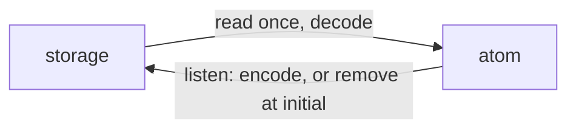

# `@dotli/stores-persistent`

Keeps a nanostores atom in web storage.

## Responsibility

- Owns `createPersistentAtom`, an atom that starts from its stored value and writes each change back.
- Does not own which values are kept, their formats or the storage itself. The caller passes the key, the storage and
  the codec.

## Design

- The stored text is read and decoded once when the atom is built. Nothing stored, or text that decodes to `undefined`,
  gives the initial value.
- Every write is stored encoded. Setting the initial value removes the key, so a default is never stored.
- It does not follow the browser's `storage` event. Another tab's write shows after a reload, and this page's next write
  replaces it.
- A storage that fails on every call leaves the atom working in memory. Pass a storage that never throws.

## Public API

- `createPersistentAtom({ key, storage, initial, decode, encode })` returns a writable atom. `decode` returns
  `undefined` for text that no longer parses, and `encode` defaults to `JSON.stringify`. It never throws when the
  storage, `decode` and `encode` never throw.
- `PersistentAtomParams`, the options `createPersistentAtom` takes.
