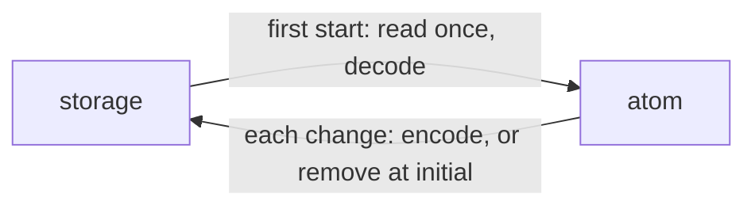

# `@dotli/stores-persistent`

## Overview

Keeps a nanostores atom in web storage.

## Responsibilities

- **Owns:** `createPersistentAtom`.
- **Does not own:** which values are kept, or their formats. Nor the storage, which the caller passes with a key and a
  codec.

## Public API

| Export                                                            | What it does                               |
| ----------------------------------------------------------------- | ------------------------------------------ |
| `createPersistentAtom({ key, storage, initial, decode, encode })` | A writable atom whose `init` is `initial`. |
| `PersistentAtomParams`                                            | Its options.                               |

`decode` returns `undefined` for text that no longer parses, which gives the initial value.

## Design

- **Lazy read:** building the atom reads nothing, so a module may build it at import. Storage is read once, on first
  use.
- **Caller wins:** a set before that read applies after it.
- **Defaults are not stored:** setting the initial value removes the key.
- **No cross-tab sync:** another tab's later write shows only after a reload.
- **Failing storage:** the atom keeps working in memory. Pass a storage that never throws.
