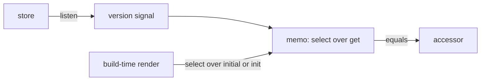

# `@dotli/stores-solid`

Reads a store in a Solid 2 component. The store is a nanostores store, or any source with its `get`, `listen` and
`init`.

## Responsibility

- Owns `useStore`, which turns a store into a Solid accessor that follows each write and stops listening when its owner
  is disposed.
- Owns the value an island shows at build time, before it hydrates.
- Does not own any store, nor how stores are built, written or kept.

## Design

- The accessor does not copy the value. A listener bumps a version signal, and a memo reads `get` and runs `select` once
  per write. The listener only bumps the signal, so it never throws into the store's own notification.
- A store notifies from whatever Solid owner its writer runs under, so the version signal opts out of Solid's
  owned-scope check.
- The accessor lags a synchronous write until Solid's next flush. A handler that acts on a value just written reads
  `get` itself.
- An island renders at build time, when nothing has written a store, and may hydrate after boot has written it. Until
  hydration completes the memo shows the build-time value: `select` over the reader's `initial` when it passed one, even
  a `null` or falsy one, and otherwise over the store's `init`. A store with no `init`, such as a computed, needs an
  `initial`.
- It imports no workspace package, so any layer that renders Solid can read its stores through it.

## Public API

- `useStore(store, { equals, initial })` returns an accessor of the whole value.
  `useStore(store, select, { equals, initial })` returns an accessor of the selected value. `equals` drops a rebuilt
  equal value, and `initial` stands in for the store's `init` at build time. Both throw outside a component or other
  reactive owner.
- `StoreSource`, the shape `useStore` reads: `get`, `listen` and an optional `init`.
- `UseStoreParams`, the options `useStore` takes.
