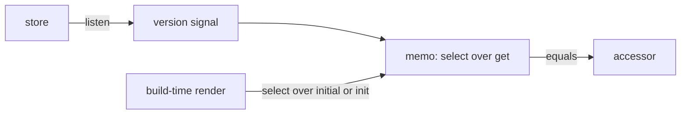

# `@dotli/stores-solid`

Reads a nanostores store, or any source with `get`, `listen` and `init`, in a Solid 2 component.

## Responsibility

- **Owns:** `useStore`, and the value an island shows at build time.
- **Does not own:** any store, or how stores are built or kept.

## Design

- **No copy:** a listener bumps a version signal. A memo reads `get` and runs `select`.
- **Lag:** the accessor updates on Solid's next flush. A handler that needs a value it just wrote reads `get`.
- **Build time:** until hydration, the value is `select` over `initial`, or else over the store's `init`. A store with
  no `init`, such as a computed, needs `initial`.
- **No workspace imports:** any layer that renders Solid can use it.

## Public API

| Export                                         | What it does                                     |
| ---------------------------------------------- | ------------------------------------------------ |
| `useStore(store, { equals, initial })`         | An accessor of the whole value.                  |
| `useStore(store, select, { equals, initial })` | An accessor of the selected value.               |
| `StoreSource`                                  | What `useStore` reads: `get`, `listen`, `init?`. |
| `UseStoreParams`                               | The options: `equals` and `initial`.             |

`useStore` throws outside a reactive owner.
