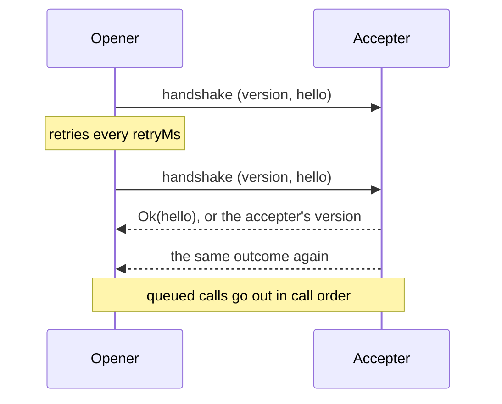
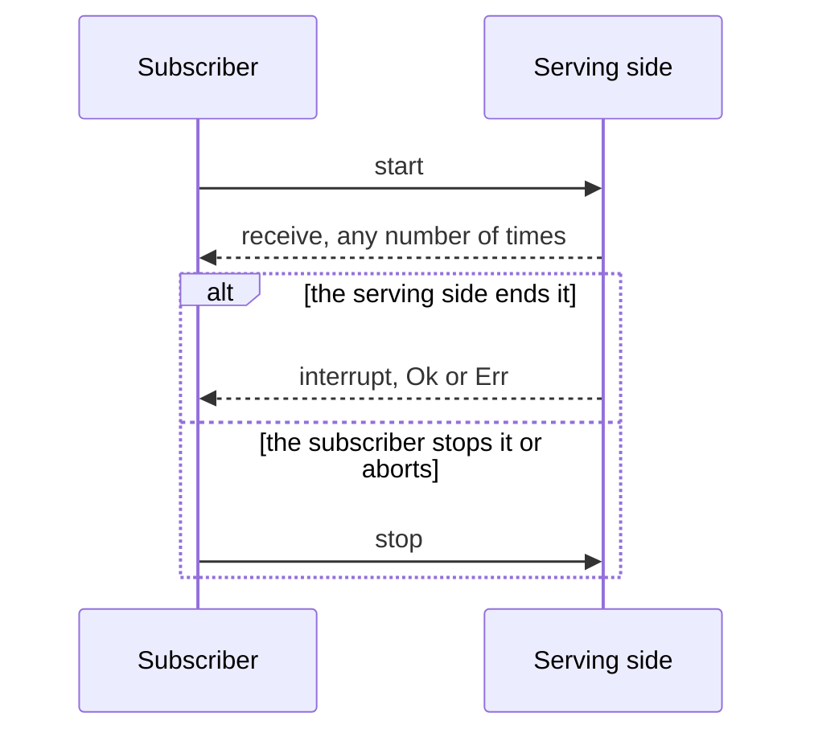

# @dotli/transport

A generic, bi-directional transport between documents. A schema author describes calls, streams and events in plain
TypeScript. The library moves them across a frame and owns correlation, cancellation and failure.

## Design

- A codec is an opaque value built from two plain functions, one that turns a value into bytes and one that turns bytes
  back. Inside, it is a SCALE codec, so the library composes it with its own. Code outside the library cannot read it,
  so the wire format stays a private detail.
- A schema nests traits, then methods, then a request or a subscription. A request carries one payload and is answered
  with a `Result`. A subscription starts with one payload, receives values, and ends with an interrupt that is a
  `Result` or with a stop that carries nothing. Each payload has its own codec.
- Wire ids are positions: a trait's id is its place in the schema and a method's id is its place in its trait. Defining
  the schema fixes them, so new traits and methods go at the end. A schema holds up to 255 traits of up to 256 methods
  each, since the library keeps one trait id for itself, and a version from 0 to 255.
- A trait or method name cannot be an integer such as `"3"`. JavaScript lists such keys first, so its id would not be
  its written place.
- The schema is opaque. Its names and payload types are read through type helpers, and nobody writes a type argument.
- A call returns a `Result`. Its error side is a `CallError`, tagged by `tag`: the handler's own `Domain` error, plus
  the library's `Denied`, `Unsupported`, `MalformedFrame`, `HostFailure` and `Cancelled`. `Cancelled` is raised by the
  caller's own side and never reaches a handler.
- A message is a SCALE codec composed from the schema. Its header is a struct of the request id (`u32`), the trait and
  method ids (`u8`) and the leg (an enum). Its body is the leg's codec: the payload for a request, a start or a value, a
  SCALE `Result` of the answer and a `CallError` for a response, a `Result` of nothing and a `CallError` for an
  interrupt, and nothing for a stop. `CallError` is a SCALE enum with its indices pinned, and a reason is a SCALE
  string. The payload always comes last, with no length prefix. Encoding is one pass of the composed codec. Decoding
  reads the header, then the body its target and leg name, on one cursor, and refuses a body that does not end where the
  message does. The user's decode gets a view of exactly the payload bytes, with no copy. The view shares the message's
  buffer at a non-zero offset, so a decode must respect `byteOffset` or copy the bytes first. A message for an address
  the schema lacks is still read as that address, so the receiver can answer it.
- The library keeps trait 255 for itself. Method 0 is the handshake, which carries the schema version and the hello, and
  method 255 is the protocol error that answers a message for an unknown address. Their layout never changes, so a peer
  of any release reads the version it refuses.
- A provider moves bytes between two contexts and knows nothing of their meaning. The window provider admits one peer
  window at a fixed origin, or at the first origin a predicate allows. The port provider speaks over a message port. Any
  object with the same four methods works.
- One transport serves every side, and both sides call and serve over it. One side opens the handshake and the other
  accepts it. The opener posts a fresh attempt every `retryMs` until it is answered or `timeoutMs` passes on the running
  clock. The accepter answers every attempt with the outcome of the first answer it could post, and counts as connected
  only once that answer is posted. A version mismatch closes both sides. A malformed handshake is refused with no
  answer.



- Calls made before the handshake wait in a queue and go out in call order once it succeeds, then run side by side. A
  call resolves to the peer's `Result`, or to `MalformedFrame` with the decode error's message when the peer's answer
  does not decode. Aborting its signal resolves it as `Cancelled`, whether it waits or is out, and a late answer is
  ignored. The peer is not told.
- A subscription waits in the same queue as the requests and goes out in call order with them. Its subscriber hears each
  value, then one end: the peer's interrupt, `Cancelled` once its signal aborts, `Unsupported` when the peer lacks the
  method, or `MalformedFrame` with the decode error's message when an interrupt or a value does not decode. A lost value
  ends the subscription, since the subscriber would fall behind the peer. Stopping it tells the peer and calls no
  listener. Aborting, a value that does not decode and a dispose tell the peer to stop too, once the start went out. A
  start that does not encode throws. `interrupt` hears only those ends. The one local end with an error goes to
  `onClose` instead: the transport closed, or the start could not be posted, whose error carries the provider's as its
  cause.



- A transport closes when the handshake fails or times out, the versions differ, or its owner disposes it. Every pending
  and later request then rejects with that error itself, and every subscription still queued or open hears it once
  through `onClose`, so a closed transport is never a call outcome. Disposing also interrupts each subscription this
  side serves with `HostFailure` carrying `"<name>: <message>"` of the reason, and tells the peer to stop each one it
  made.
- A subscription handler gets the start, the context and a sink, and returns its stop function. That function runs once,
  on the peer's stop, an interrupt or a dispose, even when the handler interrupts before it returns. An interrupt is
  posted before the stop function runs, so a stop function that disposes the transport cannot keep it from the peer. A
  handler that throws on start interrupts with `HostFailure`. A value the wire cannot carry interrupts with
  `HostFailure` with why. The sink does nothing once the subscription has ended. A start that reuses the id of a running
  subscription, or a stop that names another method than the subscription, is refused as `invalid` with no reply.
- `onPeerIdle` fires when the peer's own stop leaves nothing it opened running and no request of the peer is in flight,
  which is how a peer that disposes leaves. It fires once per departure. A call from the peer after that cancels a wait
  and arms it again, even a call whose payload does not decode or that names an address this side lacks. Interrupts this
  side posted never count, since the peer may not have heard them yet.
- The serving side answers outcomes of its own: `Unsupported` for a method with no handler, `MalformedFrame` with the
  decode error's message for a payload that does not decode, and `HostFailure` with `"<name>: <message>"`, bounded to
  500 characters, for a handler that throws or rejects or an answer the wire cannot carry. A message for an address the
  schema lacks gets one protocol error reply while the transport is open, and is refused after it closes. Nothing ever
  answers a protocol error or a refused message on the library's own addresses. A call (a request or a start) or a stop
  before the handshake, or after a failed one, is refused on its header alone with no reply, whether its payload decodes
  and whether the schema has its address or not. Such a stop never counts toward `onPeerIdle`.
- What the transport cannot handle itself goes to one issue hook: a refused message (`malformed`, `invalid` or
  `not_bytes`, with its cause), a post the provider threw on (with its error), and a callback of the owner's that threw
  (`listener_threw`: a subscription's listeners or `onClose`, a stop function, or `onPeerIdle`). A throw while a message
  is handled is reported as a refusal too and never reaches the provider, and neither does a throw from the hook itself,
  which is logged with the issue it was handed. With no hook, each issue is logged as one bounded error. Only expected
  messages are dropped without an issue: an answer or protocol error whose id names no waiting call, such as a late
  answer to a settled one, a handshake answer once the handshake is over, a stop for one of the last 1024 subscriptions
  this side ended, which may cross its interrupt, and a value or interrupt on one of the last 1024 subscriptions this
  side stopped, which may cross the stop. Any other such message cannot be a race and is refused as `invalid`: a value
  or interrupt on a subscription that is not open, such as one after the peer's own interrupt, and a stop for a
  subscription that is not running, such as one never started or stopped twice. That stop never counts toward
  `onPeerIdle`.

## Public API

### `.`

- `codec(encode, decode)` wraps two functions as a `Codec<T>`. `none` is the codec of an empty payload and refuses any
  byte on decode.
- `Result<T, E>` with `ok()` and `err(error)`.
- `CallError<E>` with the constructors `domain`, `denied`, `unsupported`, `malformedFrame`, `hostFailure` and
  `cancelled`. `hostFailure` takes a reason, or an `Error`, whose reason is the one a handler that throws it answers
  with, so a sink ends with a failure the caller reads as it would a throw.
- `request({ request, response, error? })` declares a request. `error` is the method's own error type and defaults to
  `never`. It returns a `RequestDef`.
- `subscription({ start, receive, interrupt? })` declares a subscription. `interrupt` is the method's own end reason and
  defaults to `never`. It returns a `SubscriptionDef`.
- `defineSchema({ version, hello?, traits })` checks the record, fixes the wire ids and returns a `Schema`. `hello` is
  the codec of the value each side sends in the handshake. It throws on a version outside 0 to 255, more than 255
  traits, more than 256 methods in a trait, or an integer-like trait or method name. `Traits` is the type of the record
  it takes.
- Type helpers over a schema `S`:
  - `TraitName<S>`, `MethodName<S, T>`, `RequestMethodName<S, T>` and `SubscriptionMethodName<S, T>` name its parts.
  - `MethodTypes<S, T, M>` is what each side of a method sends and receives. For a request of `P`, `R` and `E` it is
    `{ request: P; response: Result<R, CallError<E>> }`. For a subscription of `St`, `V` and `I` it is
    `{ start: St; receive: V; interrupt: Result<void, CallError<I>>; stop: void }`.
  - `DomainError<S, T, M>` is the method's own error, `E` or `I`.
  - `HelloOf<S>` is the handshake value, or `void` when the schema declares none.

- `createTransport(schema, provider, options)` returns a `Transport`. `TransportOptions`:
  - `handshake: 'open' | 'accept'` sets which side opens the handshake.
  - `hello`, this side's handshake value, required exactly when the schema declares one.
  - `retryMs` (50 by default) and `timeoutMs` (5000 by default) pace the opener.
  - `timers` replaces the page's clock and timers.
  - `onIssue(issue)` hears every `TransportIssue`: `{ kind: 'refused', reason, cause? }`,
    `{ kind: 'post_failed', error }` or `{ kind: 'listener_threw', error }`.
  - `onPeerIdle()` hears that the peer left, as described above.
- `Transport`:
  - `connect()` starts the handshake on the opener and does nothing on the accepter.
  - `whenConnected()` resolves once the handshake succeeds and rejects with the closing error.
  - `request(trait, method, payload, { signal? })` resolves to `Result<R, CallError<E>>`, the peer's or a local
    `Cancelled` or `MalformedFrame`. It rejects only with the closing error, or when the call cannot go out: a payload
    that does not encode or a post the provider throws on.
  - `handleRequest(trait, method, handler)` serves a method and returns what unregisters it. The handler gets the
    payload and a `CallContext` and returns a `Result`, sync or async. A second handler for one method throws.
  - `subscribe(trait, method, start, { receive, interrupt }, { signal? })` returns a `SubscriptionHandle`. `receive`
    hears each value and `interrupt` the one end, a `Result<void, CallError<I>>`. It throws when the start does not
    encode.
  - `SubscriptionHandle` has `stop()`, which tells the peer and calls no listener, and `onClose(listener)`. That is the
    handle's one local end with an `Error`: the transport closed while the subscription was queued or open, or its start
    could not be posted. It runs once, and at once if that has already happened, and never after a stop or an interrupt.
  - `handleSubscription(trait, method, handler)` serves a subscription method and returns what unregisters it. The
    handler gets the start, a `CallContext` and a `Sink`, and returns its stop function. A second handler for one method
    throws.
  - `Sink` has `receive(value)` and `interrupt(error?)`. With no argument the subscription ends cleanly, and an argument
    of any `CallError` variant ends it with `Err(error)`, so a relay passes a peer's outcome on unchanged.
  - `dispose(reason)` closes the transport with `reason`, interrupts what it serves, stops what it subscribed to and
    disposes the provider.
- `CallContext` is `{ origin, hello }`: the peer's origin from the provider, or null, and the peer's handshake hello.
  `RequestHandler` and `RequestOptions` name the handler and the call options. `SubscriptionHandler`,
  `SubscriptionListeners` and `SubscribeOptions` do the same for a subscription.
- `TransportHandshakeTimeoutError` closes an opener that heard no answer in time. `TransportVersionMismatchError` closes
  both sides of a mismatch and carries `ours` and `theirs`.
- `Provider` is `post(data)`, `subscribe(listener)`, `peerOrigin()` and `dispose()`. A provider holds nothing for a
  listener yet to come, and `post` transfers the buffer. `post` never delivers to the provider's own listeners before it
  returns, the peer's reply included, as `postMessage` and message ports do.
- `createWindowProvider({ listen, peer, origin, onNotBytes?, onRefusedOrigin? })` hears `listen` (a `MessageTarget`) and
  posts to `peer()`, a `WindowLike`. `origin` is fixed, or a predicate whose first origin to send bytes is locked.
  `onNotBytes` hears data from the admitted peer that is not bytes, and `onRefusedOrigin` hears bytes from an origin it
  does not admit. `WindowProviderDeps` names the argument.
- `createPortProvider(port, { closeOnDispose? })` speaks over a `PortLike`. Its peer origin is always null, and
  `closeOnDispose: false` leaves closing the port to its owner.

```ts
const schema = defineSchema({
  version: 1,
  traits: {
    names: {
      owner: request({ request: label, response: owner }),
      changes: subscription({ start: none, receive: change, interrupt: failure }),
    },
  },
});
```

### `./testing`

Test helpers for code that uses the library.

- `createProviderPair()` returns two connected providers, `left` and `right`, and the `delivered` buffers. They deliver
  on a microtask, in order, and detach each buffer as a browser transfer does.
- `describeMessage(schema, data)` reads a recorded message as `{ trait, method, leg, id, body }`. The body is the leg's
  decoded value, left as it is: a payload, an outcome, a handshake's `{ version, hello }`, or a protocol error's
  `{ trait, method }`. A library message or one for an address the schema lacks is named by its numeric ids, and the
  latter keeps its body as bytes. It throws on data the schema refuses, with the refusal as the cause.
