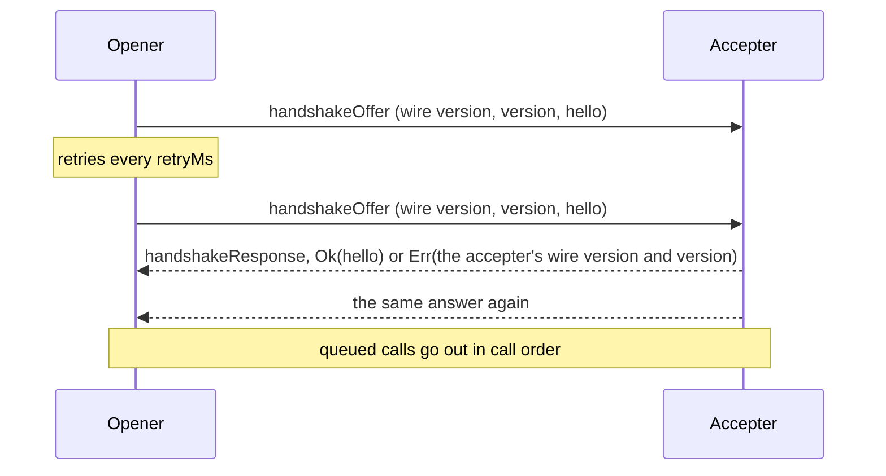
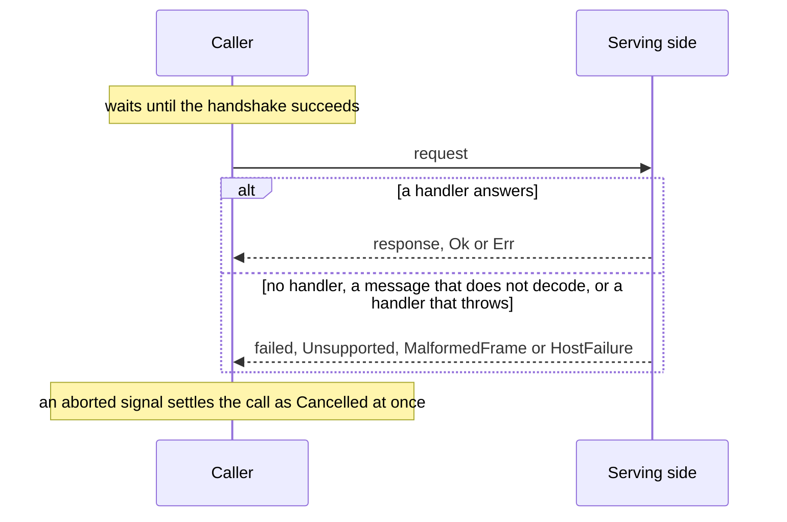
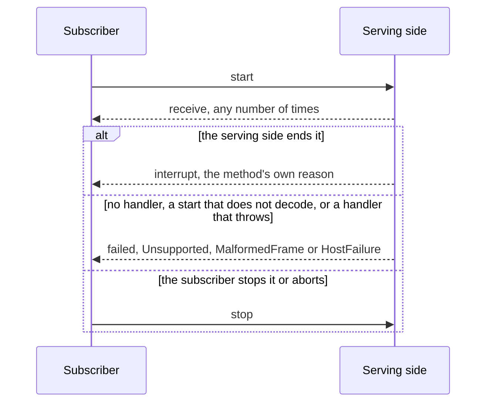
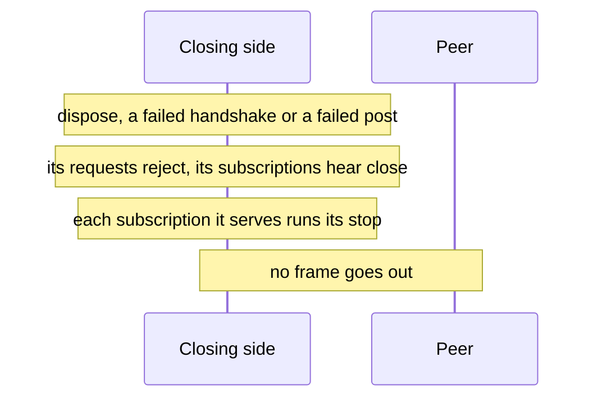

# @dotli/transport

A generic, bi-directional transport between documents. A schema author declares requests and subscriptions from codecs,
and both sides call and serve them over a window or a port. The library owns the handshake, correlation, cancellation
and failure.

## Design

- A codec is a SCALE codec. Any SCALE codec works, and `codec(encode, decode)` wraps two plain functions as one. A
  method's payload always comes last in its message, so a wrapped decode gets exactly the payload's bytes.
- A method is a request or a subscription, built from the codecs of what its sides send. A request carries one payload
  and is answered with a `Result`. A subscription starts with one payload, receives values, and ends with an interrupt
  that is the method's own interrupt reason, or with the caller's stop. A method carries its types, so the transport
  calls and serves a method by passing the method itself, and every payload, answer and end is typed from it with no
  type argument.
- A schema nests sections, then methods. Wire ids are positions: a section's id is its place in the schema and a
  method's id is its place in its section, so new sections and methods go at the end. A schema holds up to 256 sections
  of up to 256 methods each, a version from 0 to 255, and the codec of the hello each side sends in the handshake. Each
  method sits in one place only.
- `Result` is scale-ts's own, `{ success, value }`. `CallError` is truapi's, a tagged union of `{ tag, value }`: the
  handler's own `Domain` error, or a `Failure` of the library's, `Denied`, `Unsupported`, `MalformedFrame`,
  `HostFailure` or `Cancelled`. The library's failures are an enum of their own, so it answers any call with one. A
  method that declares no error has an empty one, `undefined`.
- A request's answer is `Result<R, CallError<E>>`. A subscription's interrupt is the method's own reason `I` as a whole,
  and the library adds nothing to it, so a clean end is whatever `I` says. A schema that wants truapi's layout declares
  `interrupt: Result(_void, callError(reason))`, so its handlers end with `ok()` or `err(...)`.
- A frame is a SCALE struct of a call id (`u32`) and one enum: the handshake's `handshakeOffer` and `handshakeResponse`,
  a `failed` that answers a call with a `CallError` of the library's own, or a `call` that carries the section and
  method ids and the method's own message. A message is its method's enum: `request` and `response` for a request, and
  `start`, `receive`, `interrupt` and `stop` for a subscription. A frame encodes in one pass of a codec composed from
  its method's. A received frame keeps the message as bytes until the method it names decodes it. The id, the handshake
  variants and the wire version that opens an offer never change, so a peer of any release reads the versions it
  refuses.
- A frame, a message, a hello or a failure that leaves bytes unread is refused as malformed, as truapi's `decode_all`
  refuses it. Each method and the frame build their whole decoder once, and each transport the hello's.
- Each side numbers its own calls, the opener odd and the accepter even, so a frame's id tells whose call it is about:
  one of this side's calls hears the peer's answers, values and ends, and one of the peer's reaches the handler.
- A provider moves bytes between two contexts and knows nothing of their meaning, and is the trust boundary: the
  transport serves whoever its provider delivers. The window provider admits one peer window at a fixed origin, or at
  the first origin a predicate allows, and delivers nothing from any other. The port provider speaks over a message
  port. Both post and accept an `ArrayBuffer` between documents, the message's own buffer when it holds only the message
  and a copy otherwise, so transferring it moves nothing else. Any object with the same four methods works.
- One side opens the handshake and the other accepts it. The opener starts it with its first request, subscription or
  wait for the handshake, as host-api starts it, or earlier with `connect`. It posts a fresh `handshakeOffer` every
  `retryMs` until it is answered or `timeoutMs` passes on the running clock. An offer carries the library's own wire
  version first, then the schema's version and the hello. Both versions must match. The accepter answers every attempt
  with the outcome of the first, which is its hello or both of its versions, and counts as connected only once that
  answer is posted. A hello is decoded only at the same versions, since another release's may not decode. A mismatch
  closes both sides.



- Calls made before the handshake wait and go out in call order once it succeeds. A request resolves to the peer's
  `Result` or to a failure the library answered with. An answer that does not decode rejects it with
  `TransportMalformedResponseError`, whose cause is why, as truapi's client and host-api reject it. Aborting its signal
  resolves it as `Cancelled`, and a late answer is ignored. The peer is not told.



- A subscription waits with the requests and goes out in call order with them. Its subscriber hears each value, then one
  end. `interrupt` hears the peer's own interrupt. `fail` hears a failure of the library's: one the peer answered with,
  `Cancelled` once its signal aborts, or `MalformedFrame` when a message does not decode, after which the peer is told
  to stop, since what was lost may be a value. An interrupt that does not decode is told no stop, since nothing follows
  an interrupt, and a message whose leg cannot be read counts as a value. `close` hears the one local end with an error:
  the transport closed, a post the provider threw on among the ways it does. Its `unsubscribe` tells the peer and calls
  no listener. A start that does not encode throws.



- A transport closes when its provider is not in a correct environment, which it checks once at creation, when the
  handshake fails or times out, the versions differ, its provider throws on a post, or its owner disposes it. Every
  pending and later request then rejects with that error itself, and every subscription still queued or open, or made
  later, hears it once through `close`, so a closed transport is never a call outcome. A post the provider throws on is
  reported first, and closes the transport with the provider's error, as truapi's client does.
- A closing transport posts nothing, as truapi's runtime posts nothing once disposed: no failure for the requests it
  serves and no stop for the subscriptions it made. Each subscription it serves stops, so its stop function runs, and
  each request it serves is never answered.



- A subscription handler gets the start, the context and a sink, and returns its stop function. That function runs once,
  on the peer's stop, an interrupt, a start that reuses its id, or a close, even when the handler interrupts before it
  returns. The peer hears an end before the stop function runs. A handler that throws on start, or a value the wire
  cannot carry, ends it with `HostFailure`. The sink does nothing once the subscription has ended.
- `onPeerIdle` fires when the peer's own stop leaves nothing it opened running and no request of the peer is in flight,
  which is how a peer that stops everything itself leaves. A peer that closes posts nothing, so it never fires for one.
  It fires once per departure, and a call from the peer arms it again.
- Calls of the peer reach a handler only once the handshake told who the peer is. A request or a start before the
  handshake is over is refused and answered at once with `HostFailure`, "The handshake is not over", and its handler
  never runs. One after the transport closed is refused with no answer. Nothing ever answers a `failed` frame or a frame
  that does not decode.
- As truapi does with an id the peer reuses, a request whose id is still in flight is refused with no answer, and its
  handler does not run again. A start on the id of a running subscription replaces it: the running one stops with
  nothing sent, and the new one starts.
- What the transport cannot handle itself goes to one issue hook: a refused message (`malformed` or `invalid`, with its
  cause), a post the provider threw on (with the section and method names of its call, if any), and a callback of the
  owner's that threw. A throw while a frame is handled is reported and never reaches the provider. With no hook, each
  issue is logged as one bounded error. A message on a call this side ended lately is a race, and dropped quietly. So is
  a stop of the peer's for a subscription that is not running, which counts as no call of the peer's.

## Public API

### `.`

- `codec(encode, decode)` wraps two functions as a `Codec<T>`, which is a SCALE codec.
- `ResultPayload<T, E>`, scale-ts's `Result`, with `ok(value)`, `ok()` and `err(error)`. `Variant<T>` is a record's
  entries as a tagged union.
- `CallError<E>` with the constructor `domain` and the codec `callError(domain)`, which a schema declares a
  subscription's `interrupt` with, as `Result(_void, callError(reason))`, to keep truapi's layout, and `Failure` with
  `denied`, `unsupported`, `malformedFrame`, `hostFailure` and `cancelled`. `hostFailure` takes a reason, or an `Error`,
  whose reason is `"<name>: <message>"`, bounded to 500 characters.
- `request({ request, response, error? })` declares a `Request<P, R, E>`, and
  `subscription({ start, receive, interrupt? })` a `Subscription<S, V, I>`, whose `I` is the `interrupt` codec's type as
  a whole. Without `error` or `interrupt`, `E` or `I` is `undefined`. `RequestMessage<P, R, E>` and
  `SubscriptionMessage<S, V, I>` are what their sides send.
- `defineSchema({ version, hello, sections })` checks the record and returns a `Schema<H, T>`: its `version`, `hello`
  codec, `sections`, `addressOf(method)`, its `Address` (`{ section, method, sectionId, methodId }`), which throws for a
  method of another schema, and `methodAt(sectionId, methodId)`, the method there, or undefined. `Sections` is the
  record it takes, of `AnyMethod`, and `MethodOf<T>` is any one of its methods, as a union.
- `MethodTypes<M>` is what each side of method `M` sends: `{ request: P; response: ResultPayload<R, CallError<E>> }` or
  `{ start: S; receive: V; interrupt: I; stop: undefined }`. `DomainError<M>` is its own error, `E`, or `I` as a whole.
- `createTransport(schema, provider, options)` returns a `Transport<H>`. `TransportOptions<H>`:
  - `handshake: 'offer' | 'respond'` sets whether this side offers the handshake or responds to it, and `hello` is this
    side's.
  - `retryMs` (50 by default) and `timeoutMs` (10000 by default, as host-api and truapi wait) pace the opener, on
    `timers`.
  - `onIssue(issue)` hears every `TransportIssue`: `{ kind: 'refused', reason, cause }`,
    `{ kind: 'post_failed', error, call? }` or `{ kind: 'listener_threw', error }`. `describeIssue(issue)` is one as a
    line of text, `failureReason(error)` an error as `"<name>: <message>"`, bounded, and `reasonParts(reason)` reads
    such a reason back as `{ name, message }`.
  - `onPeerIdle()` hears that the peer left.
- `Transport<H>`:
  - `connect()` starts the handshake on the opener ahead of its first call, which starts it otherwise, and
    `whenConnected()` resolves once it succeeds or rejects with the closing error.
  - `request(method, payload, { signal? })` resolves to `ResultPayload<R, CallError<E>>`. It rejects with the closing
    error, with `TransportMalformedResponseError` when the answer does not decode, or when the payload does not encode.
  - `handleRequest(method, handler)` serves a request method and returns what unregisters it. A `RequestHandler` gets
    the payload and a `CallContext` and returns a `ResultPayload`, sync or async.
  - `subscribe(method, start, { receive, interrupt, fail, close }, { signal? })` returns its `unsubscribe`. Exactly one
    of `interrupt(reason)`, `fail(failure)` and `close(error)` is called, once, unless it is unsubscribed first.
  - `handleSubscription(method, handler)` serves a subscription method. A `SubscriptionHandler` gets the start, a
    `CallContext` and a `Sink`, with `send(value)` and `interrupt(reason)`, where `reason` is the method's own interrupt
    reason, which the subscriber hears as it is, and returns its stop function.
  - `dispose(reason)` closes the transport, posting nothing, and disposes the provider.
- `CallContext<H>` is `{ hello }`, the peer's hello.
- `TransportHandshakeTimeoutError` closes an opener that heard no answer in time.
  `TransportUnsupportedProtocolVersionError` closes both sides of a mismatch. It carries `ours` and `theirs` as
  `TransportVersions`, `{ wire, schema }`, and its message names each version that differs, with both sides' values.
  `TransportMalformedResponseError` rejects a request whose answer does not decode, with the decode error as its
  `cause`.
- `Provider` is `isCorrectEnvironment()`, `postMessage(message)`, `subscribe(callback)` and `dispose()`, over
  `Uint8Array` messages. `isCorrectEnvironment` says whether the context has a peer to talk to, and a transport over a
  provider that has none closes at once with `Error('Environment is not correct')`. `postMessage` transfers the
  message's buffer and never delivers to the provider's own subscribers before it returns.
- `createWindowProvider({ listen, peer, origin, onNotBytes?, onRefusedOrigin? })` and
  `createPortProvider(port, { closeOnDispose? })` are the two providers. Each takes only as much of a window or a port
  as it uses: a `MessageTarget` that delivers each `WindowMessage` (`{ data, origin, source }`), a `WindowLike` to post
  to, and a `PortLike`. A browser's own window, `MessageEvent` and `MessagePort` are each one. The window provider is
  not in a correct environment when its peer is the window it listens on, as a page with no parent is. The port provider
  always is.

```ts
const schema = defineSchema({
  version: 1,
  hello: _void,
  sections: {
    names: {
      owner: request({ request: label, response: owner }),
      changes: subscription({ start: _void, receive: change, interrupt: failure }),
    },
  },
});

const answer = await transport.request(schema.sections.names.owner, { label: 'polkadot' });
```

### `./testing`

Test helpers for code that uses the library.

- `createProviderPair()` returns two connected providers, `left` and `right`, and the `delivered` messages. They are in
  a correct environment, deliver on a microtask, in order, and detach each buffer as a browser transfer does.
- `readFrame(schema, data)` reads a recorded frame, bytes a provider delivered or a buffer posted between documents, as
  a `RecordedFrame`. A call is named by its method's names and its message's tag, and keeps the message's bytes. It
  throws a `FrameRefusedError` on data that is no frame.
- `recordMessage(schema, data)` records a call's message as a `RecordedWireMessage`
  (`{ id, section, method, tag, message, json }`), with its bytes as hex and the decoded message as JSON with bytes as
  hex and big integers as text, so a page can keep and match it. It gives null for the library's own frames and data
  that is no frame.
- `messagesOf(schema, method, recorded)` picks the recorded messages of a method and decodes them, typed by it.
