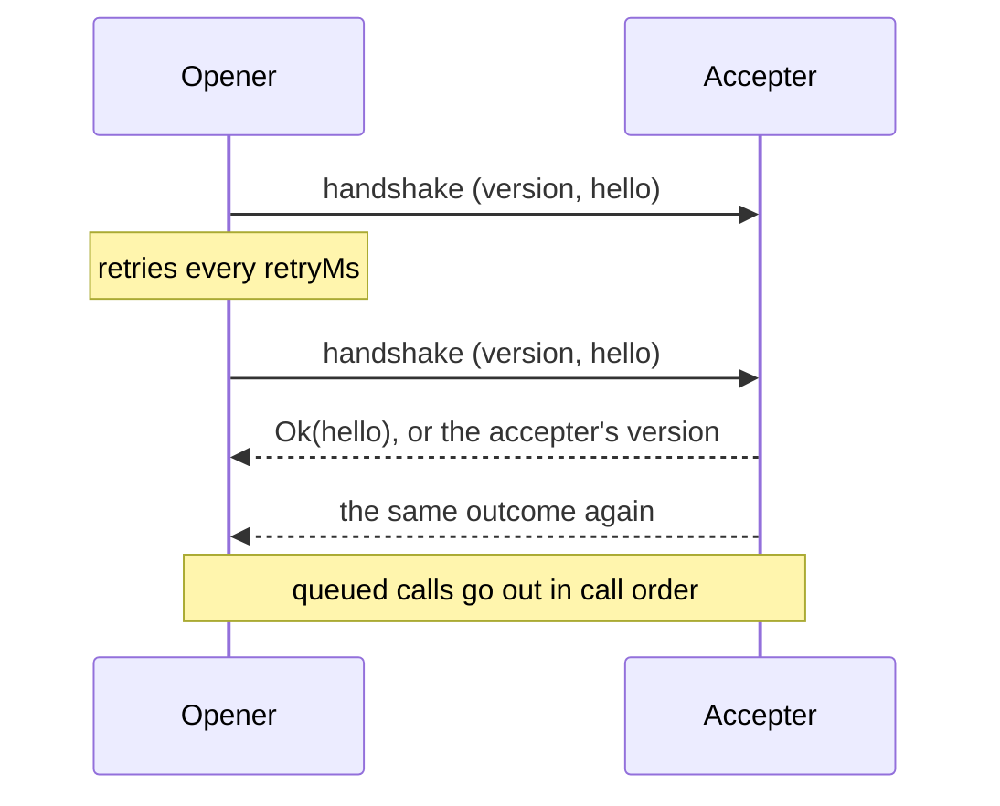

# @dotli/transport

A generic, bi-directional transport between documents. A schema author describes calls, streams and events in plain
TypeScript. The library moves them across a frame and owns correlation, cancellation and failure.

## Design

- A codec is an opaque value built from two plain functions, one that turns a value into bytes and one that turns bytes
  back. Code outside the library cannot read it, so the wire format stays a private detail.
- A schema nests traits, then methods, then a request or a subscription. A request carries one payload and is answered
  with a `Result`. A subscription starts with one payload, receives values, and ends with an interrupt that is a
  `Result` or with a stop that carries nothing. Each payload has its own codec.
- Wire ids are positions: a trait's id is its place in the schema and a method's id is its place in its trait. Defining
  the schema fixes them, so new traits and methods go at the end. A schema holds up to 255 traits of up to 256 methods
  each, since the library keeps one trait id for itself, and a version from 0 to 255.
- A trait or method name cannot be an integer such as `"3"`. JavaScript lists such keys first, so its id would not be
  its written place.
- The schema is opaque. Its names and payload types are read through type helpers, and nobody writes a type argument.
- A call returns a `Result`. Its error side is a `CallError`, tagged by `tag`: the handler's own `Domain` error, plus
  the library's `Denied`, `Unsupported`, `MalformedFrame`, `HostFailure` and `Cancelled`. `Cancelled` is raised by the
  caller's own side and never reaches a handler.
- A message is a fixed header (request id, trait id, method id and leg), the leg's envelope, then the payload with no
  length prefix. Encoding writes it into one buffer. Decoding reads the header with one cursor and hands the user's
  decode a view of exactly the payload bytes, with no copy. The view shares the message's buffer at a non-zero offset,
  so a decode must respect `byteOffset` or copy the bytes first. Decoding is strict: a whole header, a known leg, a leg
  the method has, and a body that ends where the message does. A message for an address the schema lacks is still read
  as that address, so the receiver can answer it.
- The library keeps trait 255 for itself. Method 0 is the handshake, which carries the schema version and the hello, and
  method 255 is the protocol error that answers a message for an unknown address. Their layout never changes, so a peer
  of any release reads the version it refuses.
- A provider moves bytes between two contexts and knows nothing of their meaning. The window provider admits one peer
  window at a fixed origin, or at the first origin a predicate allows. The port provider speaks over a message port. Any
  object with the same four methods works.
- One transport serves every side, and both sides call and serve over it. One side opens the handshake and the other
  accepts it. The opener posts a fresh attempt every `retryMs` until it is answered or `timeoutMs` passes on the running
  clock. The accepter answers every attempt with the outcome of the first. A version mismatch closes both sides.



- Calls made before the handshake wait in a queue and go out in call order once it succeeds, then run side by side. A
  call resolves to the peer's `Result`. Aborting its signal resolves it as `Cancelled`, whether it waits or is out, and
  a late answer is ignored. The peer is not told.
- A transport closes when the handshake fails or times out, the versions differ, or its owner disposes it. Every pending
  and later call then rejects with that error itself, so a closed transport is never a call outcome.
- The serving side answers outcomes of its own: `Unsupported` for a method with no handler, `MalformedFrame` with the
  decode error's message for a payload that does not decode, and `HostFailure` with `"<name>: <message>"`, bounded to
  500 characters, for a handler that throws or rejects or an answer the wire cannot carry. A message for an address the
  schema lacks gets one protocol error reply, and nothing ever answers a protocol error. A request before the handshake
  is refused with no reply.
- What the transport cannot handle itself goes to one issue hook: a refused message (`malformed`, `invalid` or
  `not_bytes`, with its cause), a post the provider threw on (with its leg), and a callback of the owner's that threw.
  With no hook, each issue is logged as one bounded error. Nothing is dropped unseen.

## Public API

### `.`

- `codec(encode, decode)` wraps two functions as a `Codec<T>`. `none` is the codec of an empty payload and refuses any
  byte on decode.
- `Result<T, E>` with `ok()` and `err(error)`.
- `CallError<E>` with the constructors `domain`, `denied`, `unsupported`, `malformedFrame`, `hostFailure` and
  `cancelled`.
- `request({ request, response, error? })` declares a request. `error` is the method's own error type and defaults to
  `never`. It returns a `RequestDef`.
- `subscription({ start, receive, interrupt? })` declares a subscription. `interrupt` is the method's own end reason and
  defaults to `never`. It returns a `SubscriptionDef`.
- `defineSchema({ version, hello?, traits })` checks the record, fixes the wire ids and returns a `Schema`. `hello` is
  the codec of the value each side sends in the handshake. It throws on a version outside 0 to 255, more than 255
  traits, more than 256 methods in a trait, or an integer-like trait or method name. `Traits` is the type of the record
  it takes.
- Type helpers over a schema `S`:
  - `TraitName<S>`, `MethodName<S, T>`, `RequestMethodName<S, T>` and `SubscriptionMethodName<S, T>` name its parts.
  - `MethodTypes<S, T, M>` is what each side of a method sends and receives. For a request of `P`, `R` and `E` it is
    `{ request: P; response: Result<R, CallError<E>> }`. For a subscription of `St`, `V` and `I` it is
    `{ start: St; receive: V; interrupt: Result<void, CallError<I>>; stop: void }`.
  - `DomainError<S, T, M>` is the method's own error, `E` or `I`.
  - `HelloOf<S>` is the handshake value, or `void` when the schema declares none.

- `createTransport(schema, provider, options)` returns a `Transport`. `TransportOptions`:
  - `handshake: 'open' | 'accept'` sets which side opens the handshake.
  - `hello`, this side's handshake value, required exactly when the schema declares one.
  - `retryMs` (50 by default) and `timeoutMs` (5000 by default) pace the opener.
  - `timers` replaces the page's clock and timers.
  - `onIssue(issue)` hears every `TransportIssue`: `{ kind: 'refused', reason, cause? }`,
    `{ kind: 'post_failed', leg, error }` or `{ kind: 'listener_threw', error }`.
- `Transport`:
  - `connect()` starts the handshake on the opener and does nothing on the accepter.
  - `whenConnected()` resolves once the handshake succeeds and rejects with the closing error.
  - `request(trait, method, payload, { signal? })` resolves to `Result<R, CallError<E>>`. It rejects only with the
    closing error, or when the call cannot go out: a payload that does not encode or a post the provider throws on.
  - `handleRequest(trait, method, handler)` serves a method and returns what unregisters it. The handler gets the
    payload and a `CallContext` and returns a `Result`, sync or async. A second handler for one method throws.
  - `dispose(reason)` closes the transport with `reason` and disposes the provider.
- `CallContext` is `{ origin, hello }`: the peer's origin from the provider, or null, and the peer's handshake hello.
  `RequestHandler` and `RequestOptions` name the handler and the call options.
- `TransportHandshakeTimeoutError` closes an opener that heard no answer in time. `TransportVersionMismatchError` closes
  both sides of a mismatch and carries `ours` and `theirs`.
- `Provider` is `post(data)`, `subscribe(listener)`, `peerOrigin()` and `dispose()`. A provider holds nothing for a
  listener yet to come, and `post` transfers the buffer.
- `createWindowProvider({ listen, peer, origin, onNotBytes?, onRefusedOrigin? })` hears `listen` (a `MessageTarget`) and
  posts to `peer()`, a `WindowLike`. `origin` is fixed, or a predicate whose first origin to send bytes is locked.
  `onNotBytes` hears data from the admitted peer that is not bytes, and `onRefusedOrigin` hears bytes from an origin it
  does not admit. `WindowProviderDeps` names the argument.
- `createPortProvider(port, { closeOnDispose? })` speaks over a `PortLike`. Its peer origin is always null, and
  `closeOnDispose: false` leaves closing the port to its owner.

```ts
const schema = defineSchema({
  version: 1,
  traits: {
    names: {
      owner: request({ request: label, response: owner }),
      changes: subscription({ start: none, receive: change, interrupt: failure }),
    },
  },
});
```

### `./testing`

Test helpers for code that uses the library.

- `createProviderPair()` returns two connected providers, `left` and `right`, and the `delivered` buffers. They deliver
  on a microtask, in order, and detach each buffer as a browser transfer does.
- `describeMessage(schema, data)` reads a recorded message as `{ trait, method, leg, id, body }`. The body is the leg's
  decoded value, left as it is: a payload, an outcome, a handshake's `{ version, hello }`, or a protocol error's
  `{ trait, method }`. A library message or one for an address the schema lacks is named by its numeric ids, and the
  latter keeps its body as bytes. It throws on data the schema refuses, with the refusal as the cause.
