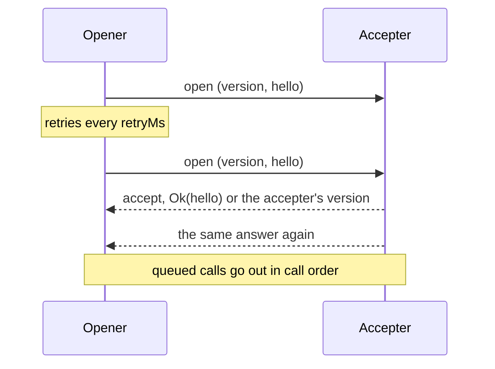
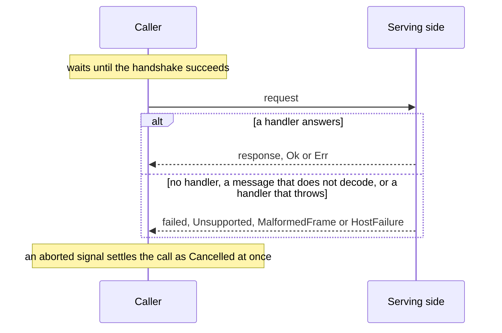
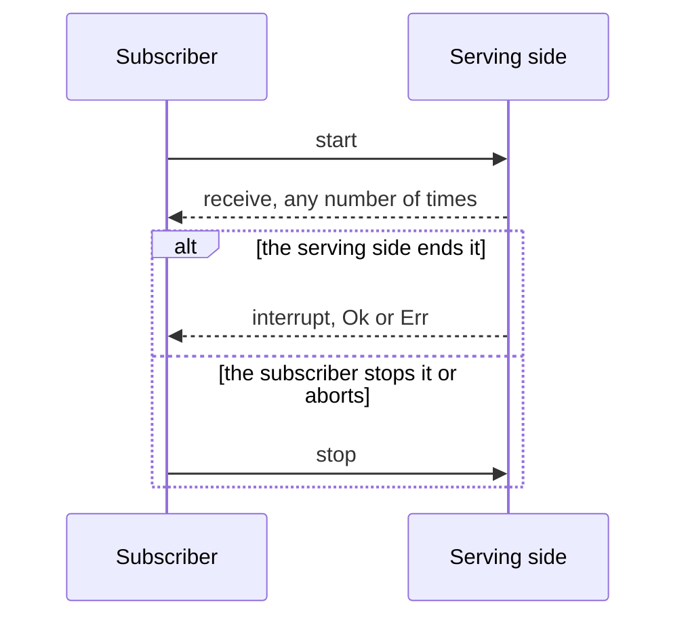

# @dotli/transport

A generic, bi-directional transport between documents. A schema author declares requests and subscriptions from codecs,
and both sides call and serve them over a window or a port. The library owns the handshake, correlation, cancellation
and failure.

## Design

- A codec is a SCALE codec. Any SCALE codec works, and `codec(encode, decode)` wraps two plain functions as one. A
  method's payload always comes last in its message, so a wrapped decode gets exactly the payload's bytes.
- A method is a request or a subscription, built from the codecs of what its sides send. A request carries one payload
  and is answered with a `Result`. A subscription starts with one payload, receives values, and ends with an interrupt
  that is a `Result`, or with the caller's stop. A method carries its types, so the transport calls and serves a method
  by passing the method itself, and every payload, answer and end is typed from it with no type argument.
- A schema nests traits, then methods. Wire ids are positions: a trait's id is its place in the schema and a method's id
  is its place in its trait, so new traits and methods go at the end. A schema holds up to 256 traits of up to 256
  methods each, a version from 0 to 255, and the codec of the hello each side sends in the handshake. Each method sits
  in one place only.
- `Result` is scale-ts's own, `{ success, value }`. `CallError` is truapi's, a tagged union of `{ tag, value }`: the
  handler's own `Domain` error, or a `Failure` of the library's, `Denied`, `Unsupported`, `MalformedFrame`,
  `HostFailure` or `Cancelled`. The library's failures are an enum of their own, so it answers any call with one. A
  method that declares no error has an empty one, `undefined`.
- A frame is a SCALE struct of a call id (`u32`) and one enum: the handshake's `open` and `accept`, a `failed` that
  answers a call with a `CallError` of the library's own, or a `call` that carries the trait and method ids and the
  method's own message. A message is its method's enum: `request` and `response` for a request, and `start`, `receive`,
  `interrupt` and `stop` for a subscription. A frame encodes in one pass of a codec composed from its method's. A
  received frame keeps the message as bytes until the method it names decodes it. The id and the handshake variants
  never change, so a peer of any release reads the version it refuses.
- Each side numbers its own calls, the opener odd and the accepter even, so a frame's id tells whose call it is about:
  one of this side's calls hears the peer's answers, values and ends, and one of the peer's reaches the handler.
- A provider moves bytes between two contexts and knows nothing of their meaning. The window provider admits one peer
  window at a fixed origin, or at the first origin a predicate allows. The port provider speaks over a message port. Any
  object with the same four methods works.
- One side opens the handshake and the other accepts it. The opener posts a fresh `open` every `retryMs` until it is
  answered or `timeoutMs` passes on the running clock. The accepter answers every attempt with the outcome of the first
  answer it could post, and counts as connected only once that answer is posted. A hello is decoded only at the same
  version, since another release's may not decode. A version mismatch closes both sides.



- Calls made before the handshake wait and go out in call order once it succeeds. A request resolves to the peer's
  `Result`, to a failure the library answered with, or to `MalformedFrame` when the answer does not decode. Aborting its
  signal resolves it as `Cancelled`, and a late answer is ignored. The peer is not told.



- A subscription waits with the requests and goes out in call order with them. Its subscriber hears each value, then one
  end: the peer's interrupt, a failure the library answered with, `Cancelled` once its signal aborts, or
  `MalformedFrame` when a message does not decode, after which the peer is told to stop, since what was lost may be a
  value. Stopping it tells the peer and calls no listener. A start that does not encode throws. The one local end with
  an error goes to `close` instead: the transport closed, or the start could not be posted.



- A transport closes when the handshake fails or times out, the versions differ, or its owner disposes it. Every pending
  and later request then rejects with that error itself, and every subscription still queued or open, or made later,
  hears it once through `close`, so a closed transport is never a call outcome. Disposing also answers each request this
  side is serving, and ends each subscription it serves, with `HostFailure` carrying `"<name>: <message>"` of the
  reason, and tells the peer to stop each subscription it made.
- A subscription handler gets the start, the context and a sink, and returns its stop function. That function runs once,
  on the peer's stop, an interrupt or a dispose, even when the handler interrupts before it returns. The peer hears an
  end before the stop function runs. A handler that throws on start, or a value the wire cannot carry, ends it with
  `HostFailure`. The sink does nothing once the subscription has ended.
- `onPeerIdle` fires when the peer's own stop leaves nothing it opened running and no request of the peer is in flight,
  which is how a peer that disposes leaves. It fires once per departure, and a call from the peer arms it again.
- Calls of the peer reach a handler only once the handshake told who the peer is. One before the handshake or after the
  transport closed is refused with no answer. Nothing ever answers a `failed` frame or a frame that does not decode.
- What the transport cannot handle itself goes to one issue hook: a refused message (`malformed` or `invalid`, with its
  cause), a post the provider threw on (with the trait and method names of its call, if any), and a callback of the
  owner's that threw. A throw while a frame is handled is reported and never reaches the provider. With no hook, each
  issue is logged as one bounded error. A message on a call this side ended lately is a race, and dropped quietly.

## Public API

### `.`

- `codec(encode, decode)` wraps two functions as a `Codec<T>`, which is a SCALE codec.
- `ResultPayload<T, E>`, scale-ts's `Result`, with `ok(value)`, `ok()` and `err(error)`. `Variant<T>` is a record's
  entries as a tagged union.
- `CallError<E>` with the constructor `domain`, and `Failure` with `denied`, `unsupported`, `malformedFrame`,
  `hostFailure` and `cancelled`. `hostFailure` takes a reason, or an `Error`, whose reason is `"<name>: <message>"`,
  bounded to 500 characters.
- `request({ request, response, error? })` declares a `Request<P, R, E>`, and
  `subscription({ start, receive, interrupt? })` a `Subscription<S, V, I>`. Without `error` or `interrupt`, `E` or `I`
  is `undefined`. `RequestMessage<P, R, E>` and `SubscriptionMessage<S, V, I>` are what their sides send.
- `defineSchema({ version, hello, traits })` checks the record and returns a `Schema<H, T>`: its `version`, `hello`
  codec, `traits`, `addressOf(method)`, its `Address` (`{ trait, method, traitId, methodId }`), which throws for a
  method of another schema, and `placeAt(traitId, methodId)`, the `Place` there (`{ method, address }`), or undefined.
  `Traits` is the record it takes, of `AnyMethod`, and `MethodOf<T>` is any one of its methods, as a union.
- `MethodTypes<M>` is what each side of method `M` sends: `{ request: P; response: ResultPayload<R, CallError<E>> }` or
  `{ start: S; receive: V; interrupt: ResultPayload<undefined, CallError<I>>; stop: undefined }`. `DomainError<M>` is
  its own error, `E` or `I`.
- `createTransport(schema, provider, options)` returns a `Transport<H>`. `TransportOptions<H>`:
  - `handshake: 'open' | 'accept'` sets which side opens the handshake, and `hello` is this side's.
  - `retryMs` (50 by default) and `timeoutMs` (5000 by default) pace the opener, on `timers`.
  - `onIssue(issue)` hears every `TransportIssue`: `{ kind: 'refused', reason, cause }`,
    `{ kind: 'post_failed', error, call? }` or `{ kind: 'listener_threw', error }`. `describeIssue(issue)` is one as a
    line of text, `failureReason(error)` an error as `"<name>: <message>"`, bounded, and `reasonParts(reason)` reads
    such a reason back as `{ name, message }`.
  - `onPeerIdle()` hears that the peer left.
- `Transport<H>`:
  - `connect()` starts the handshake on the opener, and `whenConnected()` resolves once it succeeds or rejects with the
    closing error.
  - `request(method, payload, { signal? })` resolves to `ResultPayload<R, CallError<E>>`. It rejects only with the
    closing error, or when the call cannot go out.
  - `handleRequest(method, handler)` serves a request method and returns what unregisters it. A `RequestHandler` gets
    the payload and a `CallContext` and returns a `ResultPayload`, sync or async.
  - `subscribe(method, start, { receive, interrupt, close }, { signal? })` returns what stops it.
  - `handleSubscription(method, handler)` serves a subscription method. A `SubscriptionHandler` gets the start, a
    `CallContext` and a `Sink`, with `receive(value)` and `interrupt(outcome)`, where `outcome` is the `ResultPayload`
    the subscriber hears, `ok()` or `err(error)`, and returns its stop function.
  - `dispose(reason)` closes the transport and disposes the provider.
- `CallContext<H>` is `{ origin, hello }`: the peer's origin from the provider, or null, and the peer's hello.
- `TransportHandshakeTimeoutError` closes an opener that heard no answer in time. `TransportVersionMismatchError` closes
  both sides of a mismatch, and names both versions.
- `Provider` is `post(data)`, `subscribe(listener)`, `peerOrigin()` and `dispose()`. `post` transfers the buffer and
  never delivers to the provider's own listeners before it returns.
- `createWindowProvider({ listen, peer, origin, onNotBytes?, onRefusedOrigin? })` and
  `createPortProvider(port, { closeOnDispose? })` are the two providers. Each takes only as much of a window or a port
  as it uses: a `MessageTarget` that delivers each `WindowMessage` (`{ data, origin, source }`), a `WindowLike` to post
  to, and a `PortLike`. A browser's own window, `MessageEvent` and `MessagePort` are each one.

```ts
const schema = defineSchema({
  version: 1,
  hello: _void,
  traits: {
    names: {
      owner: request({ request: label, response: owner }),
      changes: subscription({ start: _void, receive: change, interrupt: failure }),
    },
  },
});

const answer = await transport.request(schema.traits.names.owner, { label: 'polkadot' });
```

### `./testing`

Test helpers for code that uses the library.

- `createProviderPair()` returns two connected providers, `left` and `right`, and the `delivered` buffers. They deliver
  on a microtask, in order, and detach each buffer as a browser transfer does.
- `readFrame(schema, data)` reads a recorded frame as a `RecordedFrame`. A call is named by its method's names and its
  message's tag, and keeps the message's bytes. It throws a `FrameRefusedError` on data that is no frame.
- `recordMessage(schema, data)` records a call's message as a `RecordedWireMessage`
  (`{ id, trait, method, tag, message, json }`), with its bytes as hex and the decoded message as JSON with bytes as hex
  and big integers as text, so a page can keep and match it. It gives null for the library's own frames and data that is
  no frame.
- `messagesOf(schema, method, recorded)` picks the recorded messages of a method and decodes them, typed by it.
