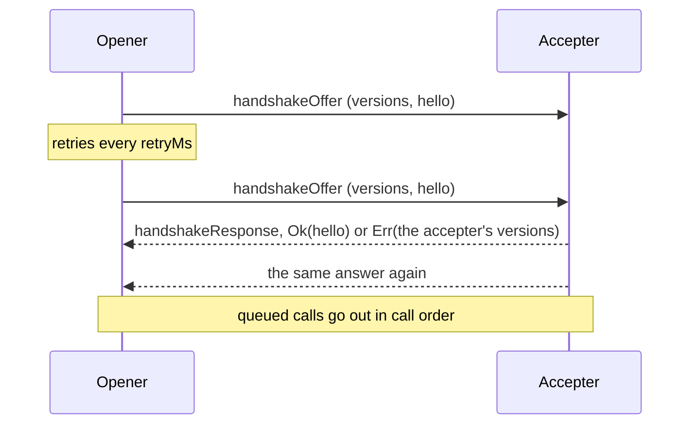
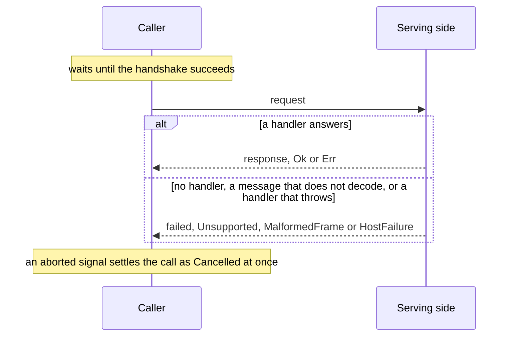
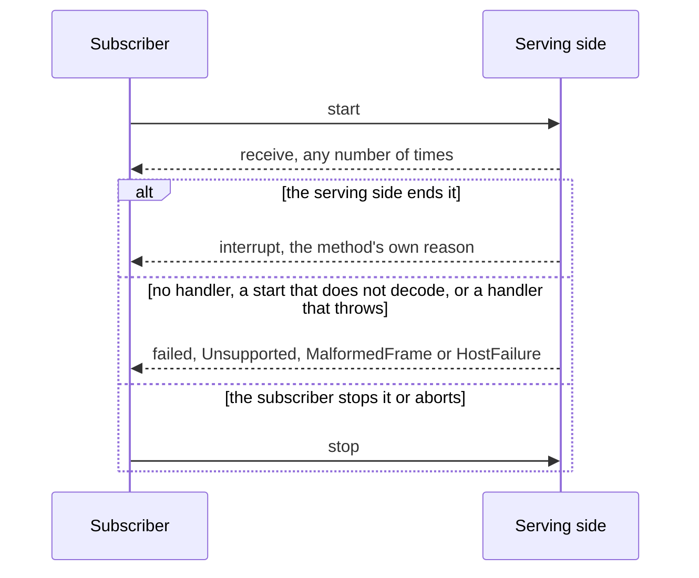
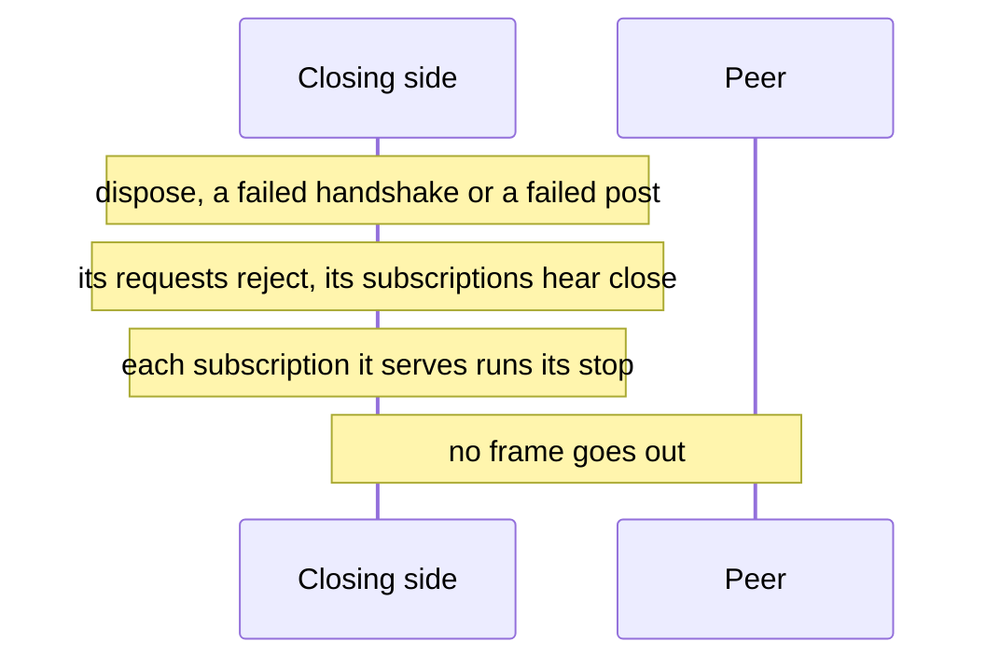

# @dotli/transport

## Overview

A generic, two-way transport between documents. A schema declares requests and subscriptions from SCALE codecs. Both
sides call and serve them over a window or a port. The library owns the handshake, correlation, cancellation and
failure.

## Responsibilities

- **Owns:** the wire format, the handshake, call ids, cancellation and failure, and the window and port providers.
- **Does not own:** what the schemas mean. Each consumer declares its own methods and serves them.

## Public API

### `.`

| Export                                                                           | What it is                                      |
| -------------------------------------------------------------------------------- | ----------------------------------------------- |
| `defineSchema`, `Schema`, `Sections`, `Address`, `MethodOf`                      | Declare a schema                                |
| `request`, `subscription`                                                        | Declare a method                                |
| `AnyMethod`, `MethodTypes`, `DomainError`, `Variant`                             | Method types                                    |
| `RequestMessage`, `RequestTypes`, `SubscriptionMessage`, `SubscriptionTypes`     | What a method's sides send                      |
| `codec`, `Codec`                                                                 | Wrap two functions as a SCALE codec             |
| `ResultPayload`, `ok`, `err`                                                     | scale-ts's `Result`                             |
| `CallError`, `domain`, `callError`                                               | The call error, its builder and codec           |
| `Failure`, `denied`, `unsupported`, `malformedFrame`, `hostFailure`, `cancelled` | Library failures                                |
| `getFailureReason`, `parseReason`                                                | An error as `"<name>: <message>"`, and back     |
| `createTransport`, `Transport`, `TransportParams`, `CallContext`                 | The transport                                   |
| `RequestParams`, `SubscribeParams`, `SubscriptionListeners`                      | Call options                                    |
| `RequestHandler`, `SubscriptionHandler`, `Sink`                                  | Handler types                                   |
| `TransportIssue`, `describeIssue`                                                | An issue, and one as text                       |
| `TransportHandshakeTimeoutError`                                                 | No handshake answer in time                     |
| `TransportUnsupportedProtocolVersionError`, `TransportVersions`                  | Version mismatch                                |
| `TransportMalformedResponseError`                                                | An answer that does not decode                  |
| `Provider`, `createWindowProvider`, `WindowProviderParams`                       | The provider interface, and the window provider |
| `createPortProvider`                                                             | The port provider                               |
| `MessageTarget`, `WindowMessage`, `WindowLike`, `PortLike`                       | What providers take                             |

`createTransport` options:

| Option      | Meaning                                                 |
| ----------- | ------------------------------------------------------- |
| `schema`    | The schema it calls and serves                          |
| `provider`  | The channel to the peer, disposed with the transport    |
| `handshake` | `'offer'` or `'respond'`                                |
| `hello`     | This side's hello, which the peer sees in `CallContext` |
| `retryMs`   | Offer interval. Default 50                              |
| `timeoutMs` | Handshake deadline. Default 10000. `null` for none      |
| `timers`    | The clock for both                                      |
| `onIssue`   | Hears every `TransportIssue`                            |

A `Transport` has `connect`, `whenConnected`, `request`, `handleRequest`, `subscribe`, `handleSubscription`, `forward`
and `dispose`.

**Trap:** for truapi's interrupt layout, declare `interrupt: Result(_void, callError(reason))` and end with `ok()` or
`err(...)`.

```ts
import { Struct, _void, str, u32 } from 'scale-ts';
import {
  createTransport,
  createWindowProvider,
  defineSchema,
  domain,
  err,
  ok,
  request,
  subscription,
} from '@dotli/transport';

// Both sides import the one schema.
export const schema = defineSchema({
  version: 1,
  hello: _void,
  sections: {
    names: {
      owner: request({ request: str, response: str, error: str }),
      changes: subscription({ start: str, receive: Struct({ block: u32, owner: str }) }),
    },
  },
});
const { owner, changes } = schema.sections.names;

// The page serves the frame it embeds.
const page = createTransport({
  schema,
  provider: createWindowProvider({
    listen: window,
    peer: () => document.querySelector('iframe')?.contentWindow ?? null,
    origin: 'https://frame.example',
  }),
  handshake: 'respond',
  hello: undefined,
});
page.handleRequest(owner, label => (label === 'alice' ? ok('5GrwvaEF') : err(domain(`No owner for ${label}`))));
page.handleSubscription(changes, (label, _context, sink) => {
  const timer = setInterval(() => sink.send({ block: 1, owner: `the owner of ${label}` }), 6000);
  return () => clearInterval(timer);
});

// The frame calls the page that embeds it, and opens the handshake with its first call.
const frame = createTransport({
  schema,
  provider: createWindowProvider({ listen: window, peer: () => window.parent, origin: 'https://page.example' }),
  handshake: 'offer',
  hello: undefined,
});
const answer = await frame.request(owner, 'alice'); // ok('5GrwvaEF')

const owners: string[] = [];
let ended: string | undefined;
const unsubscribe = frame.subscribe({
  method: changes,
  start: 'alice',
  listeners: {
    receive: change => {
      owners.push(change.owner);
    },
    interrupt: () => {
      ended = 'the page ended it';
    },
    fail: failure => {
      ended = failure.tag;
    },
    close: error => {
      ended = error.message;
    },
  },
});
```

### `./testing`

| Export                                            | What it is                              |
| ------------------------------------------------- | --------------------------------------- |
| `createProviderPair`                              | Two connected in-memory providers       |
| `readFrame`, `RecordedFrame`, `FrameRefusedError` | Read a recorded frame                   |
| `recordMessage`, `RecordedWireMessage`            | Record a call's message as hex and JSON |
| `readMessages`                                    | Decode a method's recorded messages     |

## Design

- **Methods carry their types.** Calls and handlers take the method itself, so payloads and answers need no type
  argument.
- **Request:** one payload, answered with `Result<Response, CallError<Domain>>`.
- **Subscription:** one start, then values, then the method's own `Interrupt` or the caller's stop.
- **`CallError`** uses truapi's layout: the handler's `Domain` error, or a library `Failure` (`Denied`, `Unsupported`,
  `MalformedFrame`, `HostFailure`, `Cancelled`).
- **Wire ids are positions** in the schema. Add new sections and methods at the end. Limits: 256 sections of 256
  methods, version 0 to 255.
- **Frames** are SCALE: a call id and an enum of handshake, `failed` or `call`. A message stays bytes until its method
  decodes it. Trailing bytes are refused as malformed.
- **Stable forever:** the call id, the handshake variants and the wire version, so any release can read a refusal.
- **Call ids:** the opener numbers odd, the accepter even.
- **The provider is the trust boundary.** It moves bytes and the transport serves whoever it delivers. The window
  provider admits one peer window at one allowed origin.
- **Parts:** a transport composes parts, each owning its own state. Only the connection posts and closes.

### Handshake

- The opener starts it with its first call, or earlier with `connect`. It retries every `retryMs` until `timeoutMs`.
- Both the wire and schema versions must match, or both sides close.
- Calls made before the handshake wait, then go out in order.
- A peer's call before the handshake gets `HostFailure`, and no handler runs.



### Calls

- An abort settles a request as `Cancelled` at once. The peer is not told.
- An answer that does not decode rejects with `TransportMalformedResponseError`.



- A subscriber hears values, then exactly one end: `interrupt` (the peer's own), `fail` (a library failure) or `close`
  (the local transport closed).
- A handler returns a stop function. It runs once, however the subscription ends.



### Closing

- A transport closes on a wrong environment, a failed handshake, a version mismatch, a failed post, or `dispose`.
- Its requests then reject with the closing error. Its subscriptions hear `close`.
- A closing transport posts nothing. Served subscriptions run their stop. Served requests stay unanswered.



### Forwarding and issues

- **Forwarding:** passes a peer's calls of chosen methods to another transport of the same schema. Messages cross as
  bytes, so only the far ends decode payloads. Each link keeps its own rules.
- **Issues:** what the transport cannot handle goes to one `onIssue` hook. Without it, each issue is logged.
