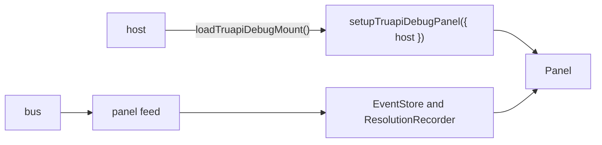

# `@dotli/truapi-debug-ui`

The TrUAPI debug panel: a docked inspector that shows the host to product traffic, a timeline, name resolution, the
product's archive, the wallet switch and diagnostics. It loads only in debug mode.

## Responsibility

- The panel views and their state: event list and filters, detail pane, timeline, resolution chart, archive, wallet,
  diagnostics.
- The models behind the views: the event store and the correlation of a call with its answer, filters, rows and detail
  formatting, timeline lanes, resolution blocks, pending-call tracking, export, chain names and payload decoding, and
  the stored dock position and section. They are plain modules with Node specs beside them.
- Its own components, icons, tokens and phone breakpoint. From the shared UI kit it takes only the Solid glue that reads
  a store and mounts a root, and the pointer drag, so a store read, a broken root and a drag behave as everywhere else
  on the page. Each icon is a Solid component that draws an `<svg>` in `currentColor`.
- Not owned: event capture and the bus, and the host's stores and layers. The host gives them through `DebugPanelHost`.

## Design

- A lazy loader keeps the panel in its own chunk, and the package index is a pure barrel.
- Setup installs the panel. A second call before disposing does nothing. Dispose also gives the product iframe its full
  size back through `host.reportDockInset`.
- The feed subscribes to the bus at once, so the buffered boot replay is in the store before the panel mounts.
- The models take their inputs as parameters and import no Solid, so the specs run under Node. Keys are stable, so a
  view updates a box in place as traffic streams in.
- `DebugPanelHost` is the port: readable stores for product, auth and wallet mode, wallet switching, diagnostics, the
  archive loader (the host picks gateway or blocks), content insets, a dock inset callback, and leaving debug mode,
  which the host does on Hide. The panel imports no host module.
- The root renders inside an error boundary. A throwing view is reported once and the root is disposed, so timers stop.
- Effects (clipboard, download), the bus, the view and the repeated computations are options of the mount with page
  defaults. A caller replaces them to count work or fake the page. The views read the computations from a context the
  mount fills.
- The panel imports no chain library. It reads keys and chains through its port, and lint enforces it.

## Using the panel

### Turning it on and off

Builds made with `VITE_APP_DEBUG=true` mount the panel collapsed. Other builds keep it off until Settings, Advanced,
**Open in debug mode**, or `?debug=true` on any URL. The choice lasts for the tab, and `?debug=off` or the panel's
**Hide** button leaves debug mode and reloads without the panel. The panel's code loads only in debug mode.

### Sections

The header holds the section tabs and the panel's own controls: dock, collapse and Hide. A collapsed panel selects no
tab, and picking one opens the panel on it. A collapsed panel also stops reading traffic, and catches up once it opens.

- **TrUAPI**: the messages between host and product, and the host's own boot, resolve, render, bridge and failover
  events, as a list or a timeline beside a detail pane.
- **Resolution**: how the last page load went, phase by phase, with the open block and the chains that never started.
- **Archive**: the files of the loaded product.
- **Diagnostics**: the site, backend and package versions, to paste into a bug report.
- **Wallet**: switches every app on the domain between Polkadot App and a local wallet.

### Reading the TrUAPI section

- A TrUAPI message groups with the others of its request id, a host event with the others of its flow id. Selecting an
  event highlights its group, and the detail pane shows the group with each event's time from the first.
- A request with no reply yet shows a pending badge that counts up and turns slow after three seconds.
- The event count, **Pause**, **Clear**, Export and Copy sit at the end of the filter row. **Pause** stops recording new
  events. The reply that closes a call the panel already recorded still lands, once, so that call does not read pending
  for good. **Clear** drops the recorded events. The Resolution section has its own **Clear** for the recorded load.
- The filters pick the kind (TrUAPI or System), the direction, the product, and the methods to include by text or
  `/regex/`, and the methods to exclude. Export and Copy take what the filters show. Copy announces its outcome as a
  status text for assistive technology.
- In the timeline, time runs downwards. Each chain that is followed gets a swimlane, then the host's events, then other
  TrUAPI traffic. A box spans a call from its request to its reply and has a dashed edge while it waits. A rail is a
  chain head subscription, and its ticks are the subscription's block events.
- Keyboard: the section and view tabs move focus with the left and right arrows, Home and End, and Enter or Space picks
  one. The event list is a listbox with the selected event as its active option. The arrow keys also move the panel's
  edge and the splitter, with Shift for a larger step.
- Chain messages are decoded into their operation and block events. Signing, session, entropy and local storage payloads
  show only their size. In local wallet mode the signing requests and the resource allocation request are decoded
  instead, because the panel stands in for the phone. A frame that cannot be decoded shows as raw bytes, with their
  length in the list and a hex preview of the first bytes in the detail pane.
- The Resolution clock runs only while a running load is on screen.
- The list keeps the newest 2000 events and counts the ones it dropped.

### Adding a host event

Emit it on the debug bus with a layer, an event name, a flow id and a payload. Give it a one-line summary and a longer
explanation in the panel's models.

## Public API

### `@dotli/truapi-debug-ui`

- `loadTruapiDebugMount`, `TruapiDebugMountModule`: the lazy loader of the panel mount, whose `setupTruapiDebugPanel`
  installs the panel and returns a dispose.
- `DebugPanelHost`: the port the host implements, with the diagnostics types it carries (`DiagnosticsSource`,
  `DiagnosticsRow`, `PackageVersion`).

### `@dotli/truapi-debug-ui/testing`

- `fakeDebugPanelHost`, `FakeDebugPanelHost`: a host port for specs and stories.
