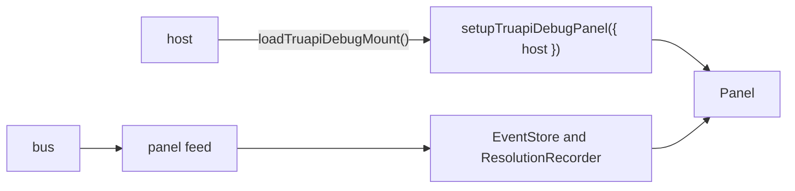

# `@dotli/truapi-debug-ui`

The TrUAPI debug panel: a docked inspector that shows the host to product traffic, a timeline, name resolution, the
product's archive, the wallet switch and diagnostics. It loads only in debug mode.

## Responsibility

- The panel views and their state: event list and filters, detail pane, timeline, resolution chart, archive, wallet,
  diagnostics.
- The models behind the views: the event store and the correlation of a call with its answer, filters, rows and detail
  formatting, timeline lanes, resolution blocks, pending-call tracking, export, chain names and payload decoding, and
  the stored dock position and section. They are plain modules with Node specs beside them.
- Its own components, icons and tokens. Of the ui package it takes only the Solid glue that reads a store and mounts a
  root, and the pointer drag, so a store read, a broken root and a drag behave as everywhere else on the page. Each icon
  is a Solid component that draws an `<svg>` in `currentColor`.
- Not owned: event capture and the bus, and the host's stores and layers. The host gives them through `DebugPanelHost`.

## Design

- A lazy loader keeps the panel in its own chunk, and the package index is a pure barrel.
- Setup installs the panel. A second call before disposing does nothing. Dispose also gives the product iframe its full
  size back through `host.reportDockInset`.
- The feed subscribes to the bus at once, so the buffered boot replay is in the store before the panel mounts.
- The models take their inputs as parameters and import no Solid, so the specs run under Node. Keys are stable, so a
  view updates a box in place as traffic streams in.
- `DebugPanelHost` is the port: readable stores for product, auth and wallet mode, wallet switching, diagnostics, the
  archive loader (the host picks gateway or blocks), content insets, a dock inset callback, and leaving debug mode,
  which the host does on Hide. The panel imports no host module.
- The root renders inside an error boundary. A throwing view is reported once and the root is disposed, so timers stop.
- Effects (clipboard, download), the bus, the view and the repeated computations are options of the mount with page
  defaults. A caller replaces them to count work or fake the page. The views read the computations from a context the
  mount fills.
- The panel imports no chain library. It reads keys and chains through its port, and lint enforces it.

## Public API

### `@dotli/truapi-debug-ui`

- `loadTruapiDebugMount`, `TruapiDebugMountModule`: the lazy loader of the panel mount, whose `setupTruapiDebugPanel`
  installs the panel and returns a dispose.
- `DebugPanelHost`: the port the host implements, with the diagnostics types it carries (`DiagnosticsSource`,
  `DiagnosticsRow`, `PackageVersion`).

### `@dotli/truapi-debug-ui/testing`

- `fakeDebugPanelHost`, `FakeDebugPanelHost`: a host port for specs and stories.
