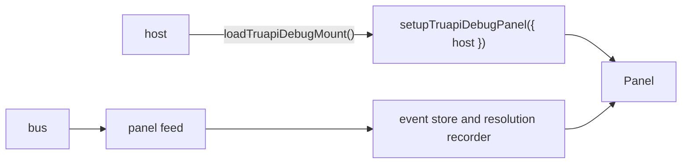

# `@dotli/truapi-debug-ui`

The TrUAPI debug panel. A docked inspector for host to product traffic, name resolution, the product's archive, the
wallet switch and diagnostics. It loads only in debug mode.

## Responsibility

**Owns:**

- The panel's views and their state.
- The models behind them: event store, call and reply correlation, filters, timeline, resolution, export, payload
  decoding, the stored dock position and section.
- Its own components, icons, tokens and phone breakpoint.

**Does not own:** event capture, the bus, and the host's stores and layers. The host passes them through
`DebugPanelHost`.

## Design

- **Own chunk:** a lazy loader keeps the panel out of the main bundle.
- **One port:** the panel imports no host module and no chain library. Everything comes through `DebugPanelHost`. Lint
  enforces it.
- **Early feed:** the feed subscribes to the bus at once, so the boot replay is in the store before the panel mounts.
- **Models import no Solid:** each is one function or factory, tested under Node. Stable keys let a view update in place
  as traffic streams in.
- **Frame-rate reads:** the event store publishes a growing change count. The panel re-reads it at most once a frame.
- **Dispose:** gives the product iframe its full size back through `host.reportDockInset`.

## Using the panel

| How                                                          | Effect                                           |
| ------------------------------------------------------------ | ------------------------------------------------ |
| Build with `VITE_APP_DEBUG=true`                             | Panel mounts collapsed.                          |
| Settings, Advanced, **Open in debug mode**, or `?debug=true` | Turns debug mode on for the tab, in any build.   |
| `?debug=off` or the panel's **Hide** button                  | Leaves debug mode and reloads without the panel. |

| Section         | Shows                                                                     |
| --------------- | ------------------------------------------------------------------------- |
| **TrUAPI**      | Host to product messages and host events, as a list or a timeline.        |
| **Resolution**  | How the last page load went, phase by phase.                              |
| **Archive**     | The loaded product's files.                                               |
| **Diagnostics** | Site, backend and package versions, for a bug report.                     |
| **Wallet**      | Switches every app on the domain between Polkadot App and a local wallet. |

Good to know:

- A collapsed panel stops reading traffic and catches up when it opens.
- Messages group by request id, host events by flow id. A request with no reply turns slow after three seconds.
- **Pause** stops recording, but the reply to a recorded call still lands.
- Signing, session, entropy and local storage payloads show only their size. In local wallet mode signing is decoded,
  since the panel stands in for the phone.
- The list keeps the newest 2000 events.

### Adding a host event

1. Add it to the debug bus's event union with a layer, an event name, a flow id and a payload.
2. Emit it.
3. Fix the type check: the panel's models must give the event a one-line summary and a facts row.

## Public API

| Entry                            | Export                                                                    | What it does                                                                       |
| -------------------------------- | ------------------------------------------------------------------------- | ---------------------------------------------------------------------------------- |
| `@dotli/truapi-debug-ui`         | `loadTruapiDebugMount`, `TruapiDebugMountModule`                          | Lazy loader. Its `setupTruapiDebugPanel` installs the panel and returns a dispose. |
| `@dotli/truapi-debug-ui`         | `DebugPanelHost`, `DiagnosticsSource`, `DiagnosticsRow`, `PackageVersion` | The port the host implements, and its diagnostics types.                           |
| `@dotli/truapi-debug-ui/testing` | `fakeDebugPanelHost`, `FakeDebugPanelHost`                                | A host port for specs and stories.                                                 |
