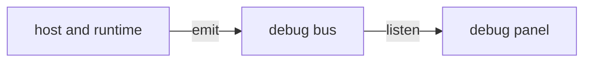

# `@dotli/truapi-debug`

The debug event bus and debug mode, with no UI. The host and its runtime emit their events here, and the debug panel
listens. Everything the panel shows is built inside the panel.

## Responsibility

- The debug event bus and the event types that cross it.
- Whether debug mode is on for this page, and leaving it.
- Not the panel's views or the models behind them, and not starting the panel, which the host does.

## Design

- The bus is the single channel. It is off until buffering is enabled, so sessions that never open debug mode pay
  nothing, and `emit` does nothing before then. Boot events are held until the first listener attaches, then replayed
  once. A throwing receiver is reported and the others still get the event.
- Debug mode reads the URL and session storage through a passed-in page, so its spec runs under Node.

## Public API

### `@dotli/truapi-debug`

- Bus: `emitDotliDebugEvent`, `onDotliDebugEvent`, `watchDotliDebugEvents`, `hasDotliDebugListeners`,
  `enableDotliDebugBuffering`, `DotliDebugBus`, `DotliDebugBusEvent`.
- Events: `DotliDebugEvent`, `TruapiDebugMessageEvent`.
- Debug mode: `resolveDebugMode`, `isDebugModeOn`, `leaveDebugMode`, `DebugMode`, `DebugModePage`.

### `@dotli/truapi-debug/testing`

- `createDotliDebugBus`: a bus apart from the page's, for specs and stories.
