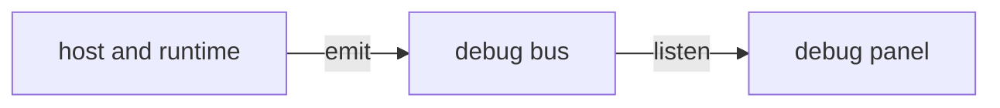

# `@dotli/truapi-debug`

## Overview

The debug event bus and debug mode, with no UI. The host emits events, and the debug panel listens and builds its views.

## Responsibilities

- **Owns:** the debug bus and its event types. It also owns whether debug mode is on.
- **Does not own:** the panel's views and models, or starting the panel.

## Public API

### `@dotli/truapi-debug`

- **Bus:** `debugBus` (`enableBuffering`, `emit`, `hasListeners`, `watch`, `subscribe`), `DebugBus`, `DebugBusEvent`.
- **Events:** `DotliDebugEvent`, `TruapiDebugMessageEvent`.
- **Debug mode:** `resolveDebugMode`, `isDebugModeOn`, `leaveDebugMode`, `DebugMode`, `DebugModePage`.

### `@dotli/truapi-debug/testing`

- `createDebugBus`: a separate bus for specs and stories.

## Design

- **Off by default:** `emit` does nothing until buffering is enabled, so normal sessions pay nothing.
- **Boot replay:** boot events wait for the first listener, which gets them once.
- **Isolated receivers:** a throwing receiver is reported, and the others still get the event.
