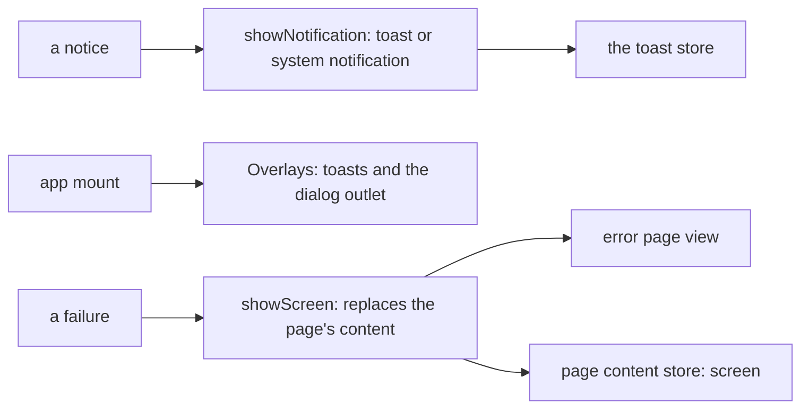

# `@dotli/ui-widgets`

The page screens and overlays that both the host and the sandbox show: the error page and its frame, notifications, and
the toast and dialog overlays. Each app mounts the overlays once.

## Responsibility

- The error page.
- Full-page screens: one screen at a time in place of the page's content, and a store that says whether one is shown. An
  app's own screen composes the error page's frame.
- The notifier that shows a toast and, for a hidden tab, a system notification too.
- The reload offer for a part of the page that failed to load, and a listener that makes it for each page chunk that
  fails and counts it.
- The prompt dialog both apps ask through (permission, password, preimage and signing prompts), and the outlet that
  shows the modal queue's first entry as that dialog.
- `Overlays`, the toast view and the dialog outlet, which each app mounts once.
- The page's notifier over the toast store.
- Not owned: primitives, the toast and modal stores, views one app uses, the runtime and the data.

## Design

- Text goes in as text, so nothing a visitor typed is parsed as markup. An action carries its icon as a component.
- `showScreen` renders a screen's view into its own element in `#app`, or in the body of a page without one, which the
  screen then fills itself. It keeps the element marked `data-overlays`. The screen before goes first. `clearScreen`
  takes it down and keeps what the page put beside it, such as the product frame. `pageContentStore` says `screen` while
  one is shown, so what the screen covered can end itself. A view that throws is reported.
- Toasts and dialogs are queued on the stores and show once the app has mounted `Overlays`, in a container it marks
  `data-overlays` so that a full-page screen keeps it. Failures it recovers from go to the metrics package's capture.
- The notifier always shows a toast, led by the caller's icon component or else its tone's. While the tab is hidden it
  also fires a system notification, when the browser has one.

## Public API

### `@dotli/ui-widgets`

- Error page: `showErrorPage` and `showError`, which show the page at once, and the types `ErrorAction`,
  `ErrorPageContent`, `ErrorText` and `ShowErrorPage`.
- Full-page screens: `showScreen`, `clearScreen`, `pageContentStore` and the type `PageContent`.
- Overlays: `Overlays`, `showNotification` and the type `ShowNotification`.
- Chunk failures: `listenForChunkFailures` and its `ChunkFailureDeps`. A failure is counted as `chunk.preload`.
  `offerReload` shows the same reload offer for any other part of the page that failed to load.
- Error frame: `ErrorFrame` and `ErrorDetail`, the error page's frame and its line under the title, with
  `ErrorFrameProps`, for an app's own full-page screen.
