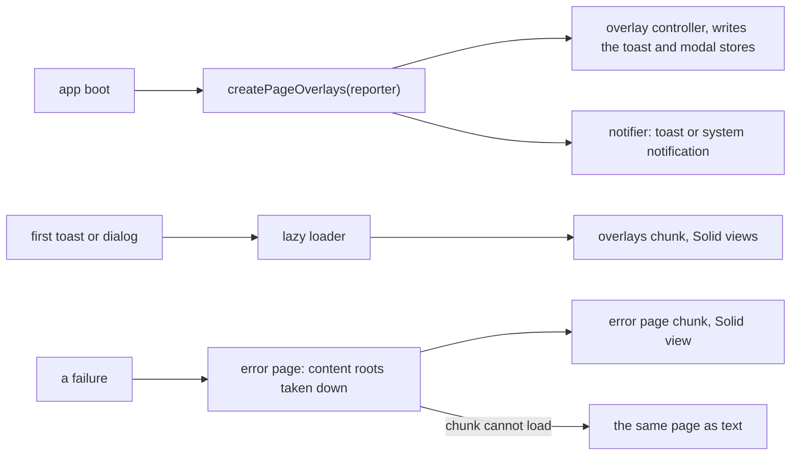

# `@dotli/ui-widgets`

The page screens and overlays that both the host and the sandbox show: the error page and its frame, notifications, and
the toast and dialog overlays. Each app creates them once.

## Responsibility

- The error page, a Solid view in a lazy chunk with a text version for when the chunk cannot load.
- Full-page screens in general: taking the page's content down, mounting a screen's view as the page's content root, and
  falling back to its text. An app's own screen composes the error page's frame.
- The notifier that shows a toast and, for a hidden tab, a system notification too.
- The reload offer for a page chunk that fails to load. Each app reports the failure under its own metric.
- The prompt dialog both apps ask through (permission, password, preimage and signing prompts), and the outlet that
  shows the modal queue's first entry as that dialog.
- The lazy overlays chunk that mounts the dialog outlet and the toast view.
- `createPageOverlays(reporter)`, which wires them for one page.
- Not owned: primitives, the toast and modal stores, views one app uses, the runtime and the data.

## Design

- Both apps' boot imports the package, so everything it reaches statically imports no Solid but the icons. The error
  page's view and frame are Solid and load in a lazy chunk. Text goes in as text in both versions, so nothing a visitor
  typed is parsed as markup. An action carries its icon as a component.
- A full-page screen disposes the page's content roots at once, then registers itself as the page's content root while
  its chunk loads. A screen shown before the chunk arrives takes it down, so it never mounts. The view replaces that
  root when it mounts. When the chunk cannot load, or the view breaks while rendering, the failure goes to the
  `Reporter` the app gave and the screen shows as text alone, built with DOM calls and with no icon.
- The overlay controller writes the toast and modal stores and leaves importing the chunk to a `load` function it is
  given. `createPageOverlays` supplies that function through a lazy loader. Chunk failures and throws from a toast's
  `onDismiss` go to the `Reporter`. Without overlays, an action toast falls back to `window.confirm`.
- The lazy chunks and the views entry are the only shipped code that may use Solid or JSX. Eslint enforces it with a
  boot ban on Solid imports, JSX and the Solid components. Of the UI layer, boot modules may import only the icons
  entry.
- The notifier always shows a toast, led by the caller's icon component or else its tone's. While the tab is hidden it
  also fires a system notification, when the browser has one.

## Public API

### `@dotli/ui-widgets`

- Error page: `createErrorPage(reporter)`, whose `showErrorPage` and `showError` settle once the page shows, and
  `renderErrorPageText`, the page in text alone. The types `ErrorAction`, `ErrorPageContent` and `ErrorPageScreen`.
- Full-page screens: `showPageScreen` and the types `PageScreen`, `PageSlot` and `ScreenSlot`.
- Overlays: `createPageOverlays`, `PageOverlays`, the types `PresentModal` and `ShowNotification`.
- Chunk failures: `listenForChunkFailures` and its `ChunkFailureDeps`.

### `@dotli/ui-widgets/views`

Solid, for an app's own full-page screen in a lazy chunk. No boot module imports it.

- `ErrorFrame` and `ErrorDetail`, the error page's frame and its line under the title, with `ErrorFrameProps`.
- `mountScreen`, which mounts a screen's view into the slot `showPageScreen` hands it.
